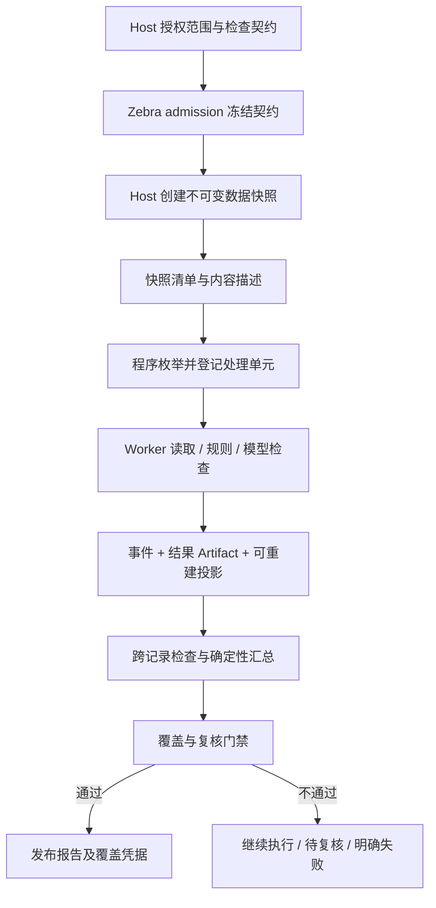

# Cloud Agent 全量数据处理与覆盖验收技术方案

日期：2026-10-07。状态：Proposed / Planning。任务：CLOUD-DATA-COVERAGE-DESIGN-01。
范围：Zebra 通用运行时 + Trench 首个适配器；本文只交付设计，不表示功能已实现或上线。
所有新增类型、事件、表、配置和 HTTP 路由均为提议名称，实施时以契约评审为准。

## 1. 目标、保证与非目标

目标：对于业务明确授权的有限数据集合，程序证明每个必需处理单元均已产生可追溯结果；未达到契约要求，不得发布全量完成标记或执行依赖该标记的业务动作。

保证有条件成立：Host 正确枚举并提供冻结内容，存储与权限服务可信，执行检查按契约实现。不能以运行时证书证明 Host 没有隐藏数据，也不能证明模型语义判断绝对正确。

| 维度 | 可验证承诺 | 不承诺 |
|---|---|---|
| 范围 | 指定权限、时间语义、快照内集合完整枚举 | 全互联网、尚未采集或未授权数据完整 |
| 读取 | 必需正文块/附件成功读取且版本匹配 | OCR/解析等价于完全理解原文 |
| 处理 | 每个必需单元有合法结果与证据 | 模型无漏判、无误判 |
| 汇总 | 数量、异常明细与底账可核对 | 自由文本保留所有隐含关系 |
| 完成 | 验收条件不满足时不得宣称 certified | 资源无限、任何任务最终必成功 |

全量的对象必须明确：原始采集记录、清洗后事件、订阅内事件是不同集合。Trench v1 默认是订阅权限内的规范化事件；不得称为“所有原始新闻”。若要求原始记录，需另行适配其枚举与清洗排除账本。

不新建通用 DAG 平台、不引入新的队列/工作流依赖、不默认增加多 Agent、不替换现有 Event Store/Effect/Artifact 体系。先建立单任务的可恢复批处理闭环，再按性能证据扩容。

## 2. 当前实现与复用点

本轮为本地源码只读核查，当前 checkout 存在其他工作的大量未提交修改；下面不是线上行为或部署验收。

| 现有入口 | 现状 | 方案动作 |
|---|---|---|
| `packages/agent-core/src/agent_core/harness/task_contracts.py` | Host 可覆盖 TaskAcceptanceContract；有证据、引用、验证、Artifact 等条件 | 增加可选 coverage contract 引用；旧任务语义不变 |
| `packages/agent-core/src/agent_core/harness/final_completion.py` | 统一调用 evaluate_answer，失败可请求模型修订 | 添加系统覆盖验证；缺数据时调度确定性工作，不让模型反复改文案 |
| `packages/agent-core/src/agent_core/harness/quality_gates.py` | 主要检查文本形式和 EvidenceLedger | 保留；不能当成全量集合验收 |
| `apps/worker/src/zebra_agent_worker/execution_completion.py` | 最终持久化与投影路径 | 完成前校验同一契约、同一验收版本，防旁路 |
| `packages/agent-storage/src/agent_storage/postgres_composition.py` | 云端显式组合权威 Store | 在同一 composition 注入 coverage projection/操作 Port |
| Trench `trench_ai_read_tools_contract.py` | native-v9；历史查询鼓励宽查询后定向核验，正文支持 chunk | 保留交互检索；新增有快照语义的 Host 能力 |
| Trench `trench_ai_history_query.py` | 总数、offset、partial_sample；注释已指出并发插入需冻结游标 | 不能通过耗尽此游标证明不可变数据集覆盖 |
| Trench `harness/full_research_scan.py` | 旧 full research 每路径最多 4 页 × 120 | 不复活旧 Harness，不放大上限伪装全量 |
| Trench `EventRow` / `RawArtifactRow` | Event 可变字段、16 字符 content_hash；RawArtifact 有 SHA-256 与存储引用 | 不能假定 Event hash 为完整版本证明；优先复用可验证原文对象 |

既有架构约束继续适用：Zebra 拥有执行事实；Host 拥有业务数据与权限；投影必须由事件重建；至少一次调度与幂等提交，不宣称跨模型/API exactly-once。

## 3. 模式与准入

只新增一个显式模式：`coverage.mode = exhaustive`；缺省仍为现有探索式研究。
严格程度由固定的 checks、content requirements、review policy 与 publication policy 表达，避免多个含混的“深度研究”档位。

1. Host 的业务入口决定是否强制 exhaustive；模型和 Skill 无权降低。
2. 用户可请求全量，模型可提出 scope 草案；最终解析为 Host 授权的结构化范围。
3. 时间缺失或“相关事件”含义不确定时，可继续准备能力检查，但不得创建声称完整的集合。必要时澄清；可配置预先公布的业务默认值。
4. 对严格任务，未经批准的关键词/市场推断不得作为枚举过滤。语义相关性应在全量内逐条标注，仍保留阴性结果。
5. 连接器无法冻结集合/内容，返回 `coverage_unsupported`；不静默退回搜索。
6. 超出任务预算返回 `budget_exceeded` 或等待预算追加；已完成结果保留。同一契约不能暗中降级。

建议 admission 中冻结以下契约（示例是协议草案）：

```json
{
  "schema_version": 1,
  "mode": "exhaustive",
  "dataset": "trench.subscribed_events",
  "scope": {
    "time_field": "visible_at",
    "timezone": "Asia/Shanghai",
    "from_inclusive": "2026-10-07T00:00:00+08:00",
    "to_exclusive": "2026-10-08T00:00:00+08:00",
    "source_selection": "all_entitled_periods"
  },
  "content_requirements": ["canonical_body"],
  "checks": [{"id": "event_risk", "version": "1", "kind": "model"}],
  "cross_record_checks": [],
  "unresolved_policy": "block",
  "publication_policy": "certified_report_only",
  "contract_revision": 1
}
```

采用左闭右开区间并显式声明业务时间字段。请求时间范围与实际 snapshot 时间独立记录；当日未结束的快照只覆盖创建时已入库数据，后到数据另开 revision。
`checks` 必须来自经发布的检查定义，冻结输入要求、输出 schema、程序版本/模型配置、阈值和复核策略。模型自述 confidence 不作为放行条件。
预算沿用 Host technical limits；不能以降低检查集来适应预算。范围/检查变更生成新 revision，保留原任务未达标历史。

## 4. 责任划分与数据流



Host：权限解析、业务范围、数据快照、完整枚举、内容版本、上游质量说明。
Zebra：执行计划、耐久处理、配额、恢复、系统验证、报告发布、技术审计。
模型：非结构化提取与判断；不能自行声明 snapshot sealed、item accepted、coverage certified。
UI：展示后端事实、明细和未完成原因；不能自行聚合聊天文字产生覆盖率。

## 5. Host 快照与连接器协议

### 5.1 最小能力集

以现有签名 authority、冻结 Host manifest、typed gateway、Effect receipt 传输，不新增任意网络通道。
以下方法可由内部受控执行器调用，v1 无需全部公开给模型自行选用：

| 方法 | 输入 | 核心输出 |
|---|---|---|
| `dataset.snapshot.create` | scope、requirements、idempotency key、contract digest | snapshot_id、creating/sealed、expires_at |
| `dataset.snapshot.get` | snapshot_id | scope digest、count、manifest digest、sealed_at、content capabilities |
| `dataset.snapshot.page` | snapshot_id、opaque cursor、page_size | 有序 item descriptors、next_cursor、page digest |
| `dataset.snapshot.read` | snapshot_id、item key、part、cursor | immutable content chunk、offset、digest、next_cursor |

快照创建是耐久写操作，走 Effect 与配额；重试返回原快照。失去创建响应时按 idempotency key 查询，不产生无界重复快照。
读取只在 sealed 后允许；游标绑定 snapshot、scope digest、页大小和协议版本并签名。不同租户/快照/过滤条件游标一律拒绝。
结构错误、重复游标、提前结束、总数不符、hash 不符应失败；`next_cursor=null` 仅是枚举结束信号，不单独作为覆盖证明。

### 5.2 Trench v1 快照实现

采用 **物化清单 + 冻结内容**，不让持续数小时的 Agent 占用数据库快照事务。

1. 权限服务先得出授权订阅周期及版本；创建操作绑定授权主体、namespace 与 scope。
2. 在一个受时长/大小约束的 PostgreSQL REPEATABLE READ 事务内，选取所有符合范围的事件；将规范化分析所需字段及必需附件描述物化到 Host snapshot items，分配固定 ordinal。
3. 若已有不可变、可保留的正文对象，保存精确 version/hash 引用；否则必须在上述一致性事务中复制所需文本，不能事务后重新读取可变 EventRow 拼装。
4. 对附件，只有已冻结且可访问的对象版本能入已就绪清单；可变 URL 不能证明创建时的附件内容。必需附件无法冻结则创建失败/待补齐，不能假装完整。
5. 提交后生成规范化 manifest，核对 item count、内容对象可读性与保留期限，写 sealed。部分创建不可供分析；失败对象按幂等清理。
6. 超过快照构建上限时拒绝当前范围；后续再引入版本化摄取/CDC 导出。不得将独立事务分页伪称同一快照。

PG 默认 Read Committed 的多条 SELECT 可见不同快照；Repeatable Read 提供事务内稳定视图，但不自动证明跨服务权限及业务批次完整。因此权限版本重检、业务 batch-ready 条件独立执行。[PostgreSQL 事务隔离](https://www.postgresql.org/docs/current/transaction-iso.html)

清单元素至少含 `(ordinal, opaque_record_id, version_digest, parts, provenance_ref)`。
版本 digest 使用 SHA-256，对规范化 JSON UTF-8 字节（键排序、固定分隔符、禁止 NaN、明确 null 语义）计算；附件另记原始字节 digest。不要使用现有 16 字符事件 hash 替代该证明。
manifest 按 ordinal 排序，记录数量、每项 digest、scope digest 与 schema version；以整份规范化清单 SHA-256 绑定。完整 ID 集合仍要核对，hash 不是数据真实性证明。

### 5.3 更新、撤权与权限边界

- 入库、编辑、删除不改 sealed snapshot；新数据生成新快照/修订，旧报告明确 as-of。
- 冻结授权范围不等于永久授权。每次读取、恢复、发布、下载都检查当前合法 authority。
- 撤权或依法删除优先于保留快照：停止读取与发布，记录 revoked/unavailable，不能缩小分母后继续 certified。
- Host 只返回不透明 ID/受控引用；不得把凭证、数据库 URI、对象存储永久链接放入模型上下文。
- 没有统一快照能力的多个数据源，只能分别声明各自 as-of；不能宣称跨系统同一时点一致。要求原子一致的业务应拒绝此能力组合。
- 上游采集质量、清洗排除、来源失败单独报告。snapshot 完整不代表 upstream 完整。

## 6. 处理粒度与执行算法

### 6.1 三类单元

- `record`：一条冻结业务记录；重复内容的不同记录 ID 仍分别记账。
- `part`：正文、附件、图片、表格或模型可消费的分块；每项内容要求对应明确 part 集合。
- `check unit`：`record/version + check_id/version + part/group`；逐项、分块或跨记录检查的实际验收单元。

单纯要求“每条 record 有一个 JSON”不足以证明长文分块和所有检查都执行。
模型上下文中的全部输入记录 ID、part digest、token 预算、模型配置、prompt version 随 model call 持久化；结构验证器核对返回 ID 集合，禁止伪造、额外、重复或缺失 ID。

### 6.2 确定性执行步骤

1. 验证并冻结 contract；Host 能力满足后创建/恢复 snapshot。
2. 分页登记 manifest。以 ordinal 稳定分区；首版按固定批次，不能按模型相关性淘汰记录。
3. 枚举完全结束并通过 count + set/digest 核对，提交 manifest sealed 事件；分析可后置，以简化首版失败边界。
4. Worker 从未接受单元中领取有期限的 work claim，绑定 run revision、attempt 和 fencing token。
5. 获取必需内容并验证版本、长度及 chunk 区间完整性；读取失败不送入“正常”分支。
6. 数值、计数、日期、枚举约束等使用已发布确定性程序。只有需语义判断的 check 调用模型。
7. 模型返回结构化 observations；验证 ID、schema、证据位置及原文摘录是否匹配。模型推理过程不要求持久化，仅保存可审计输入引用和结果依据。
8. 校验成功后提交 accepted result；不确定单元转复核队列；失败按分类重试。
9. 对所有已接受结果执行声明的跨记录检查，然后确定性汇总。
10. coverage validator 生成凭据；报告发布门禁通过后才交付最终报告。

### 6.3 长文、附件与跨记录关系

正文 chunk 使用固定版本的确定性分块算法与重叠规则；记录逻辑区间和传输字节区间，避免 UTF-8 边界截断。验证必需区间并集覆盖全文且无缺口；重叠不重复计数。
分块分析后还需 record-level merge，保留所有结构化发现；不得以最后一块结果代表全文。
OCR、转写、表格解析均记录 extractor/version、原始对象 digest、页/时间段映射、错误状态；提取完整性不能证明识别准确性。无法解析的必需附件阻断验收。
v1 可只支持 canonical body；请求图片/音视频/附件严格核验而适配器不支持时拒绝，不在 UI 中称为“全文及附件已核验”。
跨记录 check 明确分组键、排序、时间窗口、单位和算法版本。精确业务键可 SQL join/aggregate；模型推断实体关系仍存在漏召回，不能声称关系穷尽。
禁止默认全量两两比较；只有业务确实要求且预算允许才执行 O(N²) 任务。大集合使用确定性业务分组；依赖向量候选的关系发现只能标注启发式范围。

## 7. 持久化、数据模型与事件

### 7.1 权威模型

Session Event Store 仍为唯一执行事实源。新增关系表是可重建投影及租约调度索引，不成为第二套独立任务状态机。
大清单与结果放 governed Artifact；事件绑定不可变 artifact ref + SHA-256 + count。必要 Artifact 丢失时无法重建或认证，必须 fail closed。

| 投影 | 主键/唯一键 | 主要字段 |
|---|---|---|
| `coverage_runs` | namespace, task_id, run_id, revision | contract/scope/snapshot digest、phase、budget、event watermark |
| `coverage_items` | run_id, ordinal；另约束 record_id+version 唯一 | parts manifest ref、required units、item status |
| `coverage_units` | run_id, unit_id | check version、input digest、claim epoch、accepted result ref、status |
| `coverage_reviews` | run_id, unit_id, review_revision | assignee authority、decision、evidence、reason、event seq |
| `coverage_certificates` | run_id, revision, evidence watermark | input/result/aggregate digests、counts、publication status |

Host 另有 snapshots/snapshot_items，以既有 Trench migration 体系管理；这不是 Zebra 业务数据镜像库。Zebra Artifact 只留任务授权所需分析输入/输出及审计资料，受独立保留与删除策略约束。
投影索引至少覆盖 `(run_id,status,ordinal)`、`(run_id,claim_expires_at)`。对每个批次使用唯一 result commit key；大 JSON 不嵌入每条公开事件。

建议事件：`CoverageContractBound`、`CoverageSnapshotBound`、`CoverageManifestCommitted`、`CoverageBatchAccepted`、`CoverageReviewResolved`、`CoverageValidationRecorded`、`CoverageReportPublished`；异常与等待复用现有 Task/Turn 生命周期并携带 reason code。
BatchAccepted 中含 unit IDs/digest、结果 Artifact、输入凭据、fence、检查器版本；如过大以有界分片 Artifact 引用。逐项查询通过投影；不要求每个字符 chunk 发一条公共 SSE。

### 7.2 原子性与幂等

1. 先写完整不可变结果 Artifact 并确认可读/hash 正确。
2. 在同一 PG transaction 内校验 claim fence、append event、更新 coverage projection、登记后续调度意图；commit 后才确认批次成功。
3. Artifact 已写而事务未提交：它是未引用对象，可在安全保留期后 GC；不可计入覆盖。
4. 事务成功但响应丢失：按 commit key 查既有事件，返回同一接受结果。
5. 过期 Worker 的结果不可覆盖新 epoch 的接受结果；重复 model call 可能花费 token，但不能重复计数。
6. 不跨 Host DB、Zebra DB 和对象存储假定分布式原子事务；以 create key、内容 digest、可查询回执和阶段状态恢复。

### 7.3 状态与恢复

内部 phase：preparing → enumerating → processing → reviewing/aggregating → validating → certified → published。
waiting_budget/waiting_review/failed/cancelled 是明确执行结果；不得映射为业务 certified。不要为此重写既有 Task 顶层状态枚举，使用现有挂起/失败/完成机制与 coverage phase 投影组合。
对话 Turn 可以返回“任务已受理/仍在处理”并正常结束；后台 Task 未完成，UI 和业务 API 必须区分 response delivered 与 coverage certified。
恢复从最后权威 watermark 与 accepted units 继续，重新检查 authority、snapshot 可用性、Artifact retention 和配置版本。不得通过聊天摘要猜进度。
用户取消采用当前 cancellation fence；已接受结果保留，后到结果不能改变取消后的状态。续跑同一 revision 需合法 authority 和有效快照；快照过期则新建 revision，不混用数据。
同一 run 的提交首版串行、有界批次；并行读/模型调用可复用现有并发设施。后续性能不足再用既有子任务与父级汇聚合同，不先建第二调度器。

## 8. 覆盖验证与报告发布

### 8.1 精确验收谓词

设 M 为 sealed manifest 的 record/version 集，U(M,C) 为契约 C 规定的全部处理单元，A 为通过验证并已持久化的单元集。

```text
certifiable =
  trusted_snapshot_is_sealed
  AND enumerated_record_versions == M
  AND accepted_unit_keys == U(M, C)
  AND every_required_part_is_available_and_version_matched
  AND required_cross_record_checks_passed_or_validly_reviewed
  AND unresolved_failures == 0 AND unresolved_reviews == 0
  AND aggregate_is_derived_from_the_same_accepted_results
  AND authority_valid AND mandatory_artifacts_readable
```

`accepted` 表示合法检查结果，可以是“发现异常”；不是“业务无风险”。复核通过指结果可接受，不自动把异常改成正常。
默认不允许 waiver 算完整；确需业务例外时另发 qualified report，明确 exclusions 和授权人，禁止复用无例外 certified 标记。
零记录：只有 sealed 且范围/权限明确、权威总数为零才能声明空集合已枚举；显示“无范围内数据”，不输出无风险推断。分母为零时比率为 null。
聚合计数不是集合相等证明。校验采用唯一约束、精确 anti-join 差集与必要 digest；禁止 Bloom filter 等概率结构作为最终完成依据。

### 8.2 验收凭据

凭据包含 contract revision/digest、Host identity、snapshot/scope/manifest digest、枚举/读取/处理/复核计数、结果集合 digest、aggregate digest、validator version、event watermark、created_at 与 expires_at。
由服务内部验证器产生，模型不能写入。跨服务交付通过认证 API；离线凭据若签名，复用现有签名设施并带 issuer/audience/key id，权限与撤销仍需在线检查。
其含义是“在声明前提下流程完成”，不是正确率/免责证书。
凭据绑定最终 report artifact digest；先形成 validation result，渲染/核对报告，再原子提交 ReportPublished 关联，防止用一份通过的凭据发布另一份内容。

### 8.3 防止最终答案与流式旁路

仅在 final_completion 拦截不够：模型正文可能已被流式发送，或通过 content.present/files.publish/业务工具提前交付。
exhaustive 任务在发布前只允许系统生成的进度、澄清和明确未完成提示；待验收最终正文保留为内部 candidate Artifact，不推给用户为正式结论。
模型生成的逐条判断可供受控复核页访问，但须标记 draft，不能触发业务动作。v1 最终 certified report 使用固定模板展示计数/异常/证据/完整明细；自由叙述为附加解释，不能替代结构化事实。
publication gate 必须覆盖 assistant final、AG-UI/SSE 重放、content.present、files.publish、下载接口与声明依赖 coverage 的业务写工具；不能仅前端隐藏。
业务操作在执行时重新验证 authority、certificate revision 和必要的新鲜度/业务版本前置条件。旧快照通过不能授权对已变化的线上状态无条件写入。
验收失败应调度缺失工作或输出结构化停止原因，不进入无限“请模型重新回答”循环。

## 9. API、UI 与可观测性

在现有 Task API 下提议新增：GET `/tasks/{id}/coverage`、GET `/tasks/{id}/coverage/items?cursor=...&status=...`、GET `/tasks/{id}/coverage/report`。
恢复/取消复用 Task control；复核走现有授权交互/approval 基础设施，但业务复核结论需专用 typed payload，不混同于“允许执行工具”的审批。
任何输入均使用显式 schema、大小上限和 namespace 校验；服务器游标不暴露内部 SQL。模型不可直接提交 accepted/verified/certified 状态。

UI 至少提供：模式、时间范围与字段、数据截至时间、授权来源、内容要求、已枚举/已读取/已处理/待复核/失败、快照剩余有效期、完整明细下载。
计数分阶段展示，不把批次完成率当正文读取率。枚举未 sealed 时总量为 unknown，不能先显示 100%。
完成卡片明确“已完成约定检查”与“发现多少异常”；采集失败/解析不确定/附件不支持单独展示。可恢复任务退出聊天后仍从 Task 状态页访问。
公开进度事件从权威事件投影节流产生；断线通过现有 sequence/cursor 重放，不靠前端累计增量数值。

指标：manifest mismatch、missing unit、version mismatch、expired claim、retry、review backlog、publication blocked、snapshot expiry、per-unit latency、tokens/record、bytes/record、cost estimate error。
标签只使用 bounded reason code、connector/version 等低基数字段；不把用户 ID、事件正文、原始 URL 作为指标标签。追踪通过 task/run/batch/unit opaque ID 关联。
审计查询应能回答：某事件为何没进入范围、哪一版内容被处理、执行了哪些检查、失败是否重试、谁复核、哪个凭据允许报告发布。

## 10. 资源、缓存与运维

枚举、读取和模型并发分别限流；背压限制未处理输入字节数、待写 Artifact 和数据库事务批量。沿用技术预算并记录每次调用使用量；限额命中不得缩小分母。
参数集中在现有配置入口，建议命名 `coverage_enabled`、`coverage_max_snapshot_records`、`coverage_batch_tokens`、`coverage_max_inflight_batches`、`coverage_max_attempts`、`coverage_snapshot_ttl_seconds`；具体默认值由验收容量数据确定，不声称已测得安全值。
检查调用次数约为按 token 装箱后的批次数 × 检查次数，再加跨记录与复核；成本估算包括输出、重试、提取与汇总。并发只改善时延，不消除全量读取的成本。
缓存键至少绑定 namespace、record content digest、required parts、check/prompt/extractor/model config versions；缓存命中仍产生本次任务接受记录。未经授权不能跨租户复用。
快照、输入、结果、报告的 retention 至少覆盖承诺的恢复/审计周期；到期先标明不可复验再清理，不保留可下载/可续跑假象。续租需 quota/authority，不能永久 pin。
v1 不承诺增量分析复用：跨记录上下文变化会使原结果失效。后续仅对明确与全局状态无关的逐条检查复用，跨记录聚合必须重算。
告警与运维动作：投影落后先重放；Artifact 缺失阻断并告警；snapshot 过期换 revision；权限撤销停止；模型持续非法输出送失败/复核，不无限重试。

## 11. 代码落位与最小实施范围

| 层 | 建议落位与职责 |
|---|---|
| agent-core | domain/coverage 契约；application/coverage 验证与状态归约；ports/coverage 读取/提交协议；无 SQL/HTTP/provider SDK |
| agent-storage | PostgreSQL coverage 投影、事务与迁移；复用 Event/Artifact/lease/idempotency；本地无契约任务不变 |
| agent-integrations | Host snapshot 协议适配与 typed serialization；AG-UI coverage 状态映射 |
| agent-tools / security | snapshot capabilities 与 publication gate；现有 Effect/Policy 链，不绕过签名权限 |
| apps/worker | 仅组合 executor/store/gateway/limits；业务无关遍历规则留 core，不把处理逻辑堆进 composition root |
| apps/api | Task coverage 读/控制适配；当前 namespace/authority 复用 |
| Trench | Host 快照服务、事件范围与订阅周期权限、检查定义、ToC 进度/明细/复核 UI |

新增模块按职责拆分，源文件目标 <300 行、通常硬上限 500；测试 <700，文档 <600。不得为复用引入无具体调用者的通用框架。
第一条垂直切片：有限时间范围、全部有权事件、canonical body、一个逐条 check、单 Worker 恢复、全量集合门禁、固定模板报告、API 到 Trench UI 的闭环。缺任何一环不得称产品交付。
这条切片不支持的附件/复杂关系检查必须在准入拒绝，不能运行后悄悄忽略。local profile 若未组合 coverage，则显式 unsupported，旧行为保持；不为云能力顺带重建 SQLite 子系统。

## 12. 实施顺序与任务边界

下面是待创建的实施卡草案，不是 Ready 或已认领任务。每卡进入 Ready 前确定具体文件 Owned paths、一个人类 owner、独立 codex 分支/worktree；依赖必须先合并，共享 registry/PROGRESS 修改顺序协调。

| 提议任务 | 前置 | Owned paths 草案 | 退出条件 |
|---|---|---|---|
| COV-CON-01 | 设计评审 | Zebra core coverage types/Port、契约测试、设计文档 | scope、part、unit、凭据/拒绝语义稳定 |
| TRN-COV-SNAPSHOT-01 | CON 合并 | Trench snapshot service/ORM/migration、Host manifest 与配套 tests | 真实 PG 一致快照、冻结正文、权限撤销测试 |
| COV-STO-01 | CON 合并 | Zebra storage coverage/migrations、对应 PG tests | Event/Artifact/投影原子提交、重建、fence 通过 |
| COV-EXEC-01 | SNAPSHOT/STO 合并 | core coverage executor、integrations snapshot adapter、worker composition、tests | 崩溃恢复、预算、中断、多页完整处理 |
| COV-GATE-01 | EXEC 合并 | core final completion、tools publication guard、worker terminal guard、tests | 所有发布路径强门禁，错误不假成功 |
| COV-UI-01 | GATE 合并 | API coverage adapters、AG-UI projection、Trench ToC coverage UI、tests | 完整 API/UI/下载/复核路径 |
| COV-ACCEPT-01 | UI 合并 | 跨服务 tests/compose、验收 runbook、证据记录 | 真实部署 E2E、恢复与故障注入、容量指标 |

分层顺序不改变既有云主线优先级。待当前覆盖相关修改合并后重新基线审查，避免把本 checkout 未提交的实现当成 main 已具备能力。
附件、复杂跨记录检查、并行子任务、CDC/大规模快照分别后续立卡；不是首版完成的隐藏前提，但首版 capability 必须真实声明边界。

## 13. 测试与验收矩阵

| 测试 | 故障/输入 | 必须观察到 |
|---|---|---|
| 完整集合 | 10,003 条，多页、乱序响应、重复消息 | 每个 ID/version 恰有一个接受结果；集合差集为空 |
| 假总数 | 数量相同但重复一个、缺一个；伪造/额外 ID | count 相等仍拒绝 |
| 快照一致性 | 枚举期间插入、更新、删除 Event | 内容与 manifest 不漂移；后到记录进新 revision |
| 正文完整性 | 缺一块、重复块、UTF-8 边界、错误 digest | 缺口/版本错阻断；重叠不重复计数 |
| 内容能力 | 要求附件但只有摘要或可变 URL | admission 或 snapshot 明确拒绝 |
| 非法模型输出 | 缺 ID、假引文、截断 JSON、错误 schema | 结果不接受；有限重试/复核 |
| 阴性记录 | 全部无异常 | 仍有全量逐条合法结果，不以空异常列表替代 |
| 崩溃点 | Artifact 写后/DB commit 前后/响应返回前终止 | 不丢已接受结果、不重复计数、可清理孤儿 |
| 并发 fencing | 租约过期、旧 Worker 晚回 | 旧结果不能覆盖新 fence |
| 权限 | 跨租户 cursor、恢复后撤权、下载时撤权 | 拒绝且不泄漏记录存在性 |
| 生命周期 | 预算耗尽、取消、snapshot 到期 | 非 certified；状态与 UI 一致 |
| 汇总 | 异常在最后一页/仅出现一次；汇总故意漏掉 | 明细/计数核对失败，不能发布通过报告 |
| 发布旁路 | final/stream/replay/present/publish/download/write | 无有效凭据无正式结论/依赖动作 |
| 零数据 | 合法空集、权限失败、来源未采集分别测试 | 三者状态与说明不同 |
| 重建 | 删除 coverage 投影、重放事件+Artifact | 同样集合与计数；缺 Artifact 明确失败 |
| 语义评估 | 标注的反例、隐含关系、模型/检查版本变更 | 单独报告 precision/recall，不能替代覆盖测试 |

确定性 gates：契约/validator 单测、真实 PG/对象存储集成、权限矩阵、故障恢复；运行适用的 `make test`、`make check`，明确已有基线失败与跳过。
E2E：Trench 创建真实授权快照 → Zebra Task → 至少一次实际模型检查 → PG 持久化 → Worker 重启恢复 → 报告门禁 → ToC 展示和下载；单独证明模型调用成本、完整明细与 scope 对得上。
10,003 为建议验收数据规模，不是已验证容量或性能承诺。性能记录 snapshot 构建、首次进度、处理完、验收完、浏览器可见五个时间点及并发/模型/输入字节。
发布要求：覆盖完整性测试无假阳性，所有旁路测试通过；语义质量阈值由业务检查定义并预先设定，不能临时根据结果降低。

## 14. 上线、迁移与回退

1. 加法迁移，旧任务 coverage 缺省为空；旧客户端仍可使用现有探索任务。
2. 非生产/影子任务跑完整链路，确认成本、权限、快照保留和故障恢复。
3. 仅对声明支持的 Trench 严格入口灰度启用，固定检查版本；新旧结果并行观察，不把影子结果作为操作凭据。
4. 通过联合验收后开启 enforced publication gate；不能只上线 UI“全量”按钮。
5. 回退关闭新任务准入；已接纳严格任务继续由兼容版本处理或显式停止。禁止退回不认识契约的 Worker 接手并输出成功。
6. 不回滚删除审计表/Artifact。协议版本不支持时 fail closed；迁移、应用镜像、功能开关与契约版本按兼容矩阵发布。

## 15. 设计决策与剩余边界

本方案选择：物化快照而非长时间数据库事务；精确集合验收而非搜索次数；事件与 Artifact 复用而非第二账本；程序控制遍历而非模型自行判断读够；结构化明细为正式事实、自然语言为解释。
待实施前实测确认：Trench 现有原文对象的不可变/保留能力、所需业务 check 的标准、数据量与平均正文大小、复核责任及期限。以上影响配置与后续功能，不影响“未覆盖不能宣称完成”的原则。
无法用本方案消除的风险：Host 上游漏采、错误范围定义、解析错误、模型语义错误、未知跨记录关系、现实数据在报告后变化。分别用采集质量审计、契约审查、解析/语义评测、确定性规则/人工复核、业务版本校验约束。

## 16. 公开依据

- [Anthropic Building Effective Agents](https://www.anthropic.com/engineering/building-effective-agents)：固定工作流与程序检查适用于步骤明确的任务；并不提供绝对语义正确保证。
- [Anthropic 多 Agent 研究系统](https://www.anthropic.com/engineering/multi-agent-research-system)：并行探索与压缩改善研究广度，不能替代枚举账本。
- [Microsoft GraphRAG Global Search](https://microsoft.github.io/graphrag/query/global_search/)：基于社区报告 map/reduce，有过滤与汇总；不等同原始数据逐项审计。
- [LangGraph Persistence](https://docs.langchain.com/oss/python/langgraph/persistence)：checkpoints 支持状态持久化与恢复；验收条件仍由应用定义。
- [PostgreSQL Transaction Isolation](https://www.postgresql.org/docs/current/transaction-iso.html)：本方案快照隔离选择依据；Host 完整性仍是独立契约。
- [Lost in the Middle](https://arxiv.org/abs/2307.03172)：历史长上下文研究，说明进入上下文不等同可靠利用；不用于宣称所有当前模型的具体错误率。

上述资料提供机制参考。本方案的 coverage contract、集合谓词与发布约束是针对本项目的设计，不是对第三方产品已具备相同保证的转述。
