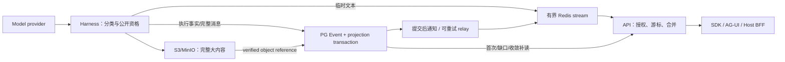

# Cloud 流式输出与持久存储优化重构 Spec

日期：2026-10-12。状态：已启动基线测量；运行时合同与后继依赖待解锁。
文档任务：CLOUD-STREAM-SPEC-01。人类 Owner：Luke Ding；编写：Codex。
源码基线：cloud-agent-trench / d836b04cef7df21c6130c1df8be74ff200089f32。
本稿由源码审计与官方资料形成；未连接生产数据库测量，未修改运行代码。

## 1. 摘要与完成边界

目标：数据库负载随执行步骤、完整消息和检查点增长，不随文本刷新次数增长。
保留 PostgreSQL 执行权威、Redis 短期传输、S3/MinIO 大对象的既有分工。
将临时文本 delta 从持久执行事务中分离，并改造三类 SSE 的等待方式。
完整交付包含 Python 契约/实现、SDK、AG-UI、真实依赖故障与负载验证。
真实 Host/BFF/browser 验收及灰度部署另列 Gate，不能用单测或 health 替代。

默认可靠性：已提交执行事实和最终结果不丢；临时流在保留窗口内可续读。
Redis 全丢或 Worker 崩溃时，未完成展示文本允许被明确重置。
不承诺模型调用能从某个 token 无损续生成，也不承诺每个展示字符永久保存。
若要求上述强保证，应采用持久分块日志；其设计、成本单列，不默认扩张范围。

## 2. 当前源码事实与问题

| 边界 | 当前行为 | 问题 |
|---|---|---|
| Event Store | session_events.payload 为 JSONB，append-only | 持久 delta 增加事件、索引、WAL 与恢复工作 |
| Model delta | 首块立即提交，随后默认 256 字符或 100ms 合并 | 合并仍逐条走持久执行事务 |
| Worker recorder | prepare 同步外部 tail；commit 校验租约、推进 stream、写投影 | 一条 delta 对应多条 SQL，不能等同一次 INSERT |
| Session SSE | 每轮先 read_since，再 Redis；缺数据时查状态，sleep 50ms | Redis 尚未消除 SQL 轮询 |
| Task SSE | read_events/get_task，空闲 sleep 50ms | 空闲订阅也产生查询 |
| AG-UI SSE | 读取共享持久 checkpoint，默认空闲轮询 250ms | 已有有界投影，但仍周期读 snapshot/page 等 |
| AG-UI 投影 | delta 维护 text_messages/text_ended 和消息 frame | 删除 delta 落库会改变投影与恢复语义 |
| Worker progress | delta 影响 model_spoke，PUBLIC_OUTPUT 有 durable 去重/证据 | 不可仅修改 TextDeltaCoalescer 的 sink |
| Artifact | PG 元数据 + S3 字节，工具 Event 保留输出/预览 | 应评估冗余，不能删除原文证据 |
| 实时发布 | ADR-024：提交后 best-effort；借用事务期间抑制 hint | 失去 hint 仍须从持久源收敛 |

源码入口（本文件相对路径；实施前按实际合并基线重新核对）：

- [存储组合](../packages/agent-storage/src/agent_storage/postgres_composition.py)
- [事件事务](../packages/agent-storage/src/agent_storage/postgres/events.py)
- [Worker 投影事务](../packages/agent-storage/src/agent_storage/postgres/workspaces.py)
- [Recorder](../apps/worker/src/zebra_agent_worker/execution_events.py)
- [delta 合并](../packages/agent-core/src/agent_core/harness/stream_deltas.py)
- [Worker 接入](../apps/worker/src/zebra_agent_worker/execution_context.py)
- [Session/Task SSE](../apps/api/src/zebra_agent_api/session_streaming.py)
- [AG-UI 入口](../apps/api/src/zebra_agent_api/ag_ui_stream.py)
- [AG-UI tail](../apps/api/src/zebra_agent_api/ag_ui_checkpoint_tail.py)
- [Redis adapter](../packages/agent-integrations/src/agent_integrations/redis_live_fanout.py)
- [Worker progress](../packages/agent-core/src/agent_core/harness/progress_recovery.py)
- [工具输出](../packages/agent-tools/src/agent_tools/output_projection.py)

此前聊天中的“50ms SSE”只适用于原始 Session/Task，不能套用当前 AG-UI。
100ms 主导时，连续一分钟约 600 次刷新；字符阈值也可更早触发。
这些是量级示例，不是吞吐测量；实际 SQL/事务/连接量必须由 Gate 0 记录。
coverage 当前严格 SQL Gate 是独立工作，不能宣称本重构自动解决其证明查询。

## 3. 架构约束与复用顺序

沿用主架构 §6 的唯一执行事实、顺序、幂等和投影可重建原则。
沿用 ADR-023 的 expected_revision、命令 admission 和幂等 fingerprint。
沿用 ADR-026 的 Task/Turn/Segment 生命周期；结束文本不等于结束 Task。
沿用 ADR-017 的 Artifact 元数据与校验字节联合权威。
沿用 ADR-024 的持久 Event 提交后发布；本稿提议新增独立临时帧类别。
实施批准时补充 ADR-024，明确其规则仍覆盖所有 canonical Event。

优先复用现有 coalescer、Redis、checkpoint、游标、Host Grant 和 outbox/relay。
不新增 Kafka、独立流数据库、第二套 Task 状态机或通用消息总线框架。
确有缺口时仅增加最小 typed Port；Redis/httpx 类型不得进入 agent-core。
local 默认保持 SQLite 事件模式；cloud v2 显式组合，不隐式降级至 SQLite。
当前 COV-SQL-PHASE-01 独占 recorder/live_event_store 等路径；实施前串行移交。

## 4. 事件与内容分类（封闭名单）

| 类别 | 示例 | 存储与语义 |
|---|---|---|
| 执行事实 | 命令、Attempt、工具开始/结果、审批、Effect、Turn 终态 | 原 PG Event/CAS/投影与安全校验 |
| 完整模型消息 | MODEL_RESPONSE_RECEIVED，包括工具调用消息和 usage | PG，保留模型/Context 恢复所需字段 |
| 已提交答案 | ANSWER_COMMITTED、delivery assessment、证据引用 | PG；通过原门禁后才可标记最终结果 |
| 受治理公开输出 | PUBLIC_OUTPUT 的事实、证据、语义 commentary | 继续 durable 去重与次数预算，不批量转临时 |
| 展示 delta | 经现有公开资格判断的普通 MODEL_RESPONSE_DELTA | v2 Redis 临时帧；不分配 SessionEvent sequence |
| 传输信号 | keepalive、retry、observation problem、resync | 传输层；不能产生 Task FAILED 等执行事实 |
| 大内容 | 完整工具输出、文件、图片、工作区快照 | S3/MinIO；PG 保存元数据和必要索引/预览 |
| coverage 原文 | 原始 MODEL transcript、不可变 source、receipt、certificate | 保持既有持久证据，不因名字有 delta 而排除 |

一期只分流普通可公开文本 delta；其他事件默认 durable，逐项审计再改。
私有 reasoning、候选答案、public_expression、coverage 未认证内容不能借临时流外泄。
如当前发布门禁禁止某内容在验证前出现，v2 仍禁止；速度不能改变资格。
新事件类型未分类时拒绝临时发送，防止默认“全发 Redis”。

## 5. 数据流与依赖边界



临时帧不能直接修改 authoritative Session/Task/Workspace/Worker progress。
Worker progress 的 model_spoke 等执行去重必须由必要的 durable 边界恢复。
临时“已显示”状态可在进程内或 Redis，但不能据此跳过模型预算或持久输出。
Gate 1 必须证明无 delta 历史时，首块、等待提示与重试预算仍正确。
若需要一次 durable “公开文本已开始”标记，应复用已有模型/public output 边界；
仅在回放不能正确表达时添加每调用最多一次标记，禁止每帧标记。

## 6. 临时帧契约（拟议 wire v2）

下列为字段设计示例，不是现有 API，也不是建议直接新增通用框架：

```json
{
  "version": 2,
  "kind": "text_delta",
  "task_id": "<uuid>",
  "segment_id": "<uuid>",
  "turn_id": "<uuid>",
  "run_id": "<opaque>",
  "attempt_number": 1,
  "model_call_id": "<opaque>",
  "message_id": "<stable-id>",
  "generation_id": "<opaque>",
  "offset": 0,
  "content_delta": "可公开的文本",
  "durable_anchor": 123
}
```

namespace/Host scope 来自服务端绑定，不接受帧自报 namespace 作为授权依据。
generation 绑定租约/fence、Attempt 和模型调用；新的 Attempt 必须新 generation。
offset 是按帧递增的位置，不是 Python 字符数、UTF-8 字节数或 token 数。
durable_anchor 仅用于定位关联事实，不能推进 expected_revision 或 Task sequence。
Redis entry ID 是传输位置；event_id/Task sequence 是持久位置，禁止混用。
重复 (generation, offset) 内容一致则去重，内容不同则完整性错误。
采用已有字段边界或更严格上限；拟定单帧 JSON 上限 16KiB，超过须合法分块。
参数均以 UTF-8 字节计容量，避免中文/emoji 与字符数估算不一致。
帧时间戳用于观测，不决定顺序；跨 generation 不用时间戳拼接正文。

## 7. 合并、容量与保留

保留首块快速显示和 time/size 双触发合并；复用现有 coalescer。
显示刷新与持久检查点频率分开配置，禁止每次刷新写完整消息快照。
以 admission 冻结的策略限制单 stream、单 Run、租户及部署总容量。
拟议初始值仅作压测起点，不是已测最佳值：

| 项目 | 起点 | 超限行为 |
|---|---|---|
| 合并 | 首块立即；后续 100ms 或 256 字符 | 调整需对照首字与 UI 延迟 |
| 单 Redis stream | 8MiB 内容预算 + 条数上限 | 保留窗口裁剪，明确 resync |
| 结束后的保留 | 10 分钟 | GC 移除临时文本与活跃映射 |
| 活跃流最大存续 | 现有执行期限 + 有界恢复宽限 | orphan sweeper 收敛，不能每帧无限续命 |
| 单连接队列 | 256KiB | 合并可替换状态；正文缺口则断开续读 |
| durable 内容 | 现有门禁与容量策略 | 长内容走 Artifact，不永久重复全文 |

MAXLEN 控制条数而非字节；需要累计 UTF-8 字节预算，不能只靠默认 1000 条。
使用已有 Redis 原子机制完成追加/容量控制，避免 XADD 后 EXPIRE 前崩溃留下孤儿。
只有活跃 writer 可续租；read 不能无限延长整个流生命周期。
按内容合并必须保留文本顺序；不能为减压丢掉中间正文后继续假装连续。
慢客户端不阻塞 Worker 执行；断连不等于 STOP/cancel。
终态通知走可靠补读/通知路径，不能因为普通帧队列满而永久丢失。
租户总配额准入与回收都要有界；拒绝新流不应阻止已接受执行提交最终事实。

## 8. SSE、AG-UI 与游标兼容

三个入口分别改造，覆盖所有 callers；HTTP GET 始终只观察，禁止修复或回填。
v1 继续读取历史 durable delta；local 与未升级客户端维持原行为。
v2 显式能力协商，Run admission 冻结模式；不得靠客户端随时改 query 切换语义。
未协商 v2 的 Run 不进入 transient-only 模式，不能偷偷丢失旧客户端的正文。

v2 游标是有版本、scope 绑定的 opaque token，包含 durable frontier 与 live 位置。
复用现有 cursor 认证/校验机制；任何字段不能成为跨 Task/Run 数据读取授权。
现有 AG-UI frame_index 表示 durable event 的 frame，不用来表示 transient offset。
针对 client-effect SSE 的消费器也要核对，不能仅升级聊天组件。

连接过程：先建立 live barrier，再获取有界 durable snapshot/replay；接上 live tail。
所有步骤带截止时间、页面条数与字节预算；已缓存正文不能绕过权限和门禁。
在 barrier 与 replay 之间提交的消息必须被补读或 live 捕获，不能有丢失窗口。
正常等待采用阻塞通知，接收 durable hint 时才按 frontier 有界补读。
每个订阅者必须收到自己的连续帧；不能把所有浏览器放进同一负载均衡 consumer group。
大量订阅可复用 API 实例内有界 fan-out，避免一个客户端一个无上限 Redis 连接。
AG-UI 继续由共享 checkpoint 投影持久事实；hint 应在 checkpoint 提交后发出。
只发 canonical Event hint 不代表 checkpoint 已 ready，须区分两种水位。
连续重复 hint 要合并；durable catch-up 不得每帧全量重建 Task history。

正文开始、内容与结束须保持 AG-UI 合法顺序；final 使用同一逻辑 message ID。
完整消息替换 provisional 文本，禁止追加一次完整正文造成重复。
若完整消息与已显示前缀不同，以 durable 内容为准并执行明确替换。
已有 checkpoint projector 的 had_message 判断须改造；仅去掉 delta 会改变此分支。
客户端不支持替换时，不启用 v2，而不是用非标准帧假装兼容。
浏览器刷新全量恢复与同实例增量续读分别验收，包括工具/文本交错。
通过 custom observation/resync 传输信号要求重载，不能制造执行失败事件。
live cursor 被裁剪或 Redis 重启时，重置 provisional 文本并加载持久消息。
没有持久完整消息时显示正在恢复/重试；不得显示成功或拼接不同 Attempt。

## 9. 租约、授权与撤销

所有 durable 写入、工具/Host I/O 和最终提交保留现有 fresh authority/fence 检查。
临时通道不能每帧重跑完整 aggregate transaction，也不能完全跳过授权。
writer 持有由已校验调用绑定的短期发布资格；Redis 原子追加校验 generation。
资格绑定原 Host scope、lease fence、过期时间和公开内容类别，不授予工具权限。
旧 Worker/旧 generation 被 fencing 后不能复活流；拒绝重复注册相同旧 fence。
续租 SQL 按时间/调用边界执行，与文本帧数解耦；单独统计授权读取，不能隐藏。

PG 撤销与 Redis 失效不能假装分布式原子事务。实施前冻结以下合同：
STOP accepted 只表示命令持久接受；STOP completed 才表示执行和展示收敛。
STOP completed 前必须失效当前 stream generation，并完成 durable 取消边界。
Redis 故障时关闭临时交付，客户端按持久状态重同步；不得报告流仍安全可用。
Host Grant 过期按现有 deadline 停止交付；续读必须重新授权，不延长原 Grant。
如产品要求撤销立即零延迟，增加逐批 fresh 检查或可靠撤销屏障并重新压测。
任何临时资格缓存不得扩大现有 scope；安全评审未通过则保持 legacy 模式。

## 10. 发布可靠性与提交顺序

canonical Event、projection 与必要通知记录在同一 PG 事务中提交。
优先复用现有工作队列/relay；缺口才增加专用于交付通知的最小 outbox。
outbox 批量取待发布项，发布可重复，消费按 event_id/frontier 去重。
不能在借用事务中发布、提前 commit 或关闭另一 adapter 的 connection。
persist 成功/publish 失败时重试通知；publish 成功/ack 失败时允许重复。
数据与通知同事务回滚；outbox 不为临时 delta 生成 SQL row。
Redis 不可用期间 Run 可按原执行规则继续，完整结果留在 PG。
恢复后 API 补读 terminal，不得要求 Worker 再执行已提交动作。
通知遗漏的低频 catch-up 是独立兜底，不恢复 50ms/250ms 正常轮询。

## 11. 模型与 Worker 恢复

普通模型完整 response 在原 durable 边界提交；记账/continuation 不依赖 Redis。
未完成调用默认按现有 provider 能力与重试预算重试，使用新 generation。
已提交 response/工具结果/ANSWER_COMMITTED 恢复不重调模型或外部副作用。
临时文本丢失不能释放已消耗预算、再次执行工具或跳过不确定 Effect reconciliation。
恢复时先确定 canonical Attempt，再读取其展示状态；不从 Redis 推断执行状态。
可选低频 partial checkpoint 必须明确“已保留正文”与“可续生成”不同。
一期不新增此 checkpoint，除非 Gate 1 证明现有恢复/产品要求确有必要。
若引入，应每消息有界快照或分块追加，禁止不断保存增长的全文导致平方级体积。
任何临时合并计数都不能替代 durable PUBLIC_OUTPUT 次数/证据/去重预算。

## 12. Artifact、coverage 与长期历史

工具完整字节仍按现有 reserve/object/commit/finalize 和 reconcile 协议处理。
数据库预览只保留消费者所需的有界文本，未知消费者存在时不删除字段。
先统计 output、preview_head/tail、模型 history 的重复字节再作窄改。
coverage 读取历史时必须获得完整不可变 source 与物理校验；Redis 不是证据。
coverage certificate、source position、receipt、Artifact retention 不受临时 GC 影响。
数据库历史归档不是本次直接删表：先确定恢复、审计和证据保留依赖。
终态 Task 的冷归档需有可验证 manifest、索引与恢复入口，然后才允许源清理。
本次交付临时流 GC 与 retention runbook；长期 Event 冷归档仅预留设计边界。
不改历史 migration checksum；新增 schema 版本必须在实际实施时领取尾号。
不把当前 catalog99 当作未来固定版本；不得跨任务争抢 migration slot。

## 13. 配置、观测与性能 Gate

复用 typed config；cloud 默认 legacy，显式 v2 admission 才激活新通道。
配置包含模式、frame/stream/tenant/部署 byte cap、保留窗口、队列上限、
阻塞等待、fallback backoff、通知批量、writer 期限；启动时校验合法组合。
运维配置持久源与运行生成值分别记录，不能只调整某个临时 env。
拟定 fallback：1s 起指数退避至 30s，加 jitter；终态 hint 立即唤醒。
具体间隔不得超过授权期限；到期断开，不能借退避延长授权。

指标统一带 workload/mode/build，日志不含正文/Grant/token/DSN。
统计 SQL 总数、分类/耗时、事务、pool checkout、实际新 socket、WAL 字节。
SQL、pool checkout 与 socket 是三个指标，不能把连接池命中当 SQL 减少。
统计持久/live 事件数与字节、outbox lag、投影 lag、Redis 内存、GC、
重连缺口、resync、重复丢弃、首个显示、帧延迟和 API queue bytes。
禁止把 Task/Run ID 用于无限基数监控标签；详细 trace 才记录受控身份。

| Gate | 拟定目标 | 测量边界 |
|---|---|---|
| delta 写入 | v2 每临时帧 0 次 PG 内容写入/投影写入 | 不排除总 SQL 中的授权续租 |
| 帧数缩放 | 固定消息/步骤，帧数 10 倍不导致 PG 工作近 10 倍 | 总 SQL 增幅 <=10%，同时间与授权计划 |
| 空闲观察 | 健康 Redis 时取消固定高频 body/page/state 轮询 | 10 分钟 steady state，补读 <=0.2 SQL/s/订阅 |
| 总读成本 | 总 SQL（含授权）较对应 v1 基线减少 >=80% | 同 Grant 时长、同连接数、同 workload |
| 交付延迟 | 首字无 >50ms 新增 p95；内容端到端 p95 <=300ms | provider callback -> SDK render；本机基线另报 |
| 有界容量 | 各队列/流/租户/总 cap 生效，无永久 orphan | 1/10/100 个 Run + 慢客户端 + Redis 重启 |
| 正确性 | 已提交事实/终态不丢，无未提交结果、越权或错误拼接 | Native fault matrix +真实 Host browser |

以上数值是验收提案，不是已达到的 SLO；冻结机器/服务版本和参数后才可测。
0.2 SQL/s 是数据补读指标，不暗中排除授权成本；总 SQL Gate 同时必须通过。
Redis 故障用独立预算测量，不能把降级时高频轮询混进正常低读成本结论。
1/10/100 并发不代表已认证支持 100 并发；缺资源时 Gate 标记 BLOCKED。
初始 replay 成本、steady state 与最终收敛分别报告，再报告全程总成本。

## 14. 失败矩阵与最小必要检查

| 注入点 | 必须观察到的结果 |
|---|---|
| 事务 rollback | 无 canonical 结果通知；temporary 内容不能被认作 committed |
| PG commit 后 kill、尚未 publish | relay/补读恢复同一事实，不重复执行 |
| publish 后 kill、尚未 ack | 重复 hint 被去重，terminal 正常收敛 |
| Redis 不可用/重启/裁剪 | 有界降级，明确 resync，最终 durable 内容仍可读 |
| Worker 首字后 kill | 新 Attempt 清理旧 provisional，不拼接，不重置预算 |
| 完整 response 提交后 kill | 重用已提交 response，不再次调用模型 |
| STOP/fence 变更 | 旧 generation 失效，原执行保护仍有效 |
| Grant 到期/跨租户游标 | 停止交付/拒绝，历史和临时流都不能泄露 |
| 慢消费/重复/乱序/缺 offset | 有界队列；去重或 resync，不悄悄丢正文 |
| coverage/private/candidate | 原门禁仍生效，不可通过临时通道发布 |
| next Turn/handoff/mixed v1/v2 | 正确身份与终态，旧历史和 local 可正常恢复 |
| 最终正文与 provisional 不同 | replace 收敛，无双倍全文，AG-UI start/end 合法 |

小范围 unit 检查与真实 PG/Redis/MinIO 集成互补；mock 不证明事务/阻塞行为。
重点复用 tests/api 的 session/task/live/agui checkpoint 用例，
tests/agent_core 的 progress/public_output，用例扩展按共享函数回归。
保留 checkpoint observer quality、publication contract、coverage fault tests。
完整验证：make check、make test、相关 native cloud gates、SDK type/test/build。
首次 native Gate 失败或缺依赖须记录原始结果，不用 skipped 当成功。
实际运行命令/环境/日志摘要由实施任务追加到 evidence，spec 不伪造通过记录。

## 15. 分阶段实施、路径与依赖

2026-10-12 用户要求纳入计划；已登记 CLOUD-STREAM-* 后继卡。
BASELINE 为 Ready，其余 Locked；登记不等于实现或部署授权。
每项一分支/Owner/worktree；跨路径更改先明确转移，不默认共享 ownership。

| 任务 | 工作及主要路径 | 依赖 / 验收 |
|---|---|---|
| STREAM-BASELINE | existing stream/recorder profiler + tests，记录三路基线 | 源码冻结；Native SQL/延迟/字节计数 |
| STREAM-READ | API session/task/ag_ui checkpoint tail + Redis notify | baseline；消除高频轮询，legacy 不变 |
| STREAM-CONTRACT | core transient frame/Port；ADR-024 与 wire 能力契约 | baseline；scope/sequence/公开资格/兼容冻结 |
| STREAM-WRITER | coalescer/model step/Worker composition + Redis adapter | contract；安全分流、容量、旧 Worker fencing |
| STREAM-CLIENT | AG-UI projection/checkpoint、API cursor、SDK client-core/React | contract+writer；replace/resync/混合历史 |
| STREAM-RELIABILITY | PG notification/relay、提交 hook、临时 GC/config | read+writer；kill/rollback/Redis 故障通过 |
| STREAM-ACCEPTANCE | native faults/load、SDK/browser、Host/BFF 跨项目 | 全部；性能、安全、最终收敛 Gate |

STREAM-READ 可先独立交付，不提前切换 durable delta；没有 v2 SDK 时不激活 writer。
完整模式必须等待 writer/client/reliability 成套通过，不以单一 Worker 改动上线。
后续卡涉及 COV-SQL-PHASE-01 recorder、live_event_store 时等待其合并/移交。
目前 React/SDK 有未提交工作；须在明确合并基线后 rebase，不能覆盖主工作区。
Trench BFF/业务 UI 属于另仓库，单独任务和 Owner；Zebra 不直接扩大 owned paths。
docs/主架构、ADR、README/PROGRESS 更新属于合同落地卡，本稿只记录提案。

## 16. 迁移、灰度与回滚

1. 冻结 native 基线、可观测性与 wire 能力；保留 legacy 行为。
2. 先升级只读等待/通知路径，测试 Redis 丢失下的低频持久补读。
3. 添加 v2 读能力与 additive schema/relay；历史 durable delta 不回写或删除。
4. 升级 SDK/BFF，验证完整消息替换与新旧游标，版本混合期间仍默认 v1。
5. admission 对新 Run 冻结 v2；使用独立测试 namespace 验证一整轮。
6. 灰度按受控 namespace/新 Run 扩大，冻结阈值并观察 SQL/延迟/丢流。
7. 真实 Host/浏览器/STOP/租约/多 Worker 与 dependency fault 全通过后才全量。

关闭 v2 只作用于新 Run。既有 v2 Run 继续由兼容 reader 观察直到 terminal。
不能把活跃 v2 中途改回 v1，因 PG 并没有先前 transient delta，旧游标不完整。
紧急情况终止临时通道并 resync；执行仍按持久事实收敛，不伪造历史帧。
回滚优先回配置/能力，保留 additive schema 和兼容 reader，不执行破坏性 down。
发布包必须提供 v2-read/legacy-write 的回滚版本；禁止回滚到完全不识别 v2 的二进制。
不要同步回滚 UI 与 Worker 而丢失活跃 Run；明确 drain、恢复与运维记录。
代码提交、目标分支集成、推送、部署分别授权；spec 本身不执行这些操作。

## 17. Token 估算与范围

计量：完成工作的累计模型输入 + 输出 token；包含上下文重读、工具结果与评审。
不以代码行数、provider 的业务 Run token、美元或当前账户额度代替该计量。
缓存 token 仍计入处理量，计费折扣另算；隐藏推理计量按实际服务 usage 为准。
下表为人工工作量区间，不是模型账单预测；本次 spec 编写不计入未来实施预算。
假设一个主执行者，复用现有基础设施，无无关重构，native 环境可用。

| 工作 | 预计 token |
|---|---:|
| 基线、调用图、Native 计数与负载工具 | 25,000–45,000 |
| 契约、ADR、能力与兼容设计落地 | 35,000–60,000 |
| Worker 分流、Redis writer、授权/容量 | 60,000–100,000 |
| 三路 SSE 等待/补读/通知 | 45,000–80,000 |
| AG-UI checkpoint/游标、SDK replace/resync | 55,000–95,000 |
| 可靠通知、故障恢复、GC/config | 45,000–75,000 |
| Native 故障/并发/负载与回归修复 | 70,000–120,000 |
| full gates、最终评审、文档/交接 | 25,000–45,000 |
| 基础小计 | 360,000–620,000 |
| 返工与上下文重读储备（低端25%，高端40%） | 90,000–248,000 |
| 本地代码/SDK/真实依赖验收完成 | **450,000–868,000** |
| 真实 Host/BFF/browser、灰度/回滚与生产观察增量 | 80,000–150,000 |
| 全部完成（含上述部署验收） | **530,000–1,018,000** |

规划建议：完整工作预留约 1,000,000 token；这是预算起点，不是保证上限。
只先交付 SSE 读优化，估计 40,000–80,000 token；不能称全重构完成。
若新增“每个展示字符永久不丢”契约，额外约 60,000–120,000 token 并重新设计。
长历史冷归档/恢复工具另估约 50,000–100,000，不属于本次默认完成定义。
两项额外范围未计入主表；与生产环境事故处理重叠时不得简单机械相加。
缺真实依赖/Grant/浏览器入口会阻塞 Gate，而不是消耗更多 token 就能证明通过。
置信度中等偏低：最不确定的是 AG-UI replacement、撤销屏障和跨项目兼容。
完成 baseline+contract 后，用实际 usage 和剩余卡重估一次，避免反复改预算。
若开启并行评审，其上下文和输出须计入同一预算；当前 spec 未启动子代理。

## 18. 决策与评审清单

- 建议批准默认 RPO：持久事实零损失；保留窗口内流可续读；临时尾部允许重置。
- 必须确认 v2 客户端能 replace/resync，旧客户端通过 capability 保持 legacy。
- 必须冻结 STOP accepted/completed 及 Host 撤销观察语义，安全 Gate 未过不激活。
- 容量与 SLO 数值是提案，Gate 0 后冻结；不能因为失败悄悄提高验收阈值。
- 始终保持 coverage source/证据/隐私/发布门禁，单独验证 SQL 优化没有削弱证明。
- approval 后更新 ADR-024；主架构中的 Event Store 仍唯一执行权威。
- 当前已有事件历史不清理；冷归档如果需要另立 spec 与完整恢复 Gate。
- 实施每卡应包含最小可运行回归，完整 Gate 和 live Gate 分开记录。

## 19. 调研来源与适用边界

检索日期：2026-10-12。以下为官方资料；公开 main 源码可能后续变化。

1. [Codex persistence policy](https://github.com/openai/codex/blob/main/codex-rs/rollout/src/policy.rs)：过滤文本/推理/命令 delta；仅证明开源运行时。
2. [LangSmith data plane](https://docs.langchain.com/langsmith/data-plane)：PG 持久资源，Redis 实时通信；不等同持久逐帧日志。
3. [AI SDK resume streams](https://ai-sdk.dev/docs/ai-sdk-ui/chatbot-resume-streams)：Redis 流 + active stream ID；客户端断连不等于取消。
4. [Redis Pub/Sub](https://redis.io/docs/latest/develop/pubsub/)：at-most-once；不能作为断线续读保证。
5. [Redis XREAD](https://redis.io/docs/latest/commands/xread/) 与 [XTRIM](https://redis.io/docs/latest/commands/xtrim/)：阻塞读取及条数/位置裁剪。
6. [SSE standard](https://html.spec.whatwg.org/multipage/server-sent-events.html)：Last-Event-ID 报告位置；补读由应用实现。
7. [AWS transactional outbox](https://docs.aws.amazon.com/prescriptive-guidance/latest/cloud-design-patterns/transactional-outbox.html)：解决提交与通知双写；仍需去重。
8. [Azure event sourcing](https://learn.microsoft.com/en-us/azure/architecture/patterns/event-sourcing)：语义事件、投影与快照；消息 broker 不替代执行 Event Store。
9. [Temporal worker performance](https://docs.temporal.io/best-practices/worker)：长历史影响回放，需控制增长。
10. [Temporal workflow streams](https://docs.temporal.io/develop/dotnet/workflows/workflow-streams)：预览阶段持久流、批处理与背压责任；不建议为本任务引入 Temporal。
11. [Temporal claim check](https://docs.temporal.io/ai/cookbook/claim-check-pattern-python)：大 payload 外置并引用。
12. [LangSmith TTL](https://docs.langchain.com/langsmith/configure-ttl)：按数据类别保留/清理；不授权删除 Zebra 证据历史。

“Zebra 采用有限 Redis Streams + 完整消息收敛”是本稿工程建议，非行业统一强制标准。
容量、SLO、token 区间均是待验证估计；不引用上述厂商为这些数值背书。

## 20. SQL 降幅估算与冻结方法（2026-10-12 计划补充）

本节估算累计 SQL statement calls，包含 SELECT/INSERT/UPDATE/事务配置等。
单独 SELECT 数量、数据库耗时、WAL 和新建连接必须分别测量，不能互相替代。
源码分支已推进至 cloud-agent-trench / 5dfa824dc8689bd6ea8b6aedd9e8557505919f20。
抽查三类 reader 与 Event/projection seam 仍保持本稿描述；未重新跑 Native baseline。
以下均为工程模型，不是测得的重构后结果，也不是生产 p95。

### 20.1 普通流式会话模型

定义 T 为输出秒数，D 为合并后的 delta 条数，S 为观察连接数。
Cd 为旧每 delta 的 SQL 数（包括同步、提交和关联投影）；Gate 0 要实测。
B 为非 delta 执行成本，含完整 response/最终答案/工具/原授权与证明。
H 为 v2 额外的续租、通知、GC 与可能 checkpoint SQL；不能记成零。
Rold/Rnew 为各观察入口补读成本，包含初始/最终/重连且按入口分别测量。

```text
Qold = B + D × Cd + Rold
Qnew = B + H + Rnew
下降比例 = 1 - Qnew / Qold
```

健康 Redis、普通消息且 delta/轮询占主要成本时，规划区间：
全程总 SQL 降低 80%–95%，即剩余 5%–20%；核心 Gate 仍为实际测量。
同消息/时长下单 delta 的 PG 内容写入与 aggregate 投影写入从非零降为零。
Qnew 仍包含 durable response、预算、授权、终态和可靠通知，不承诺整个 Run 零 SQL。
输出很短、工具很多、频繁重连或走 Redis 降级时，不能套用上述比例。

下面采用显式假设 T=60、D=600、S=1、Cd=12、B=300、H=120。
Cd=12 和 B/H 都是敏感性示例值，不是源码计数或 Native 实测值。
旧 Session Redis 超时/降级路径和原 Task 的简化假设为 20 轮/s × 2 SQL。
AG-UI 假设 4 轮/s × 每轮 3–6 SQL；实际 snapshot/page/facts 需分项核验。
Rnew=12 是稳定期 0.2 SQL/s 的补读预算，首尾/重连未计入，另记 I。
本例完整新成本为 432 + I，不能把 432 当全程硬上限。

| 入口/阶段 | 旧成本模型（SQL/60s） | 新成本模型 | 说明 |
|---|---:|---:|---|
| delta 专属写入链 | 600 × 12 = 7,200 | 0 | H 的续租/通知另计 |
| 原 Task 稳定期读取 | 60 × 20 × 2 = 2,400 | <=12 补读 | 排除首尾与授权；总表没有隐去授权 |
| 原 Session 无 live 等待 | 同上约 2,400 | <=12 补读 | 健康旧 Redis 的长阻塞分支不能套用此基线 |
| AG-UI 稳定期读取 | 60 × 4 × (3–6) = 720–1,440 | <=12 补读 | 新通知触发的业务页数须计入实际 Rnew |
| 普通 Run + Task reader 示例 | 300 + 7,200 + 2,400 = 9,900 | 432 + I | I=0 模型降幅95.6%；真实总降幅更低 |
| 普通 Run + AG-UI 示例 | 8,220–8,940 | 432 + I | I=0 模型降幅94.7%–95.2% |

因此可以用“约 10,000 次/分钟 -> 约 500–2,000 次/分钟”作普通流式工作负载预算。
这一区间取自80%–95%目标，并非特定现有会话的重构后承诺。
100 个同等独立 Run 仅作线性容量模型时约100万 -> 5万–20万 SQL/分钟。
共享 fan-out 可减少重复读，争用/授权/重连可增加成本，100 并发仍必须压测。
不能把这些累计次数称为每秒请求，也不能视为数据库本身的吞吐上限。

### 20.2 coverage 严格 SQL Gate 的边界

当前已留档 native 数值为 long6,411 / short15,653 次 SQL，仍未满足 <=1,000。
来源：[coverage SQL evidence](COVERAGE_SQL_PHASE_EVIDENCE.md) 的 post-review 记录。
它不是三路浏览器 SSE 的独立负载基线；本轮也未重跑或验证生产测量。
留档分项以 authority、publication、usage/acceptance、final proof 为主。
不能把整组 MODEL/publication 计数都视为文本 delta，也不能把旧测试数量乘0.05。

令 f 为上述 Q 中确属本重构可消除的 delta/观察成本比例，r 为其剩余比例。
该测量边界只计算实际包含的读写；不把测量之外的 API SQL 算成已节省。

```text
Qnew = Q × (1 - f + r × f) + Hextra
本表取 r=0.05–0.20，Hextra=0；新增开销会让实际残余更高。
```

| 假设可优化占比 f | long6,411 的残余 SQL | short15,653 的残余 SQL |
|---|---:|---:|
| 0%（测试未含临时流/观察成本） | 6,411 | 15,653 |
| 20% | 5,193–5,385 | 12,679–13,149 |
| 50% | 3,366–3,847 | 8,218–9,392 |

表中 f 是敏感性条件，不代表已确认占比。保守计划不抵扣 coverage 现有 SQL。
即使可优化部分减少95%，long 要达到1,000需 f>=88.84%，short 需 f>=98.54%。
现有分类不支持这些占比；必须继续 COV-SQL-PHASE-01 的操作/证明边界修复。
本计划不提高原 strict1000，也不移除独立最终校验换取“减少查询”。

### 20.3 Ready 任务交付的可复算基线

BASELINE 按 cloud 当前冻结 commit，独立 Native PG/Redis 记录三路 reader。
案例至少包含：无输出空闲、60s 普通流、短回答、工具密集、重连、Redis 降级。
分别跑1/10/100 Run；资源不足的档次标记未验证，不外推成功。
计数窗口包含 admission->完整消息提交->最后客户端收敛；另报稳态60s。
每个 delta 标签记录同步/租约/Event/Session/Workspace/progress/checkpoint 成本。
每个观察入口记录授权、snapshot/page、通知补读、首尾和降级成本。
SQL 总数与 DB server/trigger 工作分开记录，保留计量配置而不隐去 server 工作。
至少重复3次，报告中位数与范围；p95 延迟需要足够帧样本和独立运行说明。
输出 baseline.json/JUnit/trace 摘要与同参数v1/v2对照，禁止保存正文或密钥。
用实测 B/Cd/H/R/f 替换本节假设后，才能给指定会话绝对 SQL 预算。
上述为纳入计划时的基线要求；后续已启动测量，执行证据见§20.4。

### 20.4 开始实施后的 native 短窗口实测

用户随后授权开始实施；CLOUD-STREAM-BASELINE-01 已在独立分支认领。
源码5dfa824d，PG17.5、Redis8.2.1，生成独立数据库与 Redis 前缀。
既有reader/publication/progress回归72pass42.08s；Native checkpoint31pass309.47s。
原生计数器/失败报告/已知竞态检查通过；make check GO（2971/Ruff/mypy1246/eval30）。
这些检查不表示运行时终态交付正确，已知竞态检查是在证明旧行为缺陷。

冻结工具版本的单 Run 矩阵45/45单元完成，文本/工具内容45/45完整。
其中4个 Task SSE 场景漏发终态，JSON/JUnit明确失败，整体退出1。
随后健康live、idle/stream的1/10/100矩阵18/18完成，仍记录终态缺失。
两份报告均保存 harness 起止SHA256且 unchanged=true，不能与编辑中的 smoke 混用。
临时报告：.artifacts/native-frozen-one-matrix.{json,xml} 与 native-frozen-scale-matrix.{json,xml}。
正式测量提交时须提供可复算命令与持久摘要，不提交私有 .env 或敏感数据。

| reader | Run数 | 一批delta条数 | recorder delta SQL | 观测稳态秒数 | 稳态reader SQL |
|---|---:|---:|---:|---:|---:|
| Session | 1 | 1 | 20 | 0.431 | 3 |
| Task | 1 | 1 | 20 | 0.399 | 30 |
| AG-UI | 1 | 1 | 20 | 0.457 | 89 |
| Session | 10 | 10 | 200 | 0.750 | 28 |
| Task | 10 | 10 | 200 | 1.201 | 525 |
| AG-UI | 10 | 10 | 200 | 1.083 | 852 |
| Session | 100 | 100 | 2,000 | 8.522 | 381 |
| Task | 100 | 100 | 2,000 | 10.743 | 1,613 |
| AG-UI | 100 | 100 | 2,000 | 10.981 | 2,880 |

此处20是 recorder 存储 seam，不含 Worker progress coordinator/HTTP授权。
fixture按每批显式维护共享checkpoint，其额外SQL另计，不能当作生产异步成本。
使用生产 postgres_pool_scope，TaskIO仍按既有边界开连接；两类调用均被计数。
SQL调用含连接健康检查的空execute；server实际statement/trigger另报。
AG-UI首次RUN_STARTED不保证初始replay已排空，报告显式标记初始/稳态重叠可能。
请求短窗口0.35s，生产/存储工作导致实测超时长；禁止外推为600delta/min吞吐。
100Run仅为本机存储接口测量，未认证Host/HTTP/browser100并发SLO。
60秒三重复、10分钟idle、完整Worker/授权与v2对照Gate仍OPEN。

确定性Native检查复现空read之后提交终态、再读状态已完成时SSE提前退出。
Session/Task都需在READ卡做根因修复；不得靠取消terminal断言或隐藏失败过关。
纯线程取消检查还要求测量工具等待未完成writer后再退出/清理数据库。
该工具可靠性修正不改变v1 runtime，后续报告另记新的harness摘要。
最后CLI/取消/原生计数等7checks通过；final-smoke的3cell仍有1Task终态缺失。
所有报告分别保留；make check成功不能覆盖native runner的失败退出码。
§20.1的Cd=12仅是此前假设；此存储seam已实测20，仍不能据此计算完整Run SQL。
保留80%–95%为待验证普通stream目标，不改变coverage独立strict1000门槛。
