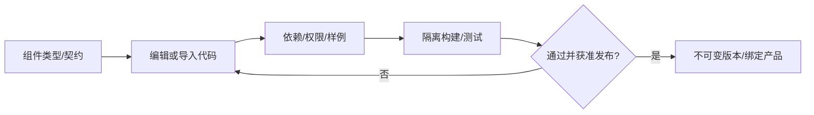
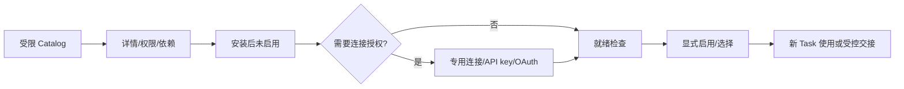
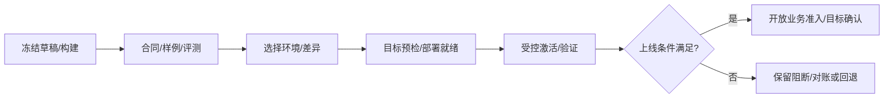
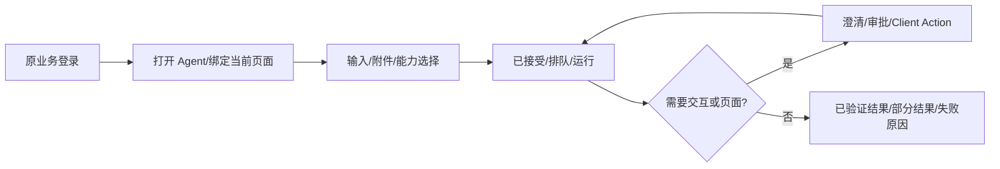
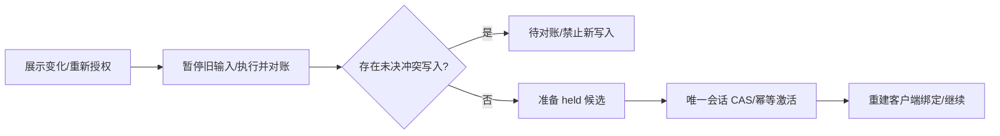

# Jorice 页面规格与交互流程 v1.0

日期：2026-10-20。状态：待产品/交互评审；配套 [Jorice PRD](PRD-Jorice.md)。
本文定义操作和反馈，不代表页面、API 或 npm 包已实现；主文 FR/AC 与本文 UX 编号共同作为验收入口。
管理后台面向 PC Web；业务 Agent 由产品布局嵌入，首个 npm SDK 面向 React。流程图下的表格是可独立阅读的文字说明。

## 1. 全局页面与交互约定

### 1.1 管理后台布局

```text
顶栏：Jorice｜产品选择｜环境选择｜当前角色｜个人菜单
左侧：总览 / Runtime / 接入 / 附加能力 / 交付 / 运行 / 设置
主区：面包屑 → 页面标题/对象状态 → 筛选或步骤 → 列表/表单/详情
辅助区：差异与校验 / 操作进度 / 当前范围及帮助（按页面出现）
```

全局资产页明确标“共享资产”；产品页始终展示产品和环境，生产环境用文本与颜色同时标识。
无权限项不提供可执行入口；必要时展示安全说明，服务端仍拒绝无权操作。所有深链接重新鉴权并恢复正确范围。
列表支持服务端分页、筛选、加载/空/错误状态；列内可见状态带观察时间。技术 ID/摘要放“诊断信息”，普通操作不要求手填。
对象详情采用总览、配置/版本、验证、操作记录等按对象适用的页签，不强求所有页面套用相同空页签。

### 1.2 草稿与长操作

编辑器显式“保存草稿”，显示未保存状态；校验基于确定的草稿 revision。切产品/环境或离开页面时可保存、放弃或取消离开。
保存、校验、构建、部署、激活互不代替；长操作提交后展示 operation 及当前阶段，允许离开后从记录继续查看。
重复点击只对应同一操作；结果未知时主按钮是“查询确认状态”，不是“再执行一次”。确定冲突时展示差异并让用户重新基于新 revision 修改。
操作失败保留可恢复配置与安全日志；不自动重做外部业务写入，不把失联写成失败/成功。

## 2. UX-01：管理登录与进入工作区

角色：所有管理用户。入口：后台访问、深链接、会话过期。
流程：访问后台→外部 IdP 登录→返回并核验会话→加载有权产品/环境→进入上次有权范围或产品目录。

| 步骤/页面 | 用户操作 | 系统反馈/分支 |
|---|---|---|
| 登录页 | 点击“使用组织账号登录” | 跳转登记的 IdP；取消回到可重试状态，失败不给通用管理员 Token |
| 登录返回 | 无需重复填写 Agent 账号 | 显示当前身份和有权范围；无任何产品权限时展示“尚未分配访问范围”及配置的管理员联系入口 |
| 产品/环境选择 | 选择获准产品与环境 | 加载对应导航/数据；深链接无权则拒绝，不泄露对象详情 |
| 会话到期 | 再次登录 | 暂停管理写入；普通草稿可恢复，Secret 不回填；已接受长操作由原 operation 查询，不自动重发 |
| 退出 | 点击退出 | 清理管理会话/缓存/流；产品 Runtime 中已接受任务按独立授权合同处理 |

验收：只隐藏按钮不算授权；产品 A 开发权限不能进入 A 生产或 B，重新登录不重复提交发布。
获权管理员从“角色与权限”选择外部 subject/group 或 CI 服务身份，设置角色/动作、产品/环境/资源和期限，预览实际允许范围后 CAS 保存；只能授予自身可委托上限内的权限。
撤销显示影响及确认结果，后续管理请求重新校验；不由此创建用户密码或赋予业务数据权，服务账号也不继承操作人的全部权限。

## 3. UX-02：产品、环境与接入检查清单

角色：产品管理员、集成开发者及获准部署/安全人员。入口：产品目录“新建产品”或产品总览“继续接入”。


| 步骤 | 主要字段/动作 | 校验与退出状态 |
|---|---|---|
| 基础信息 | 名称、技术标识、业务类别、描述、维护责任 | 标识唯一/合法，业务用户/tenant 不由此创建；保存可中断继续 |
| 模板/引擎 | 空白或固定模板版本、引擎、首个主 Agent | 展示默认原生包/配置/限制；模板未支持的组件明确阻断 |
| 环境/目标 | 开发/测试/生产、目标身份/端点、部署方式、资源/Secret 槽 | 管理权限、真实目标登记挑战/持钥证明、协议能力与网络验证；不是填 URL 即受信 |
| 业务接入 | Host、issuer/真实 scope 映射、BFF/登录 adapter、用户/工作区、ACL/委托、业务 API | 服务端核验来源；服务身份与用户委托各自测试，不从浏览器签 user_id |
| 分工清单 | 原生能力、连接、前端、预算、验证用例、备份/退出负责人 | 显示未配置/待授权/待测试/阻断；指向负责页面，不强迫重复填相同字段 |
| 完成页 | “进入 Runtime”“继续前端接入”“邀请已授权协作者查看链接” | 创建成功不显示生产可用；分享链接不授予权限，也不自动发送消息/邀请 |

产品总览显示：当前环境、期望/实际版本、接入进度、最近操作、阻断项、责任和下一步；分工者分别完成，安全前置不可跳过。
复制环境只复制允许的声明/包引用，预览端点/身份/Secret/数据范围差异；秘密与会话不复制，生产必须重新绑定。
模板页提供新建草稿、组件/配置编辑、校验、发布不可变版本、派生及弃用；展示可见范围和依赖产品。更新只产生候选版本，已派生产品显式采纳差异，共享不携带业务数据/账号/秘密。
开发试跑与生产开通条件见 UX-07；真实 UI 动作测试需已有获授权的开发测试版本，不要求新建产品后所有检查立刻完成。

## 4. UX-03：Runtime 全量配置编辑

角色：集成开发者、产品管理员。入口：产品 Runtime 定义或模板“派生”。
流程：选择草稿→按域编辑→查看最终配置/来源/上限→保存→校验→处理错误→构建。

页面布局：左侧为 PRD §7.2 的全部配置域，中间表单/组件/结构化编辑，右侧最终值、来源、权限上限、影响和校验；底部固定保存/校验/构建操作。

| 操作 | 用户看到/填写 | 系统行为 |
|---|---|---|
| 选择组件 | 类型、受支持版本、说明、权限/依赖、参数 schema | 当前引擎不支持者不可选并解释；选择不是下载后执行任意代码 |
| 修改参数/覆盖默认 | 默认来源、当前值、允许上限、是否敏感 | 就地类型/范围校验；越界、未知字段拒绝；Secret 用引用 |
| 切表单/结构化模式 | 同一份草稿内容 | 不丢字段、不静默忽略高级项；无效结构保留编辑内容但禁止构建 |
| 查看差异 | 与模板、上一版本或当前生效版本比较 | 展示新增/删除/替换、权限/模型/数据/资源变化及新 Task/部署生效边界 |
| 保存/校验 | 草稿 revision、错误定位 | CAS 冲突提示刷新对比；校验过时则重新校验，不能用旧通过状态继续构建 |
| 构建 | 精确草稿版本 | 跳转 UX-07 操作；不将保存显示成线上生效 |

首版未开放编辑的域显示“固定默认实现”和来源；已知但不支持的配置显示限制，不把空表单当全量完成。
模板更新提供候选差异，产品管理员显式采纳；不自动修改产品运行版本。

## 5. UX-04：原生能力开发与发布

角色：集成开发者；可信发布权限独立。入口：原生能力“新建”或资产库“导入”。



| 区域/步骤 | 字段/交互 | 校验与反馈 |
|---|---|---|
| 类型/基本信息 | 名称、版本、说明；tool/context/verifier，其他类型按支持矩阵启用 | 原生是产品绑定角色，不因此跳过授权；缺必需组件阻止发布 |
| 代码来源 | 在线编辑、固定 Git commit、包上传 | 显示确切输入/路径/摘要；导入不执行仓库安装命令，不支持类型拒绝 |
| 合同/运行限制 | 输入/输出、入口、依赖、超时/大小、风险/资源/权限 | 输出和受控 SDK 调用有合同；不允许生产 DB/宿主 Docker/长期秘密直接访问 |
| 样例/试跑 | 输入、获准测试连接、预期结果/验证范围 | 先构建/静态验证，真实业务试跑走测试 Runtime/Task 授权；无业务沙盒只读或拒绝写 |
| 测试结果 | 每条样例、耗时、结构化错误、安全日志/产物 | 区分未运行/通过/失败/未知；脚本自述不当业务收据 |
| 发布/绑定 | 审阅精确版本，选择产品原生或允许附加角色 | 不可变包；更新形成新包/Bundle，线上和旧 Task 不自动变化 |

多组件包显示每个入口/权限，S1 首片同时证明业务读写 Tool、Context、Verifier；其他执行点必须实际支持后才可发布。

## 6. UX-05：前端应用、Key、npm/Hook 接入

角色：业务前端/BFF 开发者、产品管理员。入口：接入→前端应用→新建或“继续接入”。


| 向导步骤 | 主要字段/操作 | 完成条件/异常 |
|---|---|---|
| 1 应用与环境 | 名称、产品/环境、frontend app、Host/BFF、目标、精确 Origin | scope/目标受权，禁止任意 URL；当前合同 HTTPS，HTTP localhost 需隔离开发 adapter |
| 2 前端契约 | Readable/Action 名称、输入/结果、资源/风险/大小/时限、SDK/协议兼容 | 可导入构建契约；未知/重复/不支持项阻断，handler 不上传 |
| 3 发布与 Key | 审阅 Profile→目标应用确认→生成/复制环境公开 Key | 显示“公开标识，可放前端”；服务秘密不出现在复制区；目标未确认不称接通 |
| 4 安装与 Hook | 展示建议 npm 版本、Provider、Readable/Action 示例、契约导出说明 | `@jorice/react`/API 为拟定接入封装；实际发布前文档标明不可安装，不提供虚假可用状态 |
| 5 BFF 接入 | 同源 bootstrap/proxy、业务会话/CSRF、服务身份引用、用户/工作区映射 | 前端只配公开 Key；未登录返回业务登录，不能凭 Key 获权 |
| 6 连接诊断 | 打开测试页面并刷新诊断 | 逐项显示登录、目标/SDK/Profile、document/Session、挂载、Controller/Observer及原因；无权不显示他人信息 |
| 7 UI 实测 | 在可用测试 Task 中选择安全 Action（如打开面板）发出受控请求 | 实际 Hook 被调用、Receipt 持久化/执行恢复；不能只看前端 console 或模拟成功 |
| 8 接入结果 | 查看版本/证据、进入发布或待解决问题 | 列明验证范围和未完成项；Key 生成/页面在线本身不等于业务上线 |

初始化示意：`JoriceProvider(publishableKey, bootstrapUrl, capabilities, conversationId)`；Hook 注册实际页面状态和类型化处理函数，完整拟 API 见 [SDK 设计](superpowers/specs/2026-10-20-jorice-frontend-sdk-binding-design.md)。
Key 绑定应用/环境；业务登录绑定用户；Client Session 绑定页面 document；Run Binding/Controller/fence 绑定任务动作权。Agent 不按 Key 广播所有页面。
Provider 首次合并挂载后才显示 ready；同 Session 后续只能收窄。SPA/lazy 新增或重挂已移除 Hook 时先处理旧 Effect，再重建 Client Session/Binding，超 Task 范围才走新 Task。
刷新或复制 Tab 各有新 document/独立 Session，不凭 sessionStorage 的 tab_handle 重发原 Secret；旧 Controller 有效时等待释放/过期或显式接管。
诊断显示“连接中”“只读观察”“等待页面”“契约不兼容”“需重新登录/绑定”，不把这些全部合为离线。
公开 Key 轮换提供新旧交叠/截止时间，旧值停止新 bootstrap；停用整个接入是另一操作，明确当前 Session/Effect 的失效/对账范围。

## 7. UX-06：Plugin 与连接授权

角色：具备当前产品/用户 scope 安装权限者、连接账号所有者。入口：附加能力或 Agent 中“管理允许的能力”。



| 交互 | 页面内容/用户动作 | 系统反馈/约束 |
|---|---|---|
| 浏览/安装 | 来源、版本/组件、风险/权限、依赖、支持 Runtime、目标产品/环境/工作区 | 不兼容禁止安装；重复安装幂等；不以 Jorice 角色冒充用户 scope |
| 认证 | 绑定已有获准连接或新建；API key 专用安全输入，OAuth 跳授权页 | 标明账号所有者和请求/实际授予 scope；取消、拒绝、过期、scope 不足分别显示 |
| 就绪/启用 | 安装状态、连接/目录/依赖检查 | 已安装≠启用≠认证完成≠Task 已选择；缺项给可处理入口，不能假称已可调用 |
| 用于任务 | 查看当前任务选择及版本影响 | 原 Task 未固定的新包/连接不能直接注入，指向 UX-09；必要时重新同意 |
| 升级/回退 | 精确版本差异、权限/组件/连接变化、影响任务/计划 | CAS/兼容验证，回退不复活撤销包；计划 pin 变化需重绑定 |
| 禁用/撤销/卸载 | 影响范围、在途/历史/共享引用 | 新调用受限，已发操作保留事实；卸载与后台 GC 分开确认，不误删共享凭据 |

OAuth 回调返回原产品/环境/连接，重新核验当前用户；不在聊天中要求粘贴 access/refresh token。
过期/invalid_grant 显示“需要账号所有者重新授权”，不悄悄换管理员账号；实际工具调用还要通过当前权限和预算。
同能力存在多个来源时显示本次安装的固定来源；禁用/撤销不能悄悄寻找其他来源绕过，也不误删独立获准来源。

## 8. UX-07：构建、评测、部署、发布与回退

角色：开发者构建测试、发布者生产发布、运维负责目标。入口：Runtime“构建版本”或交付→发布。



| 阶段 | 用户操作/所见 | 校验与结果 |
|---|---|---|
| 构建 | 选择精确草稿/包，查看构建进度/日志 | 依赖/摘要/合同固定，失败不激活；草稿改变使对应旧证据不适用 |
| 评测 | 查看样例、完成标准、安全负例、前端/业务证明 | 来源可信、范围明确；浏览器不能提交 passed 布尔值代替证据 |
| 环境差异 | 核对端点/账号/Secret 槽、scope、资源、SDK/引擎与数据范围 | 不复制生产凭据；开发证据不能替代最终生产环境的相应验证 |
| 部署预检 | 查看镜像、沙箱、schema、存储/网络/信任/Secret、旧任务处理 | 不支持版本/资源不足/破坏性迁移阻断；采用排空策略，旧任务版本不变 |
| 激活/验证 | 提交风险/范围确认，查看 operation 与逐目标结果 | 目标 AgentRelease CAS 唯一生效；响应丢失查原操作；验证未完成不称正式开通 |
| 结果/回退 | 展示实际版本/范围/时间、失败项/下一步 | 多 scope 部分成功明确列出；回退形成新操作，业务写入不自动回滚 |

开发测试发布允许先在隔离测试环境激活验收用版本，再完成真实前端/业务试跑；身份、完整性、权限/资源上限不能跳过，界面明确标“测试范围”。
生产先通过所需前置证据与目标预检，再在目标本地受限验收入口验证最终版本；只允许明确账号/资源范围的验收 Task，通过后才正式开放普通业务准入。
受限验收同样走正式 Host/Client/Task 授权，不是 Build Job 直连生产或免授权入口；该目标能力未实现时不开放该生产交付模式。
受限期普通用户及非验收资源请求必须由目标拒绝；验收失败保持准入关闭，开通响应丢失查询原操作，不再次创建发布或猜测流量已开放。
首次开通不满足条件保持“验证中/受限”；升级失败按旧版本可用性、准入 hold 和回退策略处理，不自动猜测旧版仍安全。
多 scope 先在各目标设置持久 hold/排空，逐项激活/验证，全部满足后逐项恢复入口；恢复失败也显示实际范围，不承诺分布式原子切换。

## 9. UX-08：业务内使用 Agent 与 UI 动作

角色：已登录业务用户。入口：产品页面 Agent 面板、“我的任务”或历史会话。



| 用户动作 | 页面反馈 | 必需行为 |
|---|---|---|
| 打开/继续会话 | 当前业务用户/工作区、获准 Agent、页面控制/观察状态 | 不要求第二个 Agent 登录；历史、流和产物每次核对当前身份 |
| 发消息 | 提交中→已接受→排队/执行；输入期间提供取消/待处理状态 | client_message_id 去重；运行中消息按合同排队或明确拒绝，不能静默丢失 |
| 添加附件/上下文 | 上传中/成功/失败、允许格式/大小、当前对象/页面来源 | 上传完成/任务绑定/读取分开授权；Readable 不是业务事实权威 |
| 请求 UI 操作 | 显示准备打开面板/切筛选/填本地草稿等语义 | 只当前 Controller 执行已注册 Hook，匹配 UI revision/期限；无页面则等待/不可用 |
| 请求正式业务写入 | 展示目标/差异、必要确认、真实写入和验证状态 | 走后端 Tool；浏览器 Hook 回执不能代表业务提交成功 |
| 完成/取消/继续 | 结果、产物、已完成/未完成项、等待或下一步 | 取消只停止后续受控执行；超时/未知保留对账入口，部分不能显示全成功 |

产物下载/预览仍查当前权限；禁止用 URL/会话 ID 跳过鉴权。业务用户看到必要业务信息，协议/摘要/fence 放获权诊断层。
任务可在后台运行时，离开前说明继续范围/期限；仅会话跟随授权的任务在失效后停止后续受限调用，不能把关闭页面一律等同于取消。

会话列表提供新建、重命名、归档、查看已归档与删除入口，分别校验当前业务权限：

| 会话操作 | 影响与失败处理 |
|---|---|
| 重命名 | 更新展示元数据，CAS 冲突保留用户输入并重新核对，不修改执行指令/历史事实 |
| 归档/取消归档 | 改变默认列表可见性，不取消任务；长任务仍可从“我的任务”找回 |
| 删除 | 预览在途/历史/附件与保留规则；先停止新会话交互，按获准策略处理在途任务，再执行允许的数据清理；不隐式删除业务写入/安全收据 |
| 清理失败/无权 | 显示处理中/部分完成和可继续项；未知 Effect 保留对账入口，不因页面退出抹掉事实或自动重建会话重发消息 |

## 10. UX-09：澄清、审批与任务交接

### 10.1 澄清/审批

角色：配置指定的可处理主体。入口：会话卡片或“我的待办”。
流程：收到问题/提案→查看上下文与影响→回答/批准/拒绝/建议修改→服务端重新核验→执行或失效。

| 卡片内容/操作 | 交互与分支 |
|---|---|
| 澄清 | 问题、受限选项/输入 schema、期限；必填/格式就地校验，未知答案可按合同取消/返回，不由模型猜选项 |
| 审批 | 对象/动作/字段差异/数量/风险/版本/期限；按钮“批准本次操作”“拒绝”“修改建议” |
| 回答/确认 | 显示提交中；幂等提交后显示当前结果。对象/参数已变、错误用户/过期/旧 revision 均拒绝并说明获准下一步 |
| 修改/拒绝 | 修改生成新提案和新确认，旧批准失效；拒绝不写业务；任务后续按策略暂停/结束/调整 |
| 刷新/离线/终止 | 从目标恢复同一待办；终止/交接后旧卡不可继续批准，历史决定保留 |

### 10.2 会话内换 Plugin/权限/版本

入口：当前任务需要未固定能力或用户请求更换；未启用此能力时明确“结束旧任务后新建”，不提供假按钮。



交接卡显示“正在准备新任务/旧操作待确认/新任务已就绪”，保留原会话与历史结果；只交接当前获准上下文/附件引用，不复制授权。
候选在 CAS 前不能运行；CAS 未赢的候选废弃，激活结果未对账不能再次切换。已成功业务写入不重做，旧消息/Receipt/fence 不驱动新任务。
交接失败不自动让旧任务恢复写入；重试恢复同一交接或明确结束，已接受未处理消息逐项解释去向。

## 11. UX-10：知识、文件、Memory 与撤权

角色：有权来源管理员/业务用户。入口：内容与 Memory，或业务任务的附件/引用。
流程：登记来源与策略→安全试读→明确处理/索引支持→启用→增量/使用→撤权或删除→查看派生清理结果。

| 交互 | 页面字段/反馈与限制 |
|---|---|
| 新建来源 | 来源/环境/数据范围、账号、格式/大小、解析/检索、ACL/新鲜度、引用/保留/删除；不支持格式不可宣称处理成功 |
| 验证/同步 | 连接/权限、处理版本、进度/失败项/滞后；部分索引标部分，失败可受控重试 |
| 无治理合同 | 明确“仅受限实时读取”，禁止长期索引/Memory 派生；不能勾选启用后绕过 |
| Memory 管理 | 个人/工作区、来源/候选/确认、期限、删除；默认不把个人对话共享团队 |
| 撤权/删除 | 显示源、缓存/chunk/Memory/产物/必要记录/备份影响，提交后分项状态与失败原因 |
| 历史访问 | 当前权限不足拒绝检索/上下文/下载；无法拆分受限内容时整体阻断，再重建获准版本 |

不承诺收回已交付到用户外部的内容；保留审计元数据和清除正文分开，UI 隐藏不算已物理删除。

## 12. UX-11：长任务、任务中心与可选计划

角色：业务用户/有权计划管理员。入口：业务“我的任务/待办”，管理后台运行中心，或“创建计划”。
流程：确认后台委托→提交→离开页面→查询/通知引用→按当前登录找回任务→处理认证/交互或查看结果。

| 交互 | 必须说明/反馈 |
|---|---|
| 后台任务 | 用户确认范围、时限/资源和退出后是否继续；账户禁用/安全撤销仍阻断，不存浏览器 Cookie/长效 Grant |
| 我的任务/待办 | 按当前用户/工作区过滤，状态/等待原因/结果/下一步；返回会话不重复发原指令 |
| 创建计划（启用时） | Agent/输入模板、资源/委托、时区与 once/interval/calendar、漏跑/重叠策略、有效期，预览下一触发 |
| 保存/启停 | 显式授权模板和精确版本 pin；每次触发新鉴权/预算/任务，重复 occurrence 去重 |
| 发布后漂移 | 显示“需要审阅并重绑定计划”，不自动跟随 latest；历史触发/失败可查 |
| 暂停/补跑 | 暂停只阻止新触发；补跑按受权新操作，取消已接受 Task 单独处理，不重复已确认业务动作 |

默认结果入口在业务产品内；邮件/IM/Webhook 通知只在明确支持并授权时配置，通知携受控引用，不携业务秘密，也不形成自动执行权限。

## 13. UX-12：运行诊断、预算与恢复

角色：获准业务用户或运维/审计，读取内容与执行处置权限分别校验。入口：任务/操作详情、告警链接。
流程：筛选并打开对象→看真实阶段/已完成事实→定位阻断→选择有权安全处置→对账原操作→确认结果。

页面含业务进度/结果、步骤/Effect、交互/Client、授权/版本、产物、用量和脱敏诊断；按权限展示，支持从关联 ID 跳转。

| 状态/问题 | 提供的主操作 | 不允许的行为 |
|---|---|---|
| 排队/能力或容量不足 | 查看原因/Worker 能力、获权扩容或取消 | 根据是否有 SSE 推断是否运行 |
| 认证失效 | 进入指定连接/当前用户重新授权 | 借用他人/管理员账号 |
| 页面/审批失效 | 重新绑定页面或生成新提案 | 重用旧 Receipt/批准/fence |
| 预算/限流 | 看已用/待对账、获权调整或等待 | 重试清空计数，超过 Task 上限自动提权 |
| unknown 业务写/激活 | 查询原 Effect/operation/业务收据，移交对账 | 一键重跑全部、把超时直接算失败 |
| 存储/包撤销/漂移 | 查看范围、恢复依赖或正式回退/发布 | 换空库、被撤销版本或静默模型降级 |

审计/导出选择产品/环境/时间与数据范围，先校验权限/脱敏规则；没有导出权限不以下载接口绕过。
告警去重/确认/负责人和安全处置链接可配置，UI 显示最后确认时间；失联/陈旧不得继续当作当前健康。

## 14. UX-13：暂停、解除管理、备份恢复与退出

角色：有该产品资源处置权限者；敏感操作按 Policy 再确认。入口：产品设置，日常暂停也可从总览进入。


| 操作 | 交互/确认内容 | 成功条件 |
|---|---|---|
| 暂停接入 | scope/目标、计划、新 Task，在途排空/暂停/取消策略 | 目标本地 hold 确认；部分失败显示范围，不只是目录改状态 |
| 解除 Jorice 管理 | 将保留的独立 Runtime、接管身份、配置/审计引用和管理权限回收 | 完成受权交接，不自动删除运行库或撤销仍需保留的业务运行信任 |
| 归档 | 停执行入口、数据保留/查看权限 | 无新准入，获权历史查询仍可用 |
| 彻底退出/销毁 | 目标/在途/连接/包/存储/备份/共享引用清单，逐项保留/清理计划 | 无旧可用入口/授权，专属资源按策略处理，共享资源不误删，失败项可定位续作 |
| 备份/恢复 | 版本/目标/校验、RPO/RTO 实测、影响/停写、当前撤销与 unknown 对账 | 通过来源/摘要/引用和当前安全状态，旧快照不复活失效包/账号/凭据 |

关键确认显示具体产品/环境/资源数量及不可逆影响；正式销毁按 Policy 要求输入目标标识/理由并服务端校验，不以模糊“确定？”代替。
取消此管理操作只停止后续编排，不自动撤回已发外部写入/恢复已删资源；需要恢复/补偿时启动明确的新操作。
任何操作失败保留可信步骤和实际范围；退出 A 不影响 B，包/镜像/对象 GC 需全部 Task/Bundle/备份引用与保留条件满足。

## 15. 通用空态、错误和交付要求

| 场景 | 用户文案/行为要求 |
|---|---|
| 首次无数据 | 解释当前页用途，提供获权的新建/继续接入/文档入口；不显示示例为真实数据 |
| 无匹配数据 | 保留筛选，提供清除筛选；区别“没有资源”与“没有权限”但不泄露他人对象 |
| 不支持/未启用 | 明确当前 Runtime/阶段限制与可行下一步，不呈现可点但无效的成功操作 |
| 字段错误 | 定位字段和合法范围，保留普通输入；Secret 不写草稿存储/日志、不明文回显 |
| CAS 冲突 | 提示对象已更新，展示获权差异，基于最新 revision 重填/合并，不覆盖他人工作 |
| 网络失败/未知 | 显示最后确认和关联 ID；查询原操作，只有确定安全时才能原幂等恢复 |
| 无权/身份变化 | 停流/清理缓存/禁用提交，返回重新登录或有权范围；不展示被拒对象详情 |
| 部分完成 | 已成功/失败/未执行/待对账逐项可见，给下一步；不伪造全部回滚或完成 |

所有流程需键盘可达、焦点可追踪、错误可被辅助技术读取；状态同时有文本，异步变更不会把用户输入静默清空。
交付评审需包含页面路由/状态清单、真实 API/权限映射、FR→UX→AC 对应、成功及异常演示记录；无需先实现全部视觉细节，但不能省略关键状态。
主 PRD 与本附件均为新提案；既有 mock 页面、历史 HTTP 200/截图或技术代码存在不能替代上述交互与业务验收。
