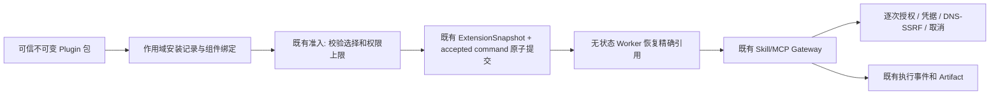

# Cloud Agent Plugin 接入实施方案

> **For agentic workers:** REQUIRED: Use superpowers:subagent-driven-development (if subagents available) or superpowers:executing-plans to implement this plan. Steps use checkbox (`- [ ]`) syntax for tracking. 用户已于2026-10-19授权实施；服务激活与真实模型验收仍为独立门槛。

**Goal:** 将可信 Plugin 包解析为 Cloud Agent 已有的 Skill/MCP 组件，完成安装、启停、Turn 固定、授权执行和安全恢复。

**Architecture:** Plugin 是扩展分发与组合单元，复用 ExtensionStore、ExtensionSnapshot、Typed Tool Gateway、Policy、Credential/Egress 与 Event Store。插件记录不成为新的执行事实或授权来源；Worker 继续无状态、按已接受 Turn 的精确引用恢复。

**Tech Stack:** Python 3.12、现有 Pydantic、PostgreSQL storage adapters、Artifact/Skill Publication/MCP HTTP transport；不增加依赖。

**状态:** Implementing，2026-10-19；方案源码基线 cloud-agent-trench `2a6966be`，实施基线 `1d160735`。本文描述目标与验收条件，不声明功能已上线。

---

## Chunk 1: 最小 Cloud Plugin 闭环

### 1. 首期交付边界

Plugin = 不可变包描述、Skill 内容/引用、MCP 逻辑组件、版本/来源/完整性和作用域安装记录。
首期允许 Skill-only、MCP-only 和 Skill+MCP 三种组合。

| 纳入首期 | 后续单独立项 |
|---|---|
| 管理员安装可信包、显式启停、按 Turn 选择 | 公共 Marketplace、任意用户远程安装 |
| 固定版本与完整 SHA-256、内容校验 | 自动更新、依赖求解、任意包管理器安装 |
| 现有 Skill Publication 和受控 HTTP MCP | 插件自行创建 stdio 子进程、任意 Python/JS Hook |
| 现有凭据引用、网络策略、逐次授权 | 安装时运行脚本、自动 OAuth、插件自授权限 |
| 根任务完整闭环、子任务拒绝越权 | 未完成独立验收前向 researcher 开放插件继承 |
| Cloud API/可执行 SDK 或原生请求验收 | Trench 专用业务逻辑、Desktop 管理页 |

插件不强制任务分类、工具调用、研究委派或搜索引擎；Yahoo 默认/Exa fast、高思考/v2 由现有配置继续决定。
不把所有插件正文、工具 schema 或大文件塞进模型上下文。

### 2. 当前源码：直接复用与真实缺口

| 已存在 | 实际边界 |
|---|---|
| `packages/agent-core/src/agent_core/domain/plugins.py` | v0.1 单个 entry、manifest digest、基础安装记录与五层概念 |
| `packages/agent-integrations/src/agent_integrations/plugins/__init__.py` | 内存 Registry，未检出 Cloud composition 调用；不是持久化多 Worker 服务 |
| `packages/agent-core/src/agent_core/domain/extensions.py` | 精确 issuer/namespace/principal/workspace、SkillInstallation/McpConnection |
| `packages/agent-core/src/agent_core/domain/extension_snapshots.py` | Turn 固定的 Skill/MCP 引用、权限上限和 digest |
| `packages/agent-storage/src/agent_storage/postgres/extensions.py` | 配置 revision/CAS、Skill 实时校验；当前只支持 skill/mcp kind |
| `packages/agent-storage/src/agent_storage/postgres/extension_snapshots.py` | 已有不可变 Turn snapshot 持久化 |
| `apps/api/src/zebra_agent_api/extension_turn_admission.py` | 准入及原 Turn snapshot 复用；当前 MCP 可从 scope 中全部 enabled 连接选择 |
| `apps/worker/src/zebra_agent_worker/extension_recovery.py` | 对照已接受命令绑定的 digest 恢复，缺失/不一致拒绝 |
| `apps/worker/src/zebra_agent_worker/mcp_composition.py` | opt-in Cloud MCP、已有凭据释放和执行 authority |

必须补齐的缺口：

1. 一个包组合多个 Skill/MCP 组件，且旧 v0.1 仍可读取。
2. 当前 content_digest 是 Manifest JSON 的哈希，不能证明 Skill 文件未被篡改。
3. 当前路径检查使用字符串 startswith；相邻路径前缀可能被误当成包内路径。
4. 可审计的持久安装/启停与包到现有组件的绑定，替代 Cloud 对内存 Registry 的依赖。
5. Plugin selection 进入现有准入与 snapshot，不能恢复时再找 latest。
6. 版本、禁用、子任务、失败恢复与每次新鲜授权的实际联动验收。

### 3. 保持同一条执行链



包来源与完整性属于供应链事实；安装/启停属于控制面配置；Task grant 与调用审批属于执行授权。
五层状态是五种独立决策，不把 Granted/Approved 写成整个插件安装的全局永久状态。
现有 v0.1 状态机只保留兼容，不直接升级为多租户生产 authority。

### 4. 包与安装契约

#### 4.1 包契约 v0.2（拟新增，非现有支持）

保留 v0.1 parser；新增有界 components，读取 v0.1 时规范化为单组件。
Cloud 发布只支持首期允许的组件种类；能解析旧 stdio/hook 不代表 Cloud 能启用它。

```json
{
  "manifest_version": "0.2",
  "id": "public-research",
  "version": "1.0.0",
  "publisher": "internal-team",
  "components": [
    {"id": "research-guide", "kind": "skill-bundle", "skill_root": "skills/research"},
    {"id": "reference-docs", "kind": "mcp-http", "connection_slot": "reference-docs"}
  ]
}
```

`connection_slot` 是逻辑槽，不是 credential、URL 或全局连接 ID。
安装请求在当前精确 scope 中把它绑定到已有受治理的 McpConnection；不把租户私有 ID 写回公共包。
首期不自动创建外部 MCP 服务或导入凭据。未就绪连接返回缺失绑定/认证状态，不暗中换服务。
Skill 文件通过现有 Skill Publication 校验和发布；引用精确的版本、安装 ID 与摘要。
首期只绑定已就绪且显式启用的现有 SkillInstallation/McpConnection；缺项由现有管理流程准备后再绑定。
插件安装器不创建或切换底层组件的 enabled 状态，避免安装插件后组件从旧的全量 enabled 选择路径意外暴露。

完整性必须分开记录：

- manifest_digest：规范化描述的摘要，沿用已有概念但不得冒充包文件哈希。
- package_digest：规范化 Manifest（仅排除明确的摘要/签名自引用字段）与排序后的全部文件路径、长度、SHA-256 共同计算。
- artifact_ref：复用 ArtifactObjectStore 的不可变对象及 ArtifactObjectExpectation/receipt，安装记录固定对象版本；不允许 Worker 按可变本地目录直接加载。
- display identity 可简写；授权、SQL 主键比较和恢复全部使用完整 digest。

JSON 重复键、重复规范化路径、绝对路径、`..`、软链接逃逸、非法组件重名必须拒绝。
实际校验使用解析后相对路径边界和既有 Skill 路径校验，不依赖字符串前缀。
文件/字节/解压预算沿用既有 Publication/Artifact 上限；仅有受限目录包即可起步，不先实现任意归档格式。

首期信任来自管理员允许的来源和明确包摘要，不来自任意 manifest 内的 publisher 字符串。
Cloud API 从运维挂载的只读包目录与摘要允许列表解析安装请求；客户端只提交摘要和作用域内绑定，不提交服务器路径或可信包元数据。
Worker 仅依赖已固定的对象版本，不需要该目录挂载。包目录/允许列表由后续默认关闭的 composition 设置提供。
已有 signature 字段不等于已经完成签名验证；外部签名信任链/撤销体系留在后续供应链任务。
安装器不执行包内任何脚本。

#### 4.2 持久化与并发

复用现有 extension_configurations / extension_configuration_revisions，扩展 kind=plugin。
这需要为两张表新增允许值的 migration，不能只改 Python Literal；版本号在实施时依据实际最新迁移分配。
新增窄 PluginInstallationStore Port；不要求所有现有 ExtensionStore mock/本地实现突然实现新接口。
PostgreSQL adapter 复用已有作用域、revision CAS 和事务模式，不另造通用配置框架。

一个 PluginInstallation revision 包含：

- 完整 scope、installation_id、revision、enabled；
- package ID/version、完整 package_digest/manifest_digest、artifact_ref；
- component ID → SkillInstallation/McpConnection 精确引用；
- operator identity、操作时间、scope 内幂等请求标识和请求摘要。

第一次安装默认 disabled。所有必要组件验证并绑定成功后，才允许显式启用。
Skill 发布可先完成；最终安装绑定一次事务提交，失败不暴露半成品 enabled 插件。
首期不自动回收 Plugin 包对象，安装记录保留对象 expectation/receipt；失败清理不删共享对象。
普通会话 Artifact payload 的 GC 尚未保护扩展安装/snapshot 引用，不能直接复用其删除入口；自动包回收另行立项。
同幂等键/同请求返回原记录，同键不同包摘要或绑定返回冲突。
不将安装日志、配置状态放进 Redis 或 Worker 内存作为唯一事实。

#### 4.3 启停、升级和回滚

沿用已有实时禁用语义：当前 Skill installation 一旦 disabled，其后续读取会被拒绝。
Plugin 禁用后，经该安装准入的后续组件调用必须检查其活跃状态，包括已固定 snapshot 的调用。
不连带禁用共享底层组件；若同一组件在该 Turn 还存在独立、已准入的直接授权来源，则该来源按原权限继续生效。
来源关系必须固定在 snapshot；不能在插件被禁用后临时寻找未准入的其他插件/直接来源来绕过。
不要承诺“禁用只影响新 Turn”；这与当前 Skill 校验不一致。
已发往上游的调用按现有取消机制尽力中止，已确认副作用不能因此假装撤销。

升级/回滚都生成显式 revision 和精确引用，不把历史 snapshot 替换成新版本。
首期变更同名 Skill/连接时使用无相关活动 Turn 的维护窗口：现有 scope 内同名 Skill 不能同时 enabled 两个版本。
如果旧 snapshot 与当前授权/revision 不再兼容，保留结果并暂停，不切换到其他插件版本或重调模型。
双版本无中断热升级不是首期验收承诺。

### 5. Task / Turn 准入与恢复

#### 5.1 选择与权限

管理面提供 list/read/install/update-enabled/rebind 的最小 API；复用现有管理授权与分页/CAS 模式。
首期可由原生 HTTP/SDK 调用验收，不先做 Trench 管理页面。
执行请求增加可选 plugin installation selection，要求精确 installation ID 和 revision。
客户端不能提交可信 scope、grant、digest 或 Worker 命令来替代服务端解析。

对显式选择执行：

1. 从 verified authority 得到 scope 和 Task ceiling。
2. 在同一 scope 读取/校验安装、包 ready、绑定和内容摘要。
3. 解析为既有 SkillInstallation / McpSnapshotEntry。
4. 计算授权交集：Task grant、当前启用状态、tool/network profile 和对应组件请求。
5. 显式要求的必要组件不满足就拒绝准入，返回具体缺项；不静默换包、扩大权限或先调用模型。
6. 相同完整组件身份去重；同名不同内容或冲突绑定明确拒绝，不按扫描顺序覆盖。

解析插件不能修改/补造原签名 TaskBinding；原 grant 不够时必须由已有授权入口补足。
Skill 仍必须属于被冻结的 skill_components ceiling，MCP 仍经过现有操作授权。

接入位置：复用 CloudExtensionTurnAdmission，新增 package resolver use case，API 层只组合依赖。
已有 select_enabled_mcp 需支持显式选择集合：None 保留旧调用语义，空集合表示不选，不能当成“全部”。
显式插件路径只加载所选组件；旧的直接 Skill/MCP 用法保持兼容，二者组合必须经过同一授权校验。

#### 5.2 Snapshot 与持久提交

扩展 ExtensionSnapshot，增加有界 plugin provenance：安装 ID/revision、包 ID/version、完整 digest、组件引用关系。
记录每个执行组件已准入的直接/插件来源；组件本体去重后仍保留来源边，供逐次授权和共享组件禁用判断。
原有 skills/mcp 字段继续是执行输入，不再创建第二套 Tool 配置。
新字段为空时从序列化中排除，保持旧 snapshot 原有 digest；旧记录不补写、不重算。
新 snapshot 的 digest 覆盖 plugin provenance，防止配置/组件来源被替换。

继续使用 append_with_extension_snapshot：准入的 accepted command、Turn snapshot 和必要 revision 校验在同一数据库事务内完成。
同一 Turn 恢复复用已接受绑定；不能因为用户后来启用/升级了插件就重新枚举 scope 全部插件。
在事务内复核 selection revision，避免校验后禁用、提交前旧状态被接受的竞态。
快照只带有界引用，不复制 Skill 正文、MCP schema 大包、密钥或私有推理；保留现有1MiB执行输入与历史预算。

#### 5.3 Worker 与失败

Worker 从可信 accepted command 的 snapshot digest 恢复；包、组件或 scope 不匹配即失败关闭。
恢复使用固定 Artifact 引用并再次校验完整性；不能从网络下载一个同版本的新内容替换。
插件状态在准入及每次组件执行的既有新鲜授权边界批量核验，只接受 snapshot 中仍有效的来源；不按 token/delta 刷新数据库。
只做描述渐进披露，skills.read/tool search 复用当前机制，不启动第二次“插件路由模型”。

| 情况 | 结果 |
|---|---|
| 旧 Turn 没有 plugin 字段 | 完全沿用当前兼容路径 |
| 包缺失、摘要不符、安装被禁用 | 暂停/明确拒绝，保留原输出，不假装完成 |
| MCP 认证未就绪/权限被收回 | 明确不可用，不读旧密钥或扩大授权 |
| 上游请求结果不确定 | 继承既有禁止不确定自动回退/重放的规则 |
| 只有部分组件准备成功 | 安装仍不可启用，不能假报整包可用 |
| STOP、租约失效、控制事件更新 | 现有取消/栅栏优先，插件不另建重试通道 |

执行结果、tool-call 配对、验证范围、验证提示去重和 Client Effect 消费标记保持原恢复契约。
插件不可在这些状态丢失时启动额外模型调用来“修复”。

#### 5.4 researcher 子任务

首期根任务闭环不宣称插件已被子任务继承；委派定义必须如实声明可用能力。
子任务开放单独经过下一阶段门禁：授权组件集合必须是父任务允许集合的子集，并保留 research 只读/深度/network ceiling。
子任务仍有自己的 Session/Turn/snapshot，不能复制父 Turn 身份或凭据。
当前 ExtensionSnapshot.is_subset_of 要求相同 Session/Turn；不能直接用它判断不同子任务。
在既有委派授权路径派生子任务组件上限，创建新的快照并校验组件集合与精确版本的子集关系。
若尚无该持久派生接线，子任务不给插件能力并返回明确限制，不能靠 system prompt 继承权限。

### 6. 文件边界与分阶段实施

下列路径为实施建议，均需在对应任务激活前登记 Owned paths。
已存在大文件接近500行时，在其原职责内拆出专门模块，不把实现堆入 apps/。

#### Task 1 — 契约与包完整性（拟 CLOUD-PLUGIN-CON-01）

**Files:**
- 修改 `packages/agent-core/src/agent_core/domain/plugins.py`，仅兼容接缝；
- 新建 `packages/agent-core/src/agent_core/domain/plugin_packages.py`；
- 修改 `packages/agent-integrations/src/agent_integrations/plugins/__init__.py` 的边界检查；
- 新建 `packages/agent-integrations/src/agent_integrations/plugins/package_integrity.py`；
- 回归 `tests/test_plugin_lifecycle.py`，新增 `tests/test_plugin_package_integrity.py`。

- [x] 先加入能击穿现状的检查：篡改 Skill 字节改变 package_digest；前缀相邻路径、软链接逃逸被拒绝。
- [x] 运行 `uv run pytest -q tests/test_plugin_lifecycle.py tests/test_plugin_package_integrity.py`，确认新增场景在现状失败。
- [x] 实现最小 v0.2 多组件读取与 v0.1 单组件规范化；不执行包代码。
- [x] 同命令转绿，旧 Manifest/canonical digest 回归不变，提交本阶段。

#### Task 2 — 持久安装与管理（拟 CLOUD-PLUGIN-STORE-01；依赖 Task 1）

**Files:**
- 新建 `packages/agent-core/src/agent_core/ports/plugin_installations.py`；
- 新建 `packages/agent-core/src/agent_core/application/plugin_installations.py`；
- 新建 `packages/agent-storage/src/agent_storage/postgres/plugin_installations.py`；
- 新建对应 migration 文件并按现有 migration registry 注册；
- API 在 `apps/api/src/zebra_agent_api/extension_composition.py` 组合，单独薄管理 adapter；
- 新增 `tests/agent_storage/test_postgres_plugin_installations.py` 及 API 授权回归。

- [x] 写入 exact-scope、CAS、同键冲突、必要绑定缺失和失败半成品不可启用的回归。
- [x] 修改两张 revision 表的 kind 约束，复用现有 transaction/Artifact/Skill Publication；迁移在隔离库测试。
- [x] 包对象复用既有 immutable put/receipt，安装器仅绑定现有组件且不改变其启停；首期不调用 payload GC 删除包。
- [x] 暴露最小管理操作，凭据仍只经现有 Credential 管理。
- [x] 运行 `uv run pytest -q tests/agent_storage/test_postgres_plugin_installations.py` 和对应 API 测试。
- [x] 验证两个独立 store/worker 实例读到同一安装事实，重启不丢失；提交。

#### Task 3 — Turn 与 Worker 接入（拟 CLOUD-PLUGIN-RUN-01；依赖 Task 2）

**Files:**
- 新建 `packages/agent-core/src/agent_core/application/plugin_resolution.py`；
- 修改 `packages/agent-core/src/agent_core/domain/extension_snapshots.py`；
- 修改 `apps/api/src/zebra_agent_api/extension_turn_admission.py`、`extension_mcp_selection.py`；
- 修改 `packages/agent-storage/src/agent_storage/postgres/events.py` 的现有准入事务校验；
- 修改 `apps/worker/src/zebra_agent_worker/extension_recovery.py`、`worker_skill_catalog.py`、`worker_mcp_catalog.py`，在现有读取/调用授权边界检查已准入的插件来源；
- 修改 `apps/config/src/zebra_agent_config/settings.py`、`.env.example` 和既有 API/Worker composition，增加默认关闭的 `ZEBRA_CLOUD_PLUGINS_ENABLED`；
- 新增 `tests/api/test_plugin_turn_admission.py`、`tests/worker/test_plugin_recovery.py`。

- [ ] 先测试无插件旧 snapshot digest 字节不变、同 Turn 重试不重新解析最新版本、跨 scope 全部拒绝。
- [ ] 插件解析进入既有 snapshot/accepted-command 原子提交，处理禁用/准入并发。
- [ ] 根任务按显式选择组合 Skill/MCP；Skill 正文不被全量注入，MCP 不覆盖内置工具。
- [ ] 验证共享组件的来源去重、插件禁用不影响独立已准入来源、无有效来源时拒绝；旧 Turn 的直接路径不变。
- [ ] 开关关闭时不接受新插件选择、不增加插件 I/O；已有插件 snapshot 不得丢弃来源后退回普通执行，必须明确暂停。
- [ ] 执行 `uv run pytest -q tests/api/test_plugin_turn_admission.py tests/worker/test_plugin_recovery.py`。
- [ ] 完成失败恢复、取消、租约、验证去重回归后提交；仍不自动启用生产 feature。

#### Task 4 — 原生验收与子任务开放（拟 CLOUD-PLUGIN-ACCEPT-01；依赖 Task 3）

**Files:**
- 委派接缝在独立 Owned paths 卡中按实际代码认领，避免扩大 Task 3；
- 保留既有 Worker child/Client Effect/provider continuation 恢复模块边界；
- 新增 `tests/worker/test_plugin_child_authority.py`、一份原生 Cloud 验收脚本；
- 更新本方案验收记录及运行手册。

- [ ] 先用固定包和本地受控 MCP stub 做无模型跨进程完整链路，使用真实隔离 PostgreSQL/Artifact。
- [ ] 若开放 researcher，先验证独立 child snapshot、父子组件交集、只读/深度和撤销；未通过则继续关闭。
- [ ] 核对当前运行实例实际装配所需 Cloud Skill/MCP 开关及凭据挂载；源码存在不等于当前服务已启用。
- [ ] 获得独立真实模型授权后，才做一次真实根任务验收；模型自主选择工具，记录实际调用与首正文/整轮/SQL。
- [ ] 按现有本地运维流程另行更新服务；先确认共享 Worker 没有活动 Run，再保留 Search/MCP 原进程和配置。
- [ ] 最终执行受影响检查及 `make check` / `make test`，记录已有失败而不扩展修复；本地集成范围遵守当前用户授权。

四项任务按顺序完成；依赖解锁遵守仓库规则及当前明确授权的集成目标。
公共 Marketplace、DSH 式任意运行时插件和第三方签名分发不是这些任务的隐藏后续。

### 7. 验收门槛

| 维度 | 必须证明 |
|---|---|
| 包完整性 | Manifest 不变而文件篡改也被发现；目录逃逸、重名、非法 kind 拒绝 |
| 持久事实 | 安装/CAS/启停跨进程一致，崩溃后无半启用记录 |
| 隔离 | deployment/issuer/namespace/principal/workspace 任一不符拒绝且不泄露存在性 |
| 授权 | 安装/启用不授予执行权；Task ceiling、network 和单次审批仍生效 |
| 准入 | 显式选择不带入其他 enabled MCP；旧直接选择路径兼容；revision 竞态失败关闭 |
| 恢复 | 原 snapshot 固定，禁用/缺失/不确定副作用不换版本、不新增模型请求 |
| 流 | v2 delta 不落成逐帧插件 SQL；模型可见正文/私有推理隔离不变 |
| 子任务 | 没有持久派生授权就不开放；开放后范围仅缩小且身份不混用 |
| 性能 | 固定脚本工作量下，插件额外成本随有界组件数变化，不随文本帧数增长 |
| 真正接线 | Cloud API 管理、准入、Worker 实际定义/执行/恢复均经过对应组件引用 |

性能先用相同脚本/相同 Tool workload 的 enabled/disabled 原生对照：
分别记录准入 SQL/耗时、连接冷/热初始化、上下文 token、工具数、首正文和整轮。
短期统计不能冒充 P95；真实模型若走了不同工具路径，不把总时间差直接归因于插件框架。
逐次新鲜授权 SQL 属于保留成本，不能为了漂亮数字被缓存掉。
首期不承诺插件会自动提高回答质量或缩短首正文等待。

### 8. 上线与回滚条件

保持默认关闭、可信内部包白名单、小范围 namespace 启用。先准入/Worker 配对发布，再开放选择。
仅回滚管理面开关不能移除已有被引用的包/安装/snapshot；先等待相关 Turn 结束或明确暂停。
数据库迁移保持加法兼容，旧记录继续可读；保留包对象引用、expectation/receipt，首期不自动回收 Plugin 包。
实施记录：Task1/Task2已实现并通过独立规格与质量审查；Task2在隔离 PostgreSQL 验证安装/CAS/绑定与迁移105，默认关闭的管理 API 可注入使用。自动 composition、Turn/Worker 和真实对象跨进程验收仍在后续阶段；正常数据库/服务未更新，无模型或搜索请求。
