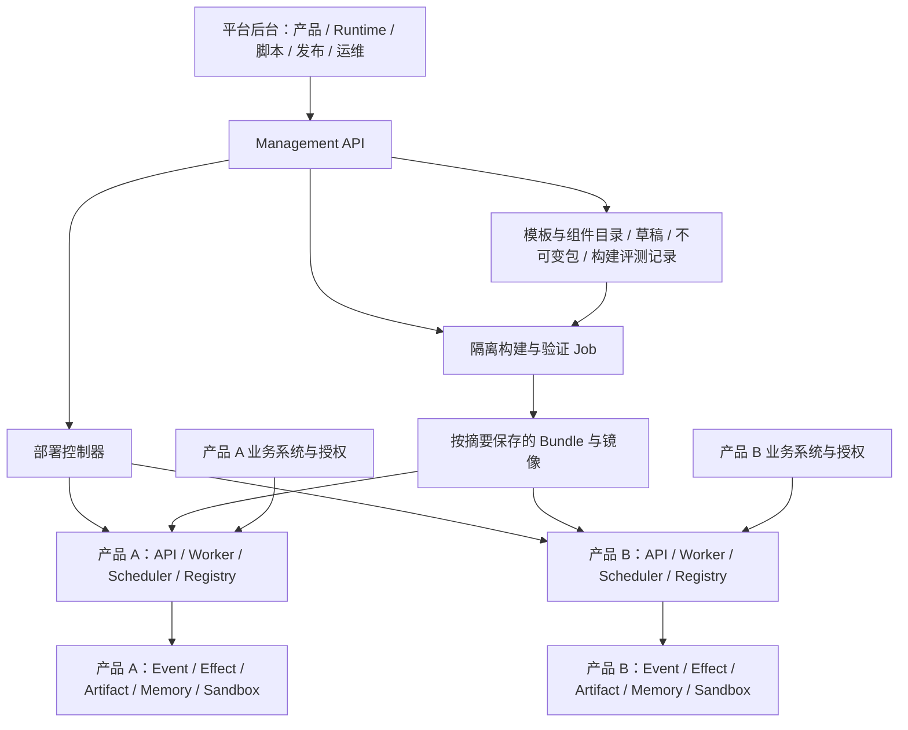

# Jorice：Agent Runtime 平台完整设计方案 v1.6

创建：2026-10-19；补充修订：2026-10-20。状态：待评审设计草案，未批准实施。

平台名称由用户确定为 **Jorice**。Jorice 与 cloud-agent 的独立边界与耦合方案见 §16；该节细化本草案的仓库/职责分配。
接入认证、管理授权、第三方凭据和完整 Plugin 管理是必需范围，详见[认证与 Plugin 补充设计](2026-10-20-jorice-access-plugin-design.md)。
业务用户旅程的缺口、补齐流程及首版边界见[业务流程复核与功能补齐](2026-10-20-jorice-business-flow-review.md)。
开发者 npm/Hook、公开接入 Key、bootstrap、Tab/Task 精确绑定详见[前端 SDK 与运行绑定设计](2026-10-20-jorice-frontend-sdk-binding-design.md)；四份文档共同构成平台设计。
业务 UI 嵌入 Agent 的用户认证贯通是核心场景：业务登录一次，Agent 绑定同一主体/工作区，访问业务接口时保留受限用户委托；详见补充设计 §2.1–2.3，不能仅以平台管理员登录代替。
产品接入清单、三方责任、操作/接口合同、分阶段上线条件和需求追踪见业务流程补充 §13–18；逐操作授权与 Plugin 可调用判定见认证补充 §15–16。
产品需求入口为 [Jorice PRD](../../PRD-Jorice.md)，页面/流程规格见[交互附件](../../Jorice_交互流程与页面规格_v1.0.md)；它们不代表本草案已实施。

本系列仅新增/修订设计文档；未修改源码、运行配置、任务登记、数据库或服务，未执行部署。
首轮核对基线为 `cloud-agent@d3bac5d7` 与 `cloud-agent-trench@2a6966be`；2026-10-20 对认证/Plugin 复核基线为 `cloud-agent@948b8a43`。
现有 `AGENTS.md` 修改保持原样。源码、历史验收记录、本轮执行验证分别处理；本轮没有重跑运行验收，不据已记录的本地验收宣称当前部署或生产完成。

## 1. 平台作用与设计目标

平台管理一个业务 Agent 的完整运行定义：业务类别模板、产品、Agent、Runtime 组件、原生能力脚本、附加能力、环境与部署。
接入新产品时，通过后台组合已有组件、编写业务脚本、选择运行环境，交付该产品专属的 Agent Runtime。
独立 Runtime 可以使用共同的 Zebra 引擎，也可以选择不同的引擎版本或经适配的其他引擎；产品无需共享一个进程、一组依赖或一个升级周期。

“Runtime 全量配置”覆盖所有运行组成，包括执行循环、模型、上下文、记忆、能力、权限、存储、通信、调度、恢复、验证和部署。
可配置的方式包括结构化参数、版本化组件替换、脚本扩展与完整引擎镜像选择，不要求把所有内容做成表单开关。
业务脚本可以定义业务动作、上下文装配、规划建议、流程决策、结果处理和验证；这些不局限于工具函数。
平台对执行事实、调用方权限、资源隔离与协议兼容性实行强制合同。自定义实现仍通过这些合同执行；选择新引擎需通过合同验收。

业务系统继续拥有用户、组织、业务 RBAC、订阅、计费和业务数据；平台接入外部身份与授权。
平台新增的是技术产品目录、部署管理和运行治理，不复制各产品的业务用户系统。

本草案采用的默认范围：内部受信开发者发布脚本；Python 3.12 为首个脚本运行时；Linux gVisor 为生产脚本执行目标；先支持 Zebra 引擎和 Compose 产品独立部署。
后台编辑代码、Git 导入和包上传共用一条构建发布链。其他语言、第三方引擎、Kubernetes 保留明确扩展接口，按独立任务接入并验收。

## 2. 方案选择

| 方案 | 优点 | 代价与适用边界 |
|---|---|---|
| 推荐：组件化运行定义 + 产品独立实例 | 复用 Zebra 执行底座；支持脚本、组件替换、独立部署与升级 | 需要补齐配置解析、脚本执行和发布控制链 |
| 各产品复制源码并独立修改 | 初期可以快速实现特例 | 恢复、安全修复和管理协议持续分叉，后台难以统一治理 |
| 从零建设可编程执行引擎和完整编排平台 | 定制空间最大 | 重写已有 Event、Effect、权限、恢复等机制，成本和验证面最大 |

推荐方案允许产品选择自己的引擎和组件版本，复用通过版本化分发实现，不通过复制 Worker 中的产品分支实现。
产品的部署隔离与能力的复用是两个独立维度。

## 3. 当前代码核对结果

| 能力 | 已有实现与证据 | 本方案需要补齐的部分 |
|---|---|---|
| 管理控制台 | `apps/platform-web` 的接入、Agent、运行、发布、治理等页面；`repository.ts` 直接读取 mock | 真实管理 API 客户端、产品/Runtime 编辑与部署页面、服务端权限和持久化交互 |
| Agent 配置与发布 | AgentDefinition Draft/Version/Release、CAS、发布门禁、Task Definition Snapshot | 完整 Runtime 清单及传递依赖解析；不能把引用存在视为对应行为已可动态装配 |
| 进程配置 | `ZebraAgentSettings`、模型/记忆/MCP/输出/沙箱等分区配置 | 按产品与版本解析运行定义，减少 Worker 对进程级配置的行为依赖 |
| 沙箱 | `RuntimePort`、SandboxSpec、Local/OS/OCI/gVisor、镜像摘要、资源和生命周期 | 业务脚本的隔离调用协议、组件装载、取消/恢复集成与发布前探测 |
| 工具 | ToolContract/ToolRegistry、WorkerToolGateway、Host 工具和作用域 | 脚本作为正式 ToolHandler 的桥接；当前静态 ToolProfile/注册清单需扩展为按 Bundle 解析的工具集合；输出 schema 合同 |
| 扩展 | Skill/MCP 及 Cloud Plugin v0.2 组合包、安装/CAS/绑定、Turn 快照、Worker 恢复等代码 | Jorice 产品级绑定、发布者信任、全生命周期治理；任意原生脚本、OAuth、签名验证等仍需补齐 |
| Hook | Planner/Verifier/Compaction 接口、HookDefinition/排序/决策合并 | 后台脚本与这些执行点的桥接、持久化结果及兼容性约束 |
| 云端执行 | PostgreSQL 控制面、Task/Session/Event、Effect、Lease、Artifact、无状态 Worker | Runtime Bundle 绑定、Worker 版本匹配、部署操作状态机 |
| 管理鉴权 | `PlatformOperatorAuthorizer`/静态 Token、HostGrant、Broker、extensions.read/manage 与受控凭据释放 | OIDC/服务身份、目标登记、产品/环境/动作权限、密钥轮换/撤销和 OAuth；详见补充设计 |
| 下游业务凭据 | `HostWorkloadCredentialResolverPort` 与配置 HMAC 兼容 adapter | 生产凭据发行/轮换/撤销及 Host 可验证用户委托；已有 Port 不能证明生产用户授权贯通 |
| Compose | 应用/依赖分离，显式 cloud composition | 当前文件有 Trench CA 挂载、legacy API 和固定 namespace；需要生成通用产品模板 |

重要事实：`execution_tool_gateway.model_gateway()` 仍从 `service._settings` 构造模型；`runtime_factory.build_runtime()` 从部署 Settings 构造沙箱。
当前 Definition Snapshot 具备配置身份与冻结机制，但不是全量 Runtime 的配置编译器。
`skill_packages.py` 验证 ZIP 内容和 digest，明确不执行包；它不能直接充当业务原生脚本引擎。

## 4. 总体架构与权威边界



三个权威边界：

1. 平台目录拥有模板、不可变组件包、Runtime 定义、构建和部署操作记录；管理面不执行产品业务脚本。
2. 每个目标 Runtime 的 Agent Registry 拥有该产品环境实际生效的 AgentRelease；中央页面的“当前版本”是目标确认结果的投影。
3. 每个产品的 Event/Effect/Lease/Artifact 元数据拥有执行事实。平台运行列表通过产品查询 API 聚合，不建第二套执行事实账本。

构建 Job 与产品业务脚本在独立隔离环境执行。部署控制器具有目标环境最小权限，浏览器/API 进程不直接取得全宿主 Docker 控制权。
中央平台故障不改变已绑定任务的 Bundle；产品可使用本地验证后的不可变包继续运行。
授权、撤销和凭据仍按各自有效期检查；无法取得安全要求的新鲜状态时，相关调用暂停或拒绝，不能因离线沿用过期授权。

## 5. 核心对象与既有对象的关系

| 对象 | 职责与版本规则 | 落地方式 |
|---|---|---|
| ProductRuntimeTarget | 技术 product_id、环境、部署标识、Host 与 issuer/namespace 显式绑定 | 新增技术目录，不生成 Tenant/User 业务模型；一个产品可以绑定多个外部 scope |
| RuntimeTemplateVersion | 一类业务的默认运行组合 | 新增不可变模板；产品创建时明确派生与锁定，模板升级不自动修改产品 |
| ComponentVersion | 类型、版本、digest、schema、合同/API 版本、兼容性、权限上限、来源 | 扩展已有组件身份；复用 Skill/MCP 等各自存储，不强行重写为同一数据库表 |
| ProductCapabilityBinding | 产品/环境/Definition scope 下的组件角色、必需性和允许的附加选择范围 | 新增绑定层；不伪造用户 principal/workspace 来套用现有 ExtensionScope |
| RuntimeDefinitionVersion | 完整运行清单：引擎、组件引用、业务能力、参数和配置 schema | 新增版本化组件；`AgentDefinitionVersion.runtime_profile_ref` 指向声明，原始脚本不进入该引用字段 |
| ResolvedRuntimeBundle | 已解析的闭包：全部组件/脚本/模型配置/镜像/锁文件摘要、编译 schema 与合同版本 | 新增不可变构建产物；重复解析相同输入得到相同规范清单摘要 |
| AgentDefinition/Version/Release | Agent 身份、行为配置、版本、环境发布与撤销 | 继续使用现有 Registry；不另建争夺生效权威的 RuntimeRelease 表 |
| DeploymentRevision/Operation | 将确定的 Bundle 和 Agent 版本部署到目标，记录期望、观察与错误状态 | 新增运维对象；部署成功不等于任务成功，回退也形成新操作记录 |
| TaskRuntimeSnapshot | 此 Task 使用的 Bundle、AgentRelease、组件和脚本摘要、部署身份 | 扩展现有 Task Binding/Prepared 快照；不保存第二份任务状态 |

第一版一个产品 Runtime 发布单元对应一个主 AgentDefinition；子 Agent 版本在 Bundle 内固定。
未来一个部署承载多个主 Agent 时，DeploymentRevision 可固定多个 AgentRelease；各定义保留自己的 scoped CAS 生效权威。
多 scope 产品按真实 `(authority_issuer, namespace_id)` 分别物化同一逻辑定义并逐 scope 授权；共享代码/模板不共享业务数据、Memory 或执行权限。
配置编辑、包构建、环境激活、任务执行分别留记录，不把“保存成功”显示为“生产已生效”。

新增 `agent-definition/2` 与对应 Snapshot 合同：Version/Snapshot 增加 `runtime_bundle_ref`、`runtime_bundle_digest`，纳入 canonical digest。
`runtime_profile_ref` 保留声明引用；实际执行只使用 Version 明确绑定的环境 Bundle。不同环境解析出不同闭包时，生成各自绑定的 DefinitionVersion。
根 Version → Bundle 是单向摘要依赖：Bundle 可含逻辑 definition_id/scope 和独立子 Agent 版本，不包含根 Version 的完整 digest，避免循环摘要。
发布门禁必须验证 Definition digest、Bundle digest、目标 product/environment、合同版本与 ready 部署证据完全对应；证据从可信构建/评测/部署记录解析，不能信任浏览器提交的 passed 布尔值。
原有 model/tool/memory/security/eval 引用与完整清单存在重叠：编译器只允许单一解析结果，二者引用不一致即拒绝，禁止 runtime_profile 静默覆盖既有策略。
v1 Definition/旧 Task 保留显式 legacy 读取与执行路径；不能从现有进程 Settings 猜测或补造 v2 Bundle digest。

## 6. Runtime 全量配置合同

### 6.1 配置覆盖矩阵

每个字段必须有 schema、默认值来源、敏感等级、支持引擎版本、校验规则、允许的覆写层级和生效时机。
组件以自己的 schema 暴露配置；平台生成基础表单并提供结构化编辑器，不要求每个组件都开发专属页面。

| 配置域 | 必须覆盖的内容 | 当前可复用部分 / 增量 |
|---|---|---|
| 引擎与协议 | 引擎类型/镜像/API 与 Event 合同版本、支持命令、状态兼容性 | 复用 Zebra；新增引擎描述符、兼容性探测和适配器 |
| Harness | 循环策略、规划、终止、重试、委派、子 Agent 选择、并发与调度策略 | 复用 Harness/Stopping/委派；新增版本化策略解析与脚本决策执行点 |
| 模型 | 提供商、模型、角色路由、参数、窗口、超时、重试、流式和能力约束 | 复用 ModelProviderSettings/网关；新增按 Bundle 的角色/模型配置装配 |
| 指令 | 系统指令、业务指令、输出约束、语言与模板 | 新增版本化指令资产与组合规则，保留调用方输入来源 |
| 上下文 | 来源、授权过滤、排序、预算、历史、Capsule、压缩、子任务继承 | 复用 context compiler/lifecycle；新增组件配置与受控构建脚本 |
| 记忆与知识 | 存储/索引适配器、scope、检索、写入/确认、过期、外部知识连接 | 复用 governed Memory 与网关；新增产品化配置与可选知识适配器 |
| 内容权限生命周期 | 来源/版本、派生关系、ACL 新鲜度、增量更新、撤权/删除与保留 | 复用 Host/Artifact/Memory；新增传播与清理合同，无合同的来源禁用长期索引/派生 |
| 原生能力 | 必需组件、脚本、上下文扩展、业务流程、验证器、工具与依赖 | 新增 Native Capability Package 与隔离脚本桥 |
| 附加能力 | Skill/MCP/工具包的安装、启停、授权、精确选择、升级和撤销 | 复用扩展链；新增绑定角色、冲突和兼容性解析 |
| 工具合同 | 名称、描述、输入/输出 schema、执行位置、权限、风险、幂等与资源绑定 | 复用 ToolContract/Host Manifest；输出 schema 与脚本合同需补齐 |
| 生命周期 | 入站处理、context build、plan、pre/post tool、verify、output、stop | 复用已有 Hook 接口；新增其余有界脚本执行点和持久结果合同 |
| 内容处理 | 文本、文件、网页、图片、音视频适配器，大小/格式、来源、提取与产物 | 复用已有文件/Web/Artifact/媒体适配；新格式逐项实现，不能配置即宣称支持 |
| Policy/授权 | 外部 issuer、业务嵌入认证 profile、用户/工作区委托、scope 映射、能力上限、审批、资源范围、凭据引用 | 复用 Policy/HITL/HostGrant；新增业务认证 adapter、SDK/BFF 与产品管理权限配置 |
| Sandbox | runtime class、镜像、CPU/内存/PID/磁盘、网络、挂载、工作区、超时 | 复用 RuntimeSettings/SandboxSpec/生命周期；业务配置只能在部署授予范围内选择 |
| 持久化与恢复 | Event/Projection/Effect/Artifact 适配器、历史、检查点、租约、恢复策略 | 云端先复用 PG/S3；其他后端需 Port 实现和一致性验收，不能用 URL 自动替换 |
| 输入与输出 | HTTP/AG-UI/SSE 等适配器、命令、重放游标、输出 schema、交付与发布门禁 | 复用现有 API/AG-UI/发布路径；新增入口/格式配置映射与协议支持矩阵 |
| 嵌入前端能力 | 前端应用/公开接入 Key、SDK/bootstrap、Profile 兼容、Readable/Action、挂载子集、Controller、澄清/审批/待办 | 复用 Client Integration 合同/Effect/React SDK；新增 Jorice 初始化封装、BFF/精确绑定与管理闭环 |
| 触发与长任务 | 交互/API、可选定时、后台委托、时区/漏跑/重叠、去重与结果入口 | 复用 schedule/authority template/Task Query；Webhook 待独立 adapter，不默认宣称支持 |
| 技术预算 | Token、调用、时间、并发、速率、费用估算数据、内容/产物限制 | 复用技术执行限制；价格/商业权益仍由外部系统决定 |
| 验证与评测 | 完成条件、验证脚本、样本集、质量门槛、发布/运行时门禁 | 复用 Eval/Verifier/Publication Gate；新增 Bundle 级证据绑定 |
| 可观测性 | 日志、追踪、指标、usage、脱敏、采样、保留期与导出 | 复用已有记录；新增跨产品聚合、配置和部署观测 |
| 部署与运维 | 单独/共享、目标主机、架构、镜像、实例数、队列、域名、Secret、备份与升级 | 复用 Compose、迁移和 Worker；新增渲染器、目标控制器与版本分流 |

基础配置清单从当前 Settings、composition 入口、硬编码行为选择点盘点生成；每项标记为运行配置、环境绑定或可信引擎合同。
新增配置字段必须通过覆盖检查，避免代码有新参数但后台没有对应入口。
不认识的字段、版本、组件或执行点在校验阶段拒绝；禁止静默忽略后继续发布。
第一版未支持的配置在 UI 明示不支持，并指出需要哪个组件/引擎适配器；全量目标按阶段完成，不能用“页面有字段”替代实现。

### 6.2 配置解析和生效

结构化顺序：固定版本模板 → 产品草稿覆写 → 环境覆写 → 解析并固定 Bundle → Task 允许的进一步收紧。
对象逐字段合并；标量替换；集合按稳定 ID 显式添加/替换/删除，禁止数组位置合并与隐式同名覆盖。
每个字段记录来源；UI 同时显示声明值、最终值、上限和覆写原因。Secret 仅显示引用和版本/轮换元数据。

| 变更类型 | 生效规则 |
|---|---|
| 指令、工具集合、模型、脚本、上下文、业务策略 | 生成新 Bundle，经发布后对新 Task 生效；现有 Task 固定原快照 |
| 撤销、授权到期、紧急限制、凭据轮换 | 在执行安全边界重新验证；可立即收紧/阻断，不能自动扩大历史权限 |
| 引擎/依赖、数据库、对象存储、Sandbox、资源、实例与队列 | 走 DeploymentRevision，预检/迁移/排空/切换后生效 |

权限上限采用求交：外部授予 ∩ 产品/Agent 上限 ∩ 包声明 ∩ Task 选择 ∩ Policy ∩ 部署硬限制。
配置不能给普通业务脚本授予 Registry/Event Store、宿主 Docker 或明文长期凭据的直接访问。
引擎、Policy、存储实现也可替换，但作为经验证的可信组件/镜像发布；业务阶段脚本使用受限执行合同。
这样“全部运行组成可选择/可替换”与“调用方授权不可被脚本扩大”同时成立。

### 6.3 遵守当前配置分层

RuntimeDefinition 是可发布的领域描述，不是第二个供各包随意读取的 Settings aggregate。
`apps/config` 保留环境/部署输入入口；composition 读取 Bundle 与环境绑定，映射到每个 adapter 的最小不可变参数。
`agent-core` 不读环境变量、不导入 apps；packages 不接收整个平台服务对象或运行总配置。
Secret 解析在目标部署侧执行；schema 标识哪些字段可引用 Secret，浏览器、草稿和 Bundle 不含明文值。

### 6.4 完整定义的结构示意

以下是待实现的声明格式示意，字段对应本节配置域，不是当前已可加载的配置文件。
引用在草稿解析时形成精确版本/digest 闭包；环境 Secret 值不参与可导出的声明，构建输出另保存 resolved lock。

```json
{
  "schema": "runtime-definition/1",
  "product_id": "jazz",
  "engine_ref": "engine/zebra@1",
  "harness_ref": "harness/jazz-adaptive@1",
  "models_ref": "models/jazz-roles@1",
  "instructions_ref": "instructions/jazz@1",
  "context_ref": "context/jazz@1",
  "memory_ref": "memory/jazz@1",
  "native_components": ["business/jazz-report@1", "business/jazz-context@1", "business/jazz-verify@1"],
  "addon_policy_ref": "addons/jazz-allowed@1",
  "tool_profile_ref": "tools/jazz@1",
  "lifecycle_ref": "lifecycle/jazz@1",
  "content_ref": "content/jazz-supported@1",
  "security_ref": "security/jazz@1",
  "sandbox_ref": "sandbox/jazz@1",
  "storage_ref": "storage/jazz-cloud@1",
  "recovery_ref": "recovery/jazz@1",
  "transport_ref": "transport/jazz@1",
  "client_profile_ref": "frontend/jazz-web@1",
  "schedule_policy_ref": "schedules/jazz@1",
  "delivery_ref": "delivery/jazz@1",
  "budgets_ref": "budgets/jazz@1",
  "evaluation_ref": "evaluation/jazz@1",
  "observability_ref": "observability/jazz@1",
  "deployment_ref": "deployment/jazz-production@1"
}
```

### 6.5 四种配置方式与装配边界

“全量配置”指运行组成均有明确选择和版本入口，不代表任意产品管理员都能改写可信引擎规则。

| 配置方式 | 典型内容 | 实际落地方式 |
|---|---|---|
| 结构化参数 | 模型参数、预算、排序、资源、超时、语言与输出格式 | 公开 schema 校验后生成 adapter 的最小 typed inputs |
| 受限业务脚本 | tool/context/step/verifier/hook | 固定包/入口/权限，隔离 runner 经 SDK 执行；不能替代授权权威 |
| 可信组件选择 | Policy/存储/模型/检索/沙箱 adapter、可信循环策略 | 目标引擎明确登记的组件 ID/版本映射到已安装实现；新增实现经可信构建/引擎发布 |
| 整体引擎/运行镜像 | 不同 Harness 实现、依赖、语言 adapter 或引擎 | 独立镜像 digest、协议/恢复验收、部署排空切换；不承诺跨格式透明恢复 |

首版按显式组件工厂/注册映射装配，不开放任意 import_path、进程内上传代码执行、生产动态 pip install 或通用依赖注入脚本。
可信组件的代码权限与业务脚本不同；能选择组件不代表能绕过产品部署/信任上限。没有对应实现的 schema 选项拒绝发布。
产品首次生产交付时 Bundle 必须完整；暂未开放编辑的域固定为显式默认组件，不能由恢复中的 Worker 猜测进程配置。
配置覆盖记录和“全量完成”的行为验收见业务流程补充 §18.1；阶段内固定默认与最终可配置完成分别报告。

## 7. 业务原生能力脚本

### 7.1 分发单元

Native Capability Package 包含 manifest、代码、资源、输入/输出 schema、锁定依赖和测试样例。
manifest 声明 publisher/package/version/content_digest、支持的 runtime contract、组件入口、权限上限、风险、超时、输出上限和依赖。
组件种类覆盖 tool、context_source/transform、planner、step_policy、verifier、output_transform、lifecycle_hook。
同一个包可包含多种组件；每个组件都有独立入口和合同。原生能力缺失或不兼容时拒绝产品发布，不退化为“Agent 自己想办法”。

后台代码编辑与 Git 导入先形成草稿；包版本发布后不可变。代码字节、资源和锁文件按 digest 保存到对象存储；元数据留在控制数据库。
构建依赖在隔离 Build Job 中安装并锁定，生成只读执行镜像/层；业务调用期间不执行动态 pip install。
Python 是首版适配器，语言扩展通过相同输入/输出和执行生命周期协议实现。

### 7.2 运行链路

1. 后台保存脚本并选择组件类型、输入/输出、权限和限制。
2. 发布服务验证包路径/大小/digest、依赖闭包、合同和样例，在隔离 Job 中构建与评测。
3. Runtime Bundle 固定包和镜像摘要；目标预检后将 tool 组件注册成正式工具，其他组件接到对应 Harness 执行点。
4. Task 准入固定 Bundle 与组件；Worker 依据快照选择入口，执行前校验新鲜授权、Lease fence 和撤销状态。
5. 通过 RuntimePort 在隔离环境启动脚本；只读挂载经校验的包，业务工作区和输入均受 Task 资源范围限制。
6. runner 校验输出 schema/大小，记录组件版本、耗时、结果、嵌套调用和产物；运行事实写入既有事件/工具/Effect 链。

脚本协议建议使用有界、版本化的 JSON 消息：单次输入、结果/错误，以及经宿主控制的 SDK 请求/响应。
stdout 为协议，stderr 为受限脱敏日志；大对象通过 Artifact 引用传递。复用现有进程树清理/输出限制，新增交互式桥接与取消集成。
脚本不能在 API/Worker 主进程内通过 eval/exec/import 上传代码执行，也不能直接拿数据库连接、长期密钥或 Worker fence。

### 7.3 受控 SDK 与业务操作

建议提供小型内部 SDK 合同：`context.read`、`tools.invoke`、`artifacts.read/write`、`model.invoke`、`progress.emit`。
SDK 只封装协议和类型；授权、租约、预算和操作执行留在宿主网关。输入中的 product_id/权限字段不构成授权依据。
每个 SDK 调用映射回同一 Task 的工具/模型/Artifact 记录；父脚本调用与内部调用关联，内部预算实际累计，不能用脚本绕过调用限制。
嵌套调用使用稳定的父步骤路径与子步骤 ID；同 ID 的输入摘要不同则拒绝，已提交响应在恢复时重放，重试不能生成新幂等键再次执行业务写入。
脚本默认无直接网络；业务读取/写入通过 Host Gateway 或部署受控适配器，凭据由网关解析，产品业务规则继续由产品接口负责。
如果原先只有数据库操作，需要先提供该产品的受控适配器；平台不会向脚本直接暴露共享生产数据库。

### 7.4 流程脚本和恢复

step_policy 输出结构化的下一步意图，例如调用工具、请求输入、委派、等待、提出完成；可信引擎负责检查并执行状态转换。
context 脚本只能从授权来源生成带来源的上下文片段；output 脚本不能把未验证结果伪装为完成；verifier 必须指明证据与判断范围。
替换整个执行循环则发布 engine 组件，需实现相同命令/事件、取消、恢复、权限与发布门禁合同。

可恢复边界是输入、决策、调用和结果的持久检查点，不保存 Python 栈/协程内存。
同一组件调用标识绑定 Task/逻辑步骤/包 digest/输入 digest；已提交决策结果也须重放，不能在恢复中重新调用模型或重算非确定性流程决策。
接管时若结果已提交则重用，否则仅重跑无副作用计算或已证明幂等的操作。
业务写入先走既有 Effect 记录与幂等键；超时但业务结果未知时进入 unknown/reconcile，不能直接重试并假设没有写入。
取消/租约失效终止进程树或容器；晚到脚本结果经 fence 拒绝。安全关键 Hook/验证器失败应暂停或拒绝，观测 Hook 的失败策略按声明执行。
脚本不能自行追加 canonical Event 或返回一份伪造的 ToolReceipt 作为事实；收据由可信网关结合真实响应产生。

## 8. 原生能力与附加能力的统一关系

| 维度 | 产品原生能力 | 附加能力 |
|---|---|---|
| 定位 | 产品 Agent 的默认、必需组成 | 按产品/管理员/用户授权范围可选 |
| 绑定 | 产品 Runtime Definition 的必需组件 | 允许的附加能力集合内显式选择 |
| 更新 | 原生组合升级产生新 Bundle/Agent 版本 | 安装/升级/启停留独立 revision，Task 准入固定精确版本 |
| 缺失 | 阻止发布或接收需要它的新任务 | 根据声明不选中，或拒绝依赖该能力的任务 |
| 权限与隔离 | 与附加能力相同的网关、授权和审计 | 与原生能力相同 |

原生/附加是产品绑定角色，不是语言、协议或信任级别：MCP 工具也可绑定成产品原生能力；脚本包也可作为附加能力。
沿用 Available → Installed → Enabled → Granted → Approved 的分层语义，安装、原生标记与 enabled 都不自动授予 Task 执行权。
首版复用已实现的 Skill/MCP 与 Cloud Plugin v0.2 安装/启停/快照/恢复，新增脚本包执行支持。
Plugin 的可信目录、认证就绪、升级/卸载/撤销/包回收与原生/附加产品绑定按补充设计完善；不重写已有安装管理链。
旧 ADR/schema 的 Locked/v0.1 描述有历史边界，不能据此判断当前 Plugin 未实现；也不能将已有 Skill/MCP 组合等同于任意脚本或 OAuth 已接通。
完整工具名采用稳定 namespace；同名冲突、依赖循环、合同冲突在构建阶段报错，禁止后装覆盖前装。
旧 Task 使用固定组件；新安装不自动注入运行中任务，紧急撤销仍在新鲜执行边界生效。
Jorice v2 Task 的后续 Turn 仅可从原 Task 精确闭包中选择/收紧；新包 digest、组件或逻辑连接需重新准入 successor Task，原生升级还须新 Bundle/AgentRelease。
现有 v1 扩展按 Turn 固定安装版本的兼容规则单独保留，不作为 v2 Task 隐式换包的依据；产品前端会话可以继续关联新的 Task。
会话到 successor Task 的交接不是改一个指针：旧任务确认暂停并推进 fence，未决写入先对账，只交接当前获准的上下文；候选持久 hold，conversation CAS 获胜后才允许幂等激活并重建客户端绑定；详见业务流程补充 §3。

## 9. 产品独立部署

### 9.1 默认部署形态

一个产品环境部署 API、Worker、必要的 Scheduler、Registry、Secret 绑定和工作区，拥有独立的 deployment_id、签名信任与访问端点。
默认独立 PostgreSQL database/role、Artifact bucket/访问策略、Redis 实例或有 ACL 的隔离通道、工作区根目录、网络与队列。
可以复用底层物理数据库/对象存储集群，但这属于逻辑隔离；强隔离要求独立实例/主机，必须在部署页面明确区分。
共享 Redis 若仅能区分 key prefix 而无有效 ACL，不计作安全隔离；同理对象 key prefix 不替代 bucket/IAM 授权。
一个产品内可以承载多个 opaque namespace，product_id 不替代外部授权 scope。
首版每个 product/environment/authority scope 只有一个活动 deployment 映射；同部署副本共享目标权威，已接 Task 固定 deployment 身份，不能靠换 URL 迁往独立运行库。

首版提供 Compose renderer/target adapter，显式生成产品和环境参数，固定镜像 digest，设置 project name、网络、端口、卷和 Secret 引用。
复用应用/依赖生命周期分离；移除通用模板对 Trench CA、legacy API、固定 namespace 的依赖，保留专用 Trench overlay。
Compose project name 负责资源分组与命名，不能代替业务授权、数据库权限和数据隔离。
现有 Worker 的 Docker socket/engine endpoint 仅留在可信执行控制层；脚本容器和管理前端没有此能力。目标允许 rootless 或受控远程执行端。

### 9.2 发布与回退

部署操作状态：requested → preparing → validated → deploying → ready → activating → active；确认失败记录 failed，回退作为新的 operation。
阶段与结果确定性分开：目标超时/响应丢失保留阶段并标记 outcome_unknown，先查询同一 operation/revision 对账；取消编排不等于撤销已生效发布。
每步带 operation_id、expected_revision、目标 Bundle digest、幂等键和观察结果。控制器重启后查询真实目标状态再继续，不能重复创建或激活。
目标预检包括架构、镜像/包摘要、资源、gVisor、数据库 schema、存储、外部信任、Secret 可解析性和必要的连通性。
完整配置和测试产物复制到目标后核验摘要；平台“发布”调用目标 AgentRelease CAS，目标确认后中央投影才显示生效。
目标返回不确定时按 operation_id/release revision 查询对账，不重新发布一个无关版本。
目标 AgentRelease 激活与普通业务准入开放分开记录：前置门禁通过后，可在目标本地限定验收身份/资源范围验证最终环境版本，通过开通门禁后才开放普通业务流量；仅激活不显示正式开通。
受限验收仍校验正式 Host/Client/Task 授权和全部强制安全合同，不是构建 Job 或免授权旁路；此目标合同需新增并验收，未支持时不开放该生产交付模式，详见 PRD 交互 UX-07。

同一产品升级首版采用排空切换；引擎或存储不兼容时不同时接收新任务。支持并行版本后，Task 固定 Bundle，Worker 注册可执行 Bundle/合同集合并在原子 claim 时匹配。
Claim 匹配、Job 路由和未知版本拒绝需要新增，现有“同一命名空间有 Worker”不足以证明它能执行该版本。
已绑定任务继续使用旧版本，旧镜像和组件保留至任务结束/retention 门禁通过；新 Task 才进入新版本。
回退重新发布旧配置为新 revision 并恢复相应 Worker/路由，不重写历史 Task 快照；安全撤销版本不可回退使用。
数据库升级采用兼容旧/新 Worker 的 expand/contract；破坏性迁移需要排空和独立迁移验收，镜像回退不等于数据库可回退。
跨环境晋级逐环境绑定端点、身份、Secret 和数据范围并生成相应 Bundle/证据，不复制生产密钥；隔离容器不等于业务写入无副作用。
多 scope 激活逐项记录；首版先在目标关闭受影响新准入并排空，全部达到目标后逐项恢复入口；恢复部分失败也显式显示，不承诺跨 scope 原子切换；详见业务流程补充 §7。

### 9.3 其他引擎与存储

外部引擎 adapter 必须实现 start/input/cancel/resume、事件/产物投影、使用量与授权/撤销合同，并声明恢复和检查点能力。
一个 Task 固定一个引擎与状态格式；跨引擎迁移需要显式转换并验收，不能把更换镜像视作透明恢复。
不满足必需合同的引擎不能发布为该产品的生产运行定义；不支持的能力应清楚展示。
存储切换属于显式停写、导出校验、迁移和切换操作，不采用双写或将 SQLite 作为云端自动回退。

## 10. 后台功能与 API

后台沿用 platform-web 的信息架构，新增或扩展以下工作区：

| 页面 | 主要操作与真实状态 |
|---|---|
| 产品与业务模板 | 创建模板、派生产品、绑定 Host/scope/环境、查看继承差异 |
| Runtime 编辑器 | 配置矩阵、组件选择、结构化清单、最终值/来源、兼容性和权限预览 |
| 原生能力开发 | 在线编辑/包上传/Git 导入、schema、样例、构建日志、隔离调试 |
| 附加能力 | 复用 Skill/MCP 管理、凭据引用、安装/启停、产品允许范围、依赖冲突 |
| 构建与发布 | Bundle 依赖图、digest、配置差异、评测证据、目标环境激活与回退 |
| Runtime 实例 | 期望/实际版本、目标、资源、Worker 能力、漂移、排空、备份状态 |
| 运行与审计 | Task/调用/Effect/Artifact、取消恢复、脚本步骤、授权来源、部署操作和 usage |
| 身份/接入/凭据中心 | 平台角色、Runtime/Host 信任、服务身份、接入测试、密钥轮换与撤销、第三方 OAuth/API key 认证状态 |
| 嵌入认证接入 | 业务已有登录接入、EmbeddedAgentAuthProfile、BFF/SDK、同用户权限委托、续期/退出和工作区切换 |
| 前端能力与业务任务 | 前端应用登记、环境公开 Key/轮换/停用、npm/Hook 接入向导、Profile/SDK 兼容和真实 UI Effect 测试、用户任务/待办与结果 |
| 内容与运行治理 | 来源/格式/ACL/派生/删除状态、可选计划、配额/排队/故障处置、产品停用/解除管理/退出 |
| Plugin 治理 | 可信 Catalog、包来源、权限/依赖预览、安装/就绪/启停、升级回退、撤销、卸载与引用回收 |

建议新增语义操作：产品/模板 CRUD，Runtime 草稿 validate/resolve/build，组件包上传/版本查询，隔离试跑，Deployment plan/apply/status/drain/rollback。
路由在设计上归入版本化 Management API；具体 URL 与 OpenAPI 合同在实现切片中确定，不把这些建议当作现有接口。
复用现有 Agent Draft/Release、扩展、Task Query API；新适配面直接调用既有用例，不复制发布或状态转换逻辑。
写操作必须校验期望 revision、幂等键、actor、product/environment scope；审计原因与风险确认留服务端验证。
前端 repository 替换为真实客户端，区分未配置、无权限、空数据、运行失败、版本未支持；生产连接不可回退到 mock。
页面的 JSON 编辑不是开放任意后端代码执行入口；保存草稿、试跑与发布具有不同的操作权限。
对应的澄清/审批、消息幂等、successor 交接、来源撤权、长任务、晋级和产品退出操作按业务流程补充实现，不只提供 CRUD 页面。

## 11. 存储、接口与包边界

中央平台库保存产品目录、模板/Runtime 版本、包索引、构建/评测、部署操作和聚合查询投影；代码/依赖/镜像与产物字节按摘要保存。
目标产品保留 AgentRegistry、Task/Event/Effect/Lease、运行快照和 Artifact metadata authority；immutable Bundle 可验证复制，不能形成两个活动发布指针。
凭据值由现有 SecretStore/部署 Secret 或外部 Secret 服务持有，Bundle 保存引用；业务脚本、日志和后台响应不包含明文。

建议职责边界（均为后续实施候选，未登记或认领；Jorice 的目录表示未来独立项目内的逻辑模块，不在本轮创建）：

| 所属项目/层 | 职责与拟新增模块 |
|---|---|
| Jorice 产品/目录模块 | 产品、模板、中立 Runtime 定义、组件索引、原生/附加绑定意图；独立存储 |
| Jorice 构建/部署模块 | 通用包构建与元数据校验、评测编排、部署 operation、Compose target adapter；业务试跑通过目标 Runtime |
| Jorice cloud-agent adapter | 中立定义到目标公开合同的映射、能力发现、管理请求、运行查询投影；不导入 agent-core 或读取其数据库 |
| Jorice 后台 | 复用 platform-web 的界面与交互，再逐步迁移至独立项目；仅调用 Jorice API |
| cloud-agent / agent-core | 引擎侧 Bundle/组件合同、Task 快照、目标校验/发布用例和 Ports；不依赖 Jorice |
| cloud-agent / agent-tools | 引擎侧包验证、ToolContract/Registry 对接与公开脚本 SDK 合同；不滥用 Skill ZIP 语义 |
| cloud-agent / agent-runtime | 隔离 runner、脚本协议桥与执行环境；复用 RuntimePort/进程清理 |
| cloud-agent / agent-security | 执行授权、包信任、求交、凭据/egress、撤销与脱敏 |
| cloud-agent / agent-storage | 产品本地 Registry/Bundle 索引、Task Binding/claim 匹配、迁移；复用 Event/Effect/Artifact，不存 Jorice 的平台目录与部署期望 |
| cloud-agent / integrations、context、apps | 引擎适配、上下文、管理与运行 API、Bundle→typed inputs 的 composition；不读取 Jorice Settings |

Jorice 独立部署属于已明确的平台目标；各自项目内部不因新增概念而拆出一批微服务或通用框架。Build/Deploy 在独立受限进程/Job 运行。
cloud-agent 内仍按现有层组织；Jorice 内先采用模块化单体和一个 cloud-agent adapter。后续代码遵守适用仓库的文件边界，本草案保持 600 行内。

## 12. 发布、执行与失败处理总流程

产品创建 → 派生固定模板 → 选择引擎/组件 → 编写原生脚本 → 配置附加能力 → 校验权限和依赖 → 构建 Bundle → 隔离评测 → 目标预检 → 部署就绪 → 激活 AgentRelease → 新任务准入。
首次远程管理与发布前，先完成管理员/服务认证、产品/Runtime/Host 登记与信任建立；需要第三方凭据的组件在认证/目录就绪后才能启用和准入。
嵌入业务 UI 时，用户请求经业务 BFF 校验已有会话与资源授权、交换受限 HostGrant，Runtime 和下游业务接口共同核验同一主体；Jorice 管理面不进入逐次业务执行路径。
Task 准入将 AgentDefinition、Host Manifest、Runtime Bundle、附加能力和外部授权绑定；Worker 在支持该 Bundle 的目标中取得租约后装配 typed adapters。
目标 Registry 内先一致解析 Release/Version/Bundle 与 Deployment 就绪证据，再 recheck/CAS 有界 binding fence；随后按幂等键向 Event Store 追加 TASK_PREPARED 快照。
遵守 ADR-016 §8.1，不使用跨中央平台/目标 Registry/Event Store 的分布式事务；有 fence 但无 Event 不是 Task 事实，append 失败用原幂等键恢复。
当前 DefinitionBindingService/AgentRegistryPort 没有完整的上述 Bundle/binding-fence 合同，应随 B 工作包补齐；现有 Host/Task 事务继续复用，不把架构目标写成已实现。
环境入口与部署路由不能决定另一份活动版本：目标 API 以 AgentRelease 绑定的 Bundle 准入，并核对请求目标身份与本地可用执行版本。
Worker 消费冻结快照，运行中变化只按明确的撤销/收紧规则处理；恢复不回读草稿、模板最新版本或 mutable latest。

| 失败位置 | 必需行为 |
|---|---|
| schema/依赖/名称冲突/未知字段 | 拒绝构建，精确指出字段/组件，现有版本继续服务 |
| 包 digest/镜像/合同不匹配 | 拒绝发布或执行，禁止换用相似版本 |
| 依赖下载/构建/评测失败 | 草稿或构建失败；不会激活生产 Release |
| 目标不可达/部署响应丢失 | operation 留有状态并可对账；产品当前版本不被猜测修改 |
| 存储/Secret/授权缺失或过期 | 所需执行路径拒绝或暂停，记录可诊断错误 |
| 脚本超时/崩溃/无效输出 | 正式失败结果；是否重试由幂等和 Effect 状态决定 |
| Worker 崩溃/租约接管 | 通过现有 Event/Effect 恢复，按调用标识复用已提交步骤 |
| 安全关键 verifier/hook 失败 | 无完成证明，不发布 completed 结果或业务写成功声明 |
| 平台不可用 | 已部署有效 Bundle 可执行；依赖在线新鲜授权的操作仍遵守失效策略 |

## 13. 实施拆分、依赖与验收

以下为建议工作包，不是已认领任务；批准后需在 AGENT_TASKS 登记 Ready/Owner/Owned paths，再按一任务一分支实施。

| 工作包 | 内容与依赖 | 退出标准 | 估算人周 |
|---|---|---|---|
| A 配置盘点与合同 | 明确全配置覆盖、Runtime/Component/Bundle、现有 ADR 扩展点 | 每项配置有归属/生效时机；当前行为映射为等价基线 Bundle | 1–2 |
| B 解析与执行装配 | 依赖 A；组件解析、digest、Task 快照、typed composition | 两个产品选择不同模型/上下文/工具/限制；Worker 恢复仍用原 Bundle | 2–3 |
| C 脚本原生能力 | 依赖 A/B；包验证、构建、runner、SDK、Tool/Context/Verifier 桥 | 一个产品的业务读写、上下文脚本和验证器可发布；取消/unknown/接管正确 | 3–5 |
| D 附加能力统一 | 依赖 A/B；复用 Skill/MCP/Cloud Plugin、角色绑定、授权/冲突 | 同一包在 A 为原生、B 为附加；安装/启用不能绕过授权 | 1–2 |
| E 产品独立部署 | 依赖 B/C；Compose、目标身份、部署操作、排空与回退 | 两产品独立资源与版本；升级/停止 A 不改变 B；旧 Task 版本不漂移 | 2–4 |
| F 后台真实管理 | 随 B–E 接合同；repository/API、Runtime/脚本/发布/实例 UI、外部管理鉴权 | 浏览器完成配置→构建→部署→真实运行→查看证据→回退，无 mock | 2–4 |
| G 生产加固与验收 | 依赖 C–F；故障注入、撤销、资源/依赖构建、备份/迁移/漂移 | 真实隔离部署和业务写入/验证，风险项有证据与恢复过程 | 3–5 |
| H 认证和接入治理 | 依赖 A；OIDC/服务身份/Runtime trust，以及嵌入业务 UI 的用户认证 adapter、BFF/SDK 和委托；为相应上线前置 | 登录一次、同主体/工作区、下游用户权限核验、登记/受众/跨产品拒绝、轮换/退出/撤销 | 2–4 |
| I 凭据与 OAuth | 依赖 H；复用加密/释放，新增 OAuth 流程、刷新和 v2 lease | 专用凭据设置、回调/刷新/失效、无 Token 泄漏或跨 scope 借用 | 2–4 |
| P Plugin 平台治理 | 依赖 H/D；复用安装/CAS/快照，新增来源信任/跨目标治理/引用 | 可信发布、升级/禁用/撤销/卸载/GC及真实组件 readiness | 2–3 |

旧版 14–25 人周未充分展开认证和 Plugin 治理；20–36 人周、误差约 ±40% 是认证/Plugin 展开后的阶段粗估，仍未逐项覆盖本轮发现的业务流程，不能作为完整范围承诺。两名熟悉仓库的工程师有部分重叠工作，工期不能简单除二。
H/I/P 的具体拆分与原 D/F/G 职责去重见补充设计；估算以内部可信 Catalog、单 IdP、单引擎和一个 OAuth Provider 为边界。
6–10 人周只适用于可信脚本、有限组件、已有目标环境的纵向最小闭环，不能代表 Runtime 全量配置和完整生产平台。
异构第三方引擎、多语言、不可信外部发布者、Kubernetes、多地区和新内容解析流水线不计入上述数字，分别需要适配与验证。
建议先完成 A/H 认证与配置合同，再完成 B/C/E 的最窄纵向切片：一个产品的 tool + context + verifier 脚本，独立部署、失败恢复和版本回退；随后补齐 I/P 与矩阵其他配置域。
全量配置目标保留；阶段出口只声明实际完成的配置域，不把未实现域标记为完成。
业务流程补充 §10 的 J1–J6 与原工作包去重后再登记；先完成真实产品纵向切片、验证复用程度，再重估剩余全量范围。
交付视图为 S0 合同/等价基线→S1 单产品纵向试点→S2 首个生产产品→S3 平台完整目标，逐阶段上线条件详见业务流程补充 §16；S1/S2 不冒充全量目标完成。

## 14. 必须留下的验收证据

| 验收域 | 必须证明的行为 |
|---|---|
| 配置覆盖 | 所有 Settings/组件/选择点均映射；未知字段拒绝；最终值与来源可查看；依赖摘要稳定 |
| 原生脚本 | 正式工具发现/调用与输出 schema，context/step/verifier 生效；代码/依赖版本精确 |
| 附加能力 | 可发现、安装、启用、授权、调用审批各层独立；冲突与撤销可复现 |
| 授权隔离 | 跨产品/namespace/资源拒绝；SDK 内部调用也检查；无敏感值泄漏 |
| 执行恢复 | 中断、超时、晚到结果、租约接管；业务写未知时先 reconcile；不重复写入 |
| 执行版本 | 新 Release 不改变旧 Task；错误 Worker 不能 claim；回退不恢复已撤销包 |
| 独立部署 | 产品 A/B 独立域名/凭据/DB 权限/产物/队列/工作区；升级或停 A 不影响 B |
| 平台故障 | 平台中断时本地有效包继续运行；授权过期与撤销检查按合同阻断 |
| 生产交付 | 有鉴权浏览器操作、产品 API、Worker、PG、对象存储、Sandbox 的真实闭环 |
| 接入和 Plugin 管理 | 五条认证链、产品/环境授权、单次目标登记、第三方 OAuth、来源信任、完整生命周期和包引用安全；详见补充设计 |
| 业务旅程 | 页面上下文/动作、澄清/审批/待办、Task 交接、部分结果、内容撤权/删除、长任务、环境晋级/路由、停用退出；详见业务流程补充 B01–B14 |
| 前端开发接入 | npm 初始化/Hook、公开 Key 不赋权、BFF bootstrap、准确 Tab/Task 绑定、多 Tab/刷新/停用；详见前端 SDK 补充的 10 项专项验收 |

先做合同和最小回归，再做包内/跨包/真实 PG/S3/隔离环境/浏览器验收；构建成功、HTTP 200、health、mock 演示都不能替代业务闭环。
严格“全量数据处理”的业务另需授权版本快照、确定枚举、集合/版本对账和所有输出路径的发布门禁；脚本能力不自动给出覆盖保证或语义正确性保证。
批准后需更新 PROGRESS、相关 ADR/架构文档和任务登记；当前仅记录提案，不把方案写成既成架构或完成状态。

## 15. 源码与标准参考

当前源码依据（链接指向本次检查的工作区；分支差异见文首）：

- [现有产品边界与能力声明](../../../README.md)
- [平台前端与 mock 边界](../../../apps/platform-web/README.md)、[数据访问层](../../../apps/platform-web/src/lib/platform/repository.ts)
- [AgentDefinition/Version/Release](../../../packages/agent-core/src/agent_core/domain/agent_definitions.py)、[任务快照](../../../packages/agent-core/src/agent_core/domain/agent_definition_snapshots.py)、[发布解析](../../../packages/agent-core/src/agent_core/application/agent_definition_binding.py)
- [Agent 发布 API](../../../apps/api/src/zebra_agent_api/agent_release_api.py)、[操作员鉴权](../../../apps/api/src/zebra_agent_api/platform_operator_auth.py)、[扩展组合](../../../apps/api/src/zebra_agent_api/extension_composition.py)
- [Settings](../../../apps/config/src/zebra_agent_config/settings.py)、[Sandbox 配置](../../../apps/config/src/zebra_agent_config/runtime_settings.py)、[Worker 模型与工具装配](../../../apps/worker/src/zebra_agent_worker/execution_tool_gateway.py)
- [Cloud Worker 组合](../../../apps/worker/src/zebra_agent_worker/cloud_composition.py)、[Runtime 构建](../../../apps/worker/src/zebra_agent_worker/runtime_factory.py)、[平台 Registry 组合](../../../packages/agent-storage/src/agent_storage/postgres_platform_composition.py)
- [ToolContract](../../../packages/agent-tools/src/agent_tools/contracts.py)、[ToolRegistry](../../../packages/agent-tools/src/agent_tools/registry.py)、[Skill ZIP 验证](../../../packages/agent-tools/src/agent_tools/skill_packages.py)、[Hook 合同](../../../packages/agent-core/src/agent_core/harness/hooks.py)
- [RuntimePort/SandboxSpec](../../../packages/agent-core/src/agent_core/ports/runtime.py)、[进程树与输出限制](../../../packages/agent-runtime/src/agent_runtime/process_execution.py)
- [当前应用 Compose](../../../docker/compose.application.yml)、[扩展 overlay](../../../docker/compose.extensions.yml)
- [架构权威文档](../../Codex-like工程Agent平台最终架构设计_v1.0.md)、[实施阶段基线](../../实施任务拆解与阶段验收.md)、[RACI](../../02_Codex-like工程Agent平台_多人协作任务分配与RACI_v1.0.md)、[任务登记](../../AGENT_TASKS.md)、[进展](../../../PROGRESS.md)
- [ADR-012 外部业务边界](../../ADR-012_Zebra_Agent_Runtime微服务与外部业务边界.md)、[ADR-014 扩展](../../ADR-014_扩展体系架构.md)、[ADR-016 Definition](../../ADR-016_Agent_Definition控制面与版本发布边界.md)、[ADR-017 多 Host](../../ADR-017_Agent_Layer边界与多Host接入.md)、[ADR-021 配置边界](../../ADR-021_配置边界与Provider-neutral输入合同.md)

外部一手参考与本方案建议分开：Docker 官方说明 project name 用于环境资源分组；本文进一步要求 IAM/数据库/工作区隔离，这是本方案的部署合同。
[Docker Compose project name](https://docs.docker.com/compose/how-tos/project-name/)、[Compose 应用模型](https://docs.docker.com/compose/intro/compose-application-model/)。
MCP 工具合同定义工具描述、输入/输出结构和调用机制；本文的原生/附加绑定角色、脚本执行及授权整合是 Zebra 平台设计。
[MCP 工具规范](https://modelcontextprotocol.io/specification/2025-11-25/server/tools)。

## 16. Jorice 与 cloud-agent 的耦合设计

### 16.1 定位和依赖方向

Jorice 是独立的 Runtime 控制平台；cloud-agent 是首个受管运行引擎，保留独立开发、配置、部署和运行能力。
首版建议独立仓库、服务、数据库、发布版本和管理身份；本轮不创建新项目或迁移现有文件。

```text
产品业务系统 ──运行请求──> 产品专属 cloud-agent Runtime
                                  ↑
Jorice ──Runtime adapter──版本化 Management API / Bundle 合同
   └──Deployment adapter──目标基础设施 API / Compose
```

代码依赖只从 Jorice adapter 指向公开合同。cloud-agent 不导入 Jorice，不连接 Jorice 数据库，也不在每个模型/工具调用时回调 Jorice。
独立产品 Runtime 只需取得有效的已发布包、配置与外部授权，即可运行；Jorice 不在用户请求的同步执行路径中。
执行所需的授权新鲜度、撤销、凭据和其他业务依赖仍按其合同检查；这里不承诺所有外部系统离线时都可继续执行。

### 16.2 只在三个边界发生耦合

| 边界 | 合同内容 | 不允许的依赖 |
|---|---|---|
| 管理协议 | 能力/schema 发现、校验/准备、激活、排空、状态/审计查询；幂等、revision 与错误语义 | 远程执行任意内部 Python 方法、以数据库表结构作接口 |
| 构建产物 | 包/Bundles/镜像摘要、manifest schema、组件类型、脚本 SDK/执行 ABI、可信发布者与证据 | 仅凭文件路径或 mutable latest 装载代码、直接依赖 agent-core 内部类 |
| 观测协议 | 任务/发布/部署的只读结果、游标、事件和关联 ID；由目标鉴权 | Jorice 通过 SQL 查改运行数据库、将聚合投影当作执行事实 |

管理 API 使用版本化 HTTP/OpenAPI，数据结构使用公开 schema。可以生成并固定版本的客户端；不共享 ORM、总 Settings 或内部领域对象。
这些 API 为待新增/完善合同；现有端点按实现复用，其 URL、认证语义和支持范围需先登记，不能宣称已有统一接口。
目标声明支持的合同版本、配置 schema、组件/脚本合同、状态恢复版本和实际能力；Jorice 根据声明展示全部受支持配置，发布前由目标再次验证。

### 16.3 两阶段配置处理

Jorice 保存引擎中立的产品/模板定义，同时保留 `engine_config` 的目标专属配置区，按目标 schema 编辑；不把所有引擎压到共同功能的最小集合。
Jorice 负责模板组合、依赖锁定与构建编排；cloud-agent adapter 将声明映射为公开输入，目标 cloud-agent 完成语义校验、标准化和本地 typed composition。
目标认可的 Bundle digest、目标身份和就绪证据固定后，才允许 AgentRelease 激活；Jorice 保存请求和确认结果，不创建另一份执行生效指针。
离线校验可使用固定版本 schema/公开校验工具，但不能替代最终目标的授权、能力、资源与版本检查。
协议或 schema 不兼容时拒绝该次发布并展示差异，不升级引擎、不删除配置字段或静默降级。

### 16.4 脚本和运行事实的归属

Jorice 拥有脚本源码、版本、通用包索引、构建记录与产品绑定意图。cloud-agent 拥有脚本执行协议、SDK 执行合同、沙箱与业务调用的授权和收据。
运行脚本依赖的 SDK 是公开、独立版本化的协议客户端，不是让脚本 import agent-core；版本和 digest 随 Bundle 固定。
Jorice 可以编排测试环境，但测试业务脚本仍通过 Runtime 执行入口；通用构建 Job 不冒充有 Task 授权的业务执行环境。
Jorice 删除产品目录或不可用，不会隐式删除产品 Event/Artifact；卸载、数据保留和资源销毁各自需要显式、可审计的管理操作。

### 16.5 演进和验收边界

Jorice 与 cloud-agent 独立发布；兼容性由协议/schema/ABI 矩阵决定，不要求版本号同步。首版只实现 cloud-agent adapter，不提前开发第二套引擎框架。
cloud-agent 升级若保持公开合同兼容，Jorice 无需修改；新能力通过新 descriptor/schema 暴露，必要时升级对应 adapter。
Jorice 升级不重装全部 Runtime；新增产品只新增定义和部署。支持第二个引擎时增加 adapter 与合同测试，产品目录、脚本资产和发布工作流尽量保持稳定。
具体验收：停 Jorice 后已部署产品仍可在有效外部依赖下执行；两个兼容的 cloud-agent 版本可同时受管；不兼容配置阻止激活；响应丢失按 operation/revision 对账；Jorice 无法直接修改执行事实；移除一个产品不影响其他产品。
版本升级门禁同时覆盖 Jorice adapter→公开合同和 cloud-agent 管理/执行合同；未通过恢复、权限与收据合同的其他引擎不能被宣称等价支持。

本节修订此前“平台元数据放入 cloud-agent 各包”的初始落地建议：只复用其界面经验和公开管理能力，Jorice 平台逻辑与存储归入独立项目。
cloud-agent 内新增内容聚焦完整运行定义的接收/验证、执行装配、脚本执行与目标管理接口。具体源文件与接口按后续任务逐项登记。
OpenAPI 的语言无关 HTTP 接口描述可支撑该协议边界：[OpenAPI 官方说明](https://www.openapis.org/what-is-openapi)。
