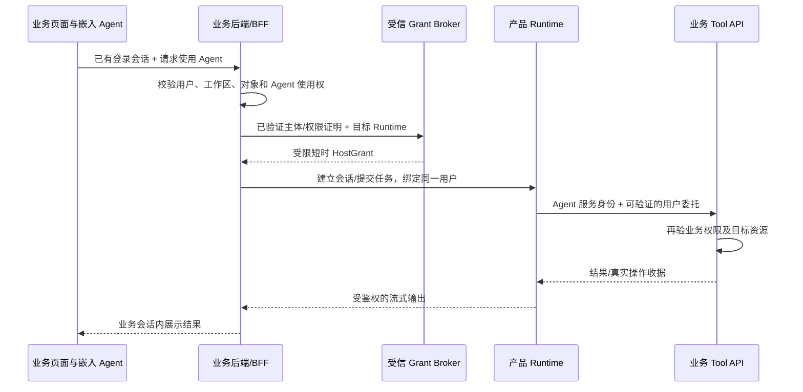

# Jorice 接入认证、凭据与 Plugin 管理补充设计 v1.4

日期：2026-10-20。状态：待评审设计草案；属于完整平台的必需设计范围，未批准实施。
配套：[平台总体设计](2026-10-19-runtime-platform-design.md)。本轮仅修改设计文档，没有修改代码、配置、数据库或服务。
嵌入交互、任务交接、内容权限、长任务、环境晋级与产品退出详见[业务流程复核与功能补齐](2026-10-20-jorice-business-flow-review.md)；认证通过不等于这些用户流程已闭合。
前端 npm/Hook、公开 Key 与会话/控制凭据的区别、bootstrap 和精确 Tab/Task 绑定详见[前端 SDK 与运行绑定设计](2026-10-20-jorice-frontend-sdk-binding-design.md)。
本轮认证/Plugin 源码盘点基线：`cloud-agent@948b8a43`。历史部署/页面验收只引用既有记录，不代表本轮重新执行或对当前运行状态作出确认。

## 1. 补齐范围与现状

上一版描述了权限和扩展边界，但没有完整定义接入注册、认证授权、凭据、插件供应链和生命周期，不能据此直接实施生产管理平台。
本补充把认证/授权、产品/Runtime 信任、第三方凭据和 Plugin 管理设为独立工作包；Runtime 编辑/发布必须依赖相应前置能力。

| 当前基础 | 本轮核对结果 | 仍需新增 |
|---|---|---|
| Host Grant | core 合同、RS256/ES256 校验接口、issuer/audience/origin/resource/scope/expiry 绑定 | Jorice 接入注册、环境化信任配置、管理授权、密钥/撤销治理 |
| Host Grant Broker | 已有 RS256 签发、Host 登录/工作负载交换及 scope 上限求交；含 Trench 专用字段和 HMAC 兼容路径 | 多产品适配、标准工作负载身份、重放/轮换治理；不能直接复制为通用身份中心 |
| Host 出站凭据 | HostWorkloadCredentialResolverPort 与 ConfiguredHmacHostCredentialResolver 有界兼容实现 | 生产部署的 workload/OAuth/mTLS adapter 及可验证用户委托；Port 存在不等于已完成生产凭据接通 |
| Runtime 管理认证 | PlatformOperatorAuthorizer 与静态 Token 实现；与普通 HostGrant 分开 | 外部 OIDC/服务身份、产品/环境/动作级管理授权和真实操作人审计 |
| MCP 凭据 | 已有 AES-GCM、SecretStore、作用域/endpoint 绑定、加密版本、publish/revoke 和逐次受控释放 | 连接认证完整 UI、OAuth 授权码交换/刷新、跨阶段一致性和运营管理 |
| Cloud Plugin | v0.2 Skill/MCP 组合包、包/manifest 双摘要、安装/CAS/组件绑定、Turn 快照、Worker 恢复和管理 HTTP 源码 | Jorice 管理面、产品级绑定、发布者信任、完整升级/卸载/撤销、依赖和回收治理 |
| 既有验收 | CLOUD_PLUGINS/PROGRESS 记录本地安装启停 UI、真实页面 Run/Skill 读取及其他分阶段验收 | 本轮未复跑；某次快照含 MCP 不证明远端 MCP 调用、OAuth 或全部恢复验收 |

旧 ADR-014 与 plugin_manifest.schema.json 的 Locked/v0.1 说明不是当前 Cloud Plugin 实现全貌。
当前 v0.2 合同在 plugin_packages.py/plugin_installations.py；不能用旧 JSON schema 代替当前包规范。
当前 Plugin 复用 Skill/MCP，不具备完整的任意 Python/JS 原生业务脚本执行面；原生脚本桥仍按总体方案另行建设。
MCP auth_mode 枚举包含 oauth 也不代表 OAuth 已实现；当前 McpCredentialManagement 明确拒绝直接以 token provision 模拟 OAuth 授权交换。

## 2. 五条身份与授权链

认证说明主体是谁，授权决定该主体此刻可执行什么动作；两者分开记录，登录成功不自动授予产品或生产权限。

| 链路 | 凭据与身份 | 校验方/权威 | 允许范围 |
|---|---|---|---|
| 人 → Jorice | 外部 IdP 的 OIDC 登录，主体以 issuer+subject 标识 | Jorice BFF 验证；身份与 MFA 属于 IdP | 管理权限由 Jorice 产品/环境角色绑定决定 |
| Jorice → Runtime | 有目标 audience 和权限范围的短时服务/委托管理令牌 | Runtime 管理入口验证，目标本地 trust/Policy 执行 | 仅声明的产品、环境和管理动作；不能用普通 agent.run 冒充 |
| 业务 Host → Runtime | Host 用户会话/工作负载交换出的签名 HostGrant | 受信 Broker/Host 签发，Runtime 验证并收窄 | principal/workspace/resource/namespace/技术预算与作用域 |
| Runtime → Host 业务接口 | workload identity、mTLS 或受控短时业务凭据 | Host 校验；Credential/Egress Gateway 负责释放 | 当前调用的 audience、资源和 scope，不转发入站 Token |
| Runtime/Plugin → 第三方服务 | 同一 scope/连接/账号绑定的 API key、Bearer 或 OAuth | 目标侧 Credential Gateway + 第三方资源服务 | 该连接已授权能力；Plugin 不拥有可导出的长期凭据 |

部署控制器访问基础设施还需独立身份：按目标主机/集群/namespace 的部署权限，不与产品业务读写权限混用。
Jorice 不实现密码、MFA 或用户目录；它保存外部主体引用与平台角色/资源绑定。业务产品仍拥有其用户、组织和业务 RBAC。
ID token 用于登录验证，不能作为 Runtime 管理或业务资源的 access token。
这些链路不复用万能管理员 Token；audience、签发者、scope 和资源绑定均不可从浏览器请求中直接信任。

### 2.1 嵌入业务 UI 的用户身份贯通：核心接入场景

用户需求是：Agent 嵌入业务页面，业务登录后即可使用 Agent；Agent 识别同一个业务用户和工作区，并按该用户的业务权限执行。
这条链路同时包含“用户可使用哪个 Agent”“Agent 可代表该用户做什么”与“业务接口如何再次验证该委托”，不能只完成 Jorice 管理员登录或服务间鉴权。
业务身份是根来源，Agent 不要求用户另注册一个账号。Agent 自己的 workload 身份表明哪个服务在调用，委托主体表明它代表哪个用户，两者都要验证。

推荐接入流程（路径名为设计语义，不是现有统一 API）：

1. 用户按业务原流程登录；业务后端/IdP 建立和校验自己的会话，兼容 Cookie Session、JWT/OIDC 等已有方式。
2. 嵌入式 Agent SDK 携带公开接入 Key/契约版本向同源业务 BFF 请求 bootstrap；Key 仅定位产品环境/前端应用，BFF 校验当前用户、工作区成员关系、业务对象权限、可使用的 Agent 和技术上限。
3. BFF 以受信服务身份请求 HostGrant 交换；Broker 通过受信 Host 身份证明或服务器回查核验用户授权，取请求权限与业务当前权限上限的交集。
4. BFF 将短时、限定 Runtime audience 的 Grant 交给目标 Runtime，另按 Client 合同建立 Client Session/Run Binding；浏览器只拿当前 Tab 的临时 Client 会话配置/凭据和受控引用，不拿 HostGrant、服务身份或长期 Secret。
5. 后续发消息、SSE 重连、历史/产物读取、取消、审批和 Plugin 设置都通过 BFF 当前会话鉴权并核对既有绑定，不能仅凭 conversation_id 放行。
6. Runtime 调用业务 Tool 时，网关检查 Task 的用户/工作区/资源及新鲜授权，取得面向该业务接口的受限委托凭据；业务接口再次检查主体与行/对象级权限。

浏览器只提出操作和对象选择，不能自己声明 subject/tenant/scopes；BFF 不能只把 user_id 转签，必须基于真实会话和当前业务权限核验。
下游只校验 Agent 服务账号仍不够：凭据或受信网关证明必须让业务接口可靠恢复同一业务用户/工作区/资源权限，再按当前业务规则判定。
当前配置 HMAC 出站 adapter 证明的是受限服务调用来源，不自动证明同一业务用户；生产上线必须将受信用户委托一并接到 Host 校验，并验证实际部署的凭据发行/轮换/撤销，不能只凭 resolver Port 已有就通过门禁。
不用邮箱/显示名猜测跨系统身份；以外部 issuer/subject 与业务服务器提供的稳定 principal 映射，连同 Host app/namespace/workspace 固定。
旧 HostGrant 使用严格 schema，不能随意增加 sid/act 等字段；需要新委托声明时显式版本化合同，或保存在可信 BFF/Runtime 绑定中并由受信 adapter 引用。

### 2.2 BFF、嵌入组件与 Jorice 的职责

默认采用同源 BFF 代理，避免浏览器持有 Runtime/第三方长期凭据；Cookie 保留在业务认证边界，普通业务 access token 不直接当作 Runtime 管理令牌或跨 audience 转发。
SSE 通过 BFF fetch/代理流式转发，连接和重连都核对当前主体与绑定；不把 bearer token 放在 URL、日志、模型或 SDK 持久存储中。
若采用跨域 iframe，由宿主页面/BFF 建立限定 origin、单次握手和会话绑定的通信；不依赖第三方 Cookie 自动同步，不通过任意 postMessage 传递业务 Cookie。
若业务提供方和 Runtime 分别接同一 OIDC IdP，SSO 可复用登录状态，但仍需验证目标 audience、业务成员关系与资源权限；SSO 本身不是完整的业务授权贯通。

Jorice 负责登记/版本化 EmbeddedAgentAuthProfile 与接入验证，profile 属于产品 Runtime 的 security/transport 配置，而不是 Jorice 管理员权限。
profile 至少声明：Host app 与目标 Runtime、业务认证 adapter、issuer/audience、主体/工作区映射、服务端权限来源、允许 Agent/资源、BFF/嵌入 origin、Grant TTL、续期与退出/委托策略。
原始 Cookie、Token、服务私钥不进入 profile/Bundle。业务认证 adapter 部署在业务 BFF 或受信身份边界，Runtime 只消费已验证授权和稳定绑定，不直接访问各产品用户数据库。
SDK 提供会话初始化、发送/流式、身份/工作区变化清理和授权失效状态接口；浏览器提供的用户信息只供显示，不赋权。
公开 Integration Key 不等于认证令牌；Client Session Credential 认证 Tab 会话，Controller fence 控制某次 Run 的动作权，三者不能合并成一把共享前端 Secret。
前端能力优先复用既有 TS/React SDK、Client Profile/Effect 和澄清/审批合同；页面上下文、Controller、待办恢复与正式后端写入按业务流程补充 §2/§4 接通，不新建聊天框架。
这样产品可以保留已有认证系统；Jorice 复用 adapter 合同和配置，cloud-agent 复用 HostGrant/绑定/网关，而无需为每个产品维护一套 Agent 用户中心。

### 2.3 会话、权限变化与后台任务

Agent 会话绑定 Host app、issuer、principal、namespace/workspace、业务 conversation 和 Runtime/Task；读取/下载/重连等每条入口都校验对应关系。
切换用户或工作区时，前端关闭原流、清理隔离缓存并请求新绑定；服务端拒绝用新身份复用旧会话，不能仅在 UI 更换名称。
短时 Grant 过期时由 BFF 在业务会话与授权仍有效的前提下续期；新权限不得扩大原 Task 上限，需要扩大或新版本 pin 时按既有 successor Task 规则重新准入。
successor 的旧任务暂停/Effect 对账、当前授权下的上下文交接、conversation CAS 和新客户端绑定按业务流程补充 §3 执行，不能只替换 Task ID。
业务角色、成员关系、资源 ACL 的减少在后续敏感调用前由业务授权源和 Tool API 再验证；冻结 Task 能力不等于冻结用户永远有权访问的数据。

新嵌入接入 profile 建议默认 follow_business_session：退出/过期后立即停止新交互，BFF 不再交换令牌；任务后续调用受会话委托与撤销新鲜度检查约束。
需要关闭页面/登出后继续执行的任务显式选择 bounded_task_delegation，由业务 Policy 给出持续授权、时限和资源上限；账户禁用/安全撤销仍可阻断后续动作。
已有 Trench/v1 durable Task 可在登出后继续的语义保持兼容；不能把 UI 退出、JWT 到期、运行取消和远端已发请求撤回混为一件事。
profile 的会话跟随、续期、撤销通知/回查与 SDK 是待补齐能力；现有 JWT 验签和 TTL 不足以宣称即时退出联动已实现。
第三方 Plugin OAuth 是同一业务用户 scope 下的另一项连接授权：可复用已完成授权；没有授权时走专用连接流程，不把“业务已登录”视为自动获得第三方账号权限。

现有 Trench 的 cookie→受信 viewer 校验→HostGrant 交换及 login-once 委托可复用，但只是当前 Host adapter；通用业务认证、同源 SDK/BFF、会话策略与可验证下游用户委托需要分别盘点接通。
若保留 Broker 校验业务 Cookie 的兼容路径，只向配置固定的该 Host 验证端点转发，不向任意 Runtime/第三方扩散 Cookie。
标准 OAuth token exchange 可作为部分产品的接入 adapter；当前自定义 HostGrant /exchange 不因此被宣称符合 RFC 8693。

## 3. Jorice 管理员认证与授权

### 3.1 登录和会话

接入既有 Authelia 或兼容 OIDC IdP，使用 Authorization Code + PKCE；校验 issuer、签名、audience、时间、nonce 与 state。
redirect URI 精确登记。发现/JWKS 地址来自受信 IdP 配置，不跟随任意请求指定的 URL；未知 kid 可受限刷新，未知签发者拒绝。
BFF 完成 code 交换，浏览器只保存 Secure/HttpOnly 的会话 cookie，不将管理 access/refresh token 写入 localStorage、脚本包、模型上下文或日志。
写 API 校验 CSRF/Origin；角色撤销、会话过期、退出和 IdP 禁用按明确定义的会话/复核策略生效，不能仅隐藏按钮。
生产发布、信任变更、凭据替换与紧急撤销可要求 IdP step-up/MFA；具体要求是可审计的管理 Policy。

### 3.2 最小角色与资源权限

| 角色 | 主要权限 | 默认约束 |
|---|---|---|
| 平台安全管理员 | 身份接入、信任根、签发者/发布者撤销、应急停用 | 不能凭此自动读取产品业务数据或导出 Secret |
| 产品管理员 | 该产品接入、环境、允许能力与角色绑定 | 不能管理其他产品，不能赋予超过自身可授予范围的权限 |
| 集成开发者 | 修改开发环境 Runtime/脚本、导入候选 Plugin、试跑 | 无生产发布/全局信任权限 |
| 发布者 | 发布已通过门禁的精确 Bundle/Plugin digest | 权限限制到产品与环境；不能把待评审包直接标记为可信 |
| 运维人员 | 部署、观测、排空和回退 | 无凭据明文读取和任意业务操作权限 |
| 审计/观察者 | 读取所授权范围的元数据与脱敏证据 | 产物/业务内容另查其访问权限 |

实际授权绑定为 subject/group → action → product/environment/resource，按默认拒绝执行；角色名只是权限集合，不单独构成运行授权。
配置读写、部署、发布、Plugin 安装、启用、凭据设置、全局包信任和数据导出是不同动作。
服务账号也采用该资源授权模型；CI 只获得指定候选版本、环境、动作与有效期，不继承使用者所有产品权限。
管理请求记录原始操作人和执行服务身份；委托信息必须由受信签发方签名或服务端查证，不能信任任意 X-User/actor 请求字段。

## 4. 产品和 Runtime 接入认证管理

### 4.1 首次登记流程

1. 有权限的管理员创建产品、环境和 RuntimeTarget，登记预期 endpoint、部署身份、信任来源与外部 scope 映射。
2. 部署侧预置组织信任根或操作员批准的 enrollment 凭据；新目标没有“填写 URL 即成为受信 Runtime”的权限。
3. Jorice 生成短时、单次、限定目标的一次性登记 challenge；目标证明其受信身份和公钥持有，并报告合同版本/配置 schema。
4. 服务端对 challenge/目标/请求摘要作持久去重和 CAS，成功后建立 RuntimeTrustBinding；重放、过期、目标替换均拒绝。
5. 配置双向信任：Runtime 信任哪个管理 issuer/audience；Jorice 信任哪个目标证书/身份；分别记录环境和允许动作。
6. 进行只读认证探测与负向测试，再授权部署/发布；保存认证证据及配置 revision，不能用健康检查代替授权验收。

私有部署端点只能来自管理员批准的网络目标与 DNS/证书规则，发现/探测保留 SSRF、重定向、超时和响应大小限制。
Runtime 登记身份与其代表用户的业务 authority 分开；管理服务拥有部署权限不代表它可签发任意用户的 HostGrant。
首版采用外部 IdP/受信签发者提供的非对称短时 access token；mTLS 可进一步约束服务身份。静态 token 只保留为显式开发/应急模式，不作为默认生产授权方案。
Jorice 本身不默认成为 HostGrant 或管理令牌签发中心；需要专用 Broker 时，其部署、密钥和授权策略是独立信任边界。

### 4.2 信任对象与管理操作

| 对象 | 必须保存的非敏感信息 | 管理操作 |
|---|---|---|
| IdentityProviderBinding | issuer、client 引用、回调集合、subject/group 映射、会话策略、revision | 登记、验证、停用、迁移 |
| RuntimeTrustBinding | product/environment/target、管理 issuer/audience、目标身份、公钥/证书引用、动作上限 | 登记、激活、轮换、隔离、撤销 |
| HostAuthorityBinding | Host app、issuer/JWKS/audience/origin、外部 scope 映射、允许资源与技术上限 | 接入、测试、授权收紧、密钥轮换、禁用 |
| ServicePrincipalBinding | 外部服务主体、允许的产品/环境/操作、有效期、委托规则 | 授权、到期、轮换、撤销 |
| CredentialProviderBinding | Secret 服务/密钥句柄引用、目标环境、使用策略、轮换元数据 | 健康检查、轮换、停用；无明文读取接口 |

这些对象属于 Jorice 的管理意图/授权配置与目标确认记录；Runtime 的有效 trust/Policy 保存在目标侧，不能读取 Jorice 数据库作为逐次授权事实。
管理密钥轮换允许有界重叠；旧 kid 到期/撤销后停止接受，新版本仍保持 issuer/audience 和资源约束。
key id 或 issuer 字符串不是可信证明；公钥必须通过已受信配置取得，禁止任意 jku/x5u 导向外部密钥。
nonce/jti 的存在不自动证明防重放；登记 challenge/一次性断言需持久使用记录，发布命令另用幂等键与 revision 防止重复执行。

### 4.3 Host 接入、任务授权与撤销

Host 注册、连接器登记、产品启用、Task 获得能力和某次写入获批是独立决策。
延续 HostGrant 校验与权限求交；namespace/principal/workspace/资源均来自验证结果与服务器绑定，不采用请求体中的同名字段作为身份。
现有 Trench Broker 的专用 viewer/资源映射留在 Host adapter；Jorice 通过公开接入合同配置，不把 Trench 字段写进通用管理模型。
扩展自助管理继续使用真实 HostGrant 的 extensions.read/manage；Jorice 产品级管理走独立的目标管理授权入口，不能构造伪 VerifiedHostGrant 或虚拟用户 scope。

授权撤销策略分为会话、服务身份、Host trust、任务权限、Plugin/包和第三方凭据；UI 必须说明影响范围和已确认目标。
短时 JWT 验签不等于即时撤销。拟新增目标侧持久 trust/revocation revision 与逐次复核，不能把现有 expiry 校验宣传为全局即时退出。
建议生产撤销状态最大允许陈旧时间 60 秒，作为目标合同可收紧参数；敏感写在 dispatch 前向权威源重新核验，超过新鲜度上限即暂停/拒绝。
该数值是待实现设计目标；传播只读缓存、签名令牌 TTL、网络故障和时钟偏差共同纳入验收，不假设事件通知永不丢失。
浏览器登出终止新会话操作；已接受长任务是否继续由独立的任务委托有效期/策略决定。账户禁用/安全撤销可阻断后续调用，不承诺撤回已发出的远端写入。

## 5. 第三方认证、凭据与密钥生命周期

### 5.1 归属与数据模型

Jorice 提供认证入口、状态和流程编排；目标 Runtime 的 Credential Gateway/SecretStore 持有或使用密钥，Plugin 和脚本只得到受控能力。
管理 Token、HostGrant、下游业务凭据、第三方 OAuth token 和包签名密钥分别隔离，不跨 audience 透传，不借用其他用户/产品的管理员凭据。

| 记录 | 核心绑定 | 保存位置 |
|---|---|---|
| AuthConnection | product/environment/issuer/namespace/principal/workspace、provider、账号标识、endpoint、scope、配置 revision | 目标连接元数据；Jorice 保存经授权的状态投影 |
| CredentialBinding | 连接、主体、目标 audience、scope 上限、Secret 引用与版本、有效期 | 目标凭据存储/外部 Secret 服务 |
| AuthorizationFlow | flow_id、发起人、目标连接、PKCE/state/nonce 绑定、过期/单次消费状态 | 可信回调服务；敏感字段加密且短时保留 |
| CredentialAudit | 谁/何时/为什么 provision、轮换、撤销及使用结果码 | 审计元数据；不含 code、access/refresh token 或原始授权头 |

Secret 经过认证加密后存储，密钥与密文分离；密钥句柄、版本、轮换与备份恢复纳入运维，不能只备份数据库而丢失解密能力。
敏感值允许用户经专用 TLS/BFF 提交或外部 Secret 引用导入，只写不回显；认证状态接口绝不提供“读取凭据明文”。

### 5.2 API key / Bearer

选择目标连接 → 校验用户/管理权限 → 安全提交或引用 Secret → 目标加密存储并 CAS 发布新引用 → 可选受控认证探测 → 刷新目录/绑定。
已 provisioned、authenticated、catalog_verified、enabled、granted 分开展示；有密钥不等于密钥有效，有目录不等于当前 Task 已选择。
替换 endpoint、账号或认证方式时旧绑定失效；撤销原子更新连接 revision/认证状态并停止后续释放。现有 MCP publish/revoke 可复用。
Token 不进入模型、环境镜像、Artifact、包、前端持久存储或错误栈；仅在可信网关发送请求前短时释放。

### 5.3 OAuth 授权与刷新

由目标 Credential Gateway 或受委托专用服务处理回调，Jorice UI 只发起和展示流程；不把回调 code 经普通聊天或脚本执行链转发。
明确 provider/client/目标资源和回调白名单；使用授权码与 PKCE，绑定发起主体、产品、环境、连接、state 和期限。
回调验证 state/issuer/回调地址及当前主体权限，单次消费 flow，服务端交换 token，核验提供方可获得的账号/scope/audience 信息后加密发布。
请求 scope 与实际授予 scope 分别记录；未授予的能力不得启用。取消、拒绝、过期、scope 不足分别展示，不能全部记作连接成功。
按连接序列化 refresh，防止多个 Worker 消费同一 refresh token；新值加密原子写入，遵守 provider 的轮换/复用检测合同。
invalid_grant、撤销或无法安全续期时进入 reauth_required；不能回退到系统管理员 Token，不能把用户重新授权伪装成自动刷新。
回调/授权端点与资源端点检查沿用 egress/SSRF 和 TLS 验证；授权期间增加的权限、账户变更需重新同意与绑定。

### 5.4 冻结快照与 Token 轮换的相容性

当前 MCP 路径固定 credential_ref/revision，配置改变后拒绝旧绑定；这属于已有行为，不支持直接注入 OAuth token 作为替代。
现有 v1 API key 替换遵守该规则，按其已有后续 Turn/重绑定机制恢复，不偷偷替换正在执行的连接。
Jorice v2 Bundle 管理的 Task 若需要新逻辑连接/包 pin，则按第8节重新准入新 Task；不能仅因为出现新 Turn 就改变该 Task 的冻结闭包。
OAuth 工作包新增 CredentialLease 合同：Task 固定账号/endpoint/audience/scope/逻辑授权绑定，可信网关可获取该绑定下最新有效的短时 material revision。
自动 refresh 仅能更新同一逻辑授权中的 token material，不允许改变账号、endpoint、目标资源或扩展 scope；改变这些内容必须生成新授权绑定，v2 任务重新准入新 Task。
旧快照保留旧解释，v2 连接显式声明支持 lease；每次释放、后续 SDK/工具发送前检查 scope、租约、撤销与有效期，不将 token 缓存在插件实例中跨操作使用。
释放成功后的远端请求不能被事后撤销；已发出的写入结果未知时使用 Effect reconcile，不自动重试。

## 6. Plugin 的产品定义和支持矩阵

Plugin 是版本化分发与组合单元，可以包含 Skill、工具、MCP、原生脚本、Hook/上下文/验证器及配置声明，但每类都必须有实际执行 adapter。
“原生/附加”是 ProductCapabilityBinding 的角色，Plugin 是包类型；同一个包在 A 产品可必需，在 B 产品可选。

| 组件类型 | 当前 cloud-agent 基础 | Jorice 交付要求 |
|---|---|---|
| Skill bundle | 现有 v0.2 组合、内容完整性、publication/install/读取路径 | 目录、配置、审阅、安装及产品绑定 UI |
| HTTP MCP | 现有连接槽、catalog pin、凭据与执行授权；无完整通用 OAuth 流程 | 连接配置/认证、实际就绪状态、目录差异与风险预览 |
| 原生业务脚本 | 总体方案的新增隔离执行合同 | 按 Tool/Context/Step/Verifier 逐类实现后才能发布 |
| 自定义 Hook/运行组件 | 有部分合同，不能据此宣称任意插件代码已可执行 | 相应 adapter、权限、超时、失败策略和恢复验收 |
| stdio/任意可执行程序 | 历史 manifest 可描述，不等于 Cloud v0.2 支持 | 首版不开放宿主进程执行；后续隔离 adapter 单独验收 |

基础包不包含用户 Token、固定生产连接、任意安装命令或数据库权限；MCP 使用逻辑 connection_slot，由产品/用户在目标 scope 内绑定。
Runtime descriptor 必须说明支持哪些包/组件/schema/SDK 版本；不支持的类型阻止安装或发布，不能只在前端显示可安装。
Skill 正文/插件 metadata/工具输出仍按来源处理，包被信任发布不使其模型输出成为系统授权或执行成功证据。

## 7. Plugin 来源、发布与信任管理

### 7.1 目录与供应链

首版内部 Catalog，沿用管理员允许的完整 package_digest 与只读包源；企业内部分发先做实，不自动扩展为任意公共 Marketplace。
候选包可由后台上传、Git 固定提交或受控 Registry 导入；下载源必须经过批准，不克隆后执行仓库脚本或动态安装包管理器 lifecycle。
代码构建确有依赖时只在隔离 Build Job 中安装经过锁定的依赖；“安装 Plugin”只登记和物化经过验证的产物。
包的 manifest_digest、完整内容 package_digest、对象 receipt/version 和构建镜像 digest 分开保存；JSON 重复键、路径逃逸、软链接、解压超限和重名拒绝。
publisher 字符串、signature 字段存在或 HTTPS 下载成功都不构成可信发布者证明。
外部发布者接入需 TrustedPublisher/SigningKey 记录，验证签名覆盖的包 digest 与发布者/环境策略；未通过的包只可留作隔离候选。
首版可以继续使用管理员明确批准 digest 的内部信任；不能把它描述为已具备第三方签名信任链。
保留来源、构建锁文件、SBOM/扫描结果与评测证据；证据必须对应确切 digest，按发布 Policy 判断是否可用，不用浏览器传来的 passed 替代。

### 7.2 三组独立状态

| 状态域 | 状态/事实 | 权威 |
|---|---|---|
| 包版本 | candidate、validated、trusted、quarantined、revoked、deprecated | Jorice Catalog/可信发布流程；目标复核包信任与拒绝列表 |
| 安装配置 | 安装 ID/revision、包 pin、组件绑定、enabled、readiness | 目标 Runtime 安装管理；Jorice 保存操作与确认投影 |
| 执行授权 | 某 Task/Turn 的 Granted，以及某次调用的 Approved/Policy decision | 目标执行快照与审批/Event Store |

Available → Installed → Enabled → Granted → Approved 表达五层决策，不把 Granted/Approved 写成插件全局永久状态。
认证状态另有 not_required/pending/ready/expired/revoked/reauth_required，不能混成一个 enabled 开关。
插件详情展示每个组件的已安装/启用/认证/目录/任务选择状态与失败原因；不能仅凭安装记录显示“全部可用”。

## 8. Plugin 管理操作办法

| 操作 | 前置条件和执行方式 | 对已有任务的影响 |
|---|---|---|
| 发布包 | 可信来源、内容 pin、组件兼容/评测、发布权限；版本不可变 | 不自动更新任何安装或 Task |
| 安装 | 操作 scope 有权；先预览组件/权限/网络/依赖；保存安装和精确绑定，默认 disabled | 不授予当前 Task 能力 |
| 配置/认证 | 参数按 schema；MCP slot 绑定同 scope 连接；认证另走第5节 | 变更若超出冻结合同，旧绑定停止；v2 新逻辑绑定需新 Task，单纯 lease material 刷新按第5节 |
| 启用 | 必需组件完整、ready、信任有效、权限检查通过，CAS 更新 | 新准入可选；不向当前任务自动加能力 |
| 升级/重新绑定 | 固定新 digest，展示组件/schema/scope 差异，重验依赖、凭据与评测，再 CAS 切换 | 原生/Bundle 内组件先生成新 Bundle/AgentVersion 并经 Release，仅新 Task 生效；附加组件的新 pin 也不得越过 v2 Task 原精确闭包 |
| 回退 | 指定仍可信的旧版本，经兼容性/依赖/连接验证，形成新 revision | 不复活撤销授权，不重写历史快照 |
| 禁用 | 目标立即确认 disabled revision，逐次调用复核 | 经该 Plugin 来源准入的后续调用拒绝；已发远端请求无法撤回 |
| 包撤销/隔离 | product/environment 或全局包 digest/发布者范围，传播到目标并收集确认 | 停止新准入及后续危险调用，必要时暂停任务；回退不得选择已撤销包 |
| 卸载 | 先禁用、检查活跃引用，移除安装可用关系，保留必要历史证据 | 不直接删除共享 Skill/MCP/凭据或正在恢复的包 |
| 对象回收 | 安装/Task/Turn/Bundle/Artifact 引用对账、保留期和对象版本条件删除 | 被引用的不可变包不能回收；失败可重试且不误删共享对象 |

同幂等键/同请求复用原结果；同键不同包或绑定返回冲突。更新要求 expected_revision，全过程记录 actor、来源、请求摘要和操作结果。
冻结粒度明确为：Jorice v2 Task 固定 Bundle 与其准入的原生/附加精确组件集合；后续 Turn 只能在该集合内进一步选择或收紧。
需要新包 digest、组件身份或逻辑连接绑定时，显式创建/重新准入 successor Task，校验新授权并固定新快照；保留产品会话关联，不在运行中的原 Task 偷换包。
旧 v1 扩展按 Turn 取安装 revision 的兼容行为保持原样，包括受支持的同 ID 升级；不得把它推导为 v2 Task 可绕过 Bundle 发布。新鲜禁用/撤销仍可拒绝旧绑定。
所有必要组件验证完成后再提交可用安装，跨步骤构建失败不得留下半启用状态；现有受管 Skill 自动安装能力可复用，但不得泄漏为未准入的直接能力。
插件禁用不连带关闭共享底层组件；如果某组件已在同一 Turn 经独立直接来源准入，该来源可按其原授权继续。
来源关系在 snapshot 固定，禁用后不得临时寻找别的插件/直接来源绕过；不能把禁用解释为“仅影响新任务”。
卸载和删除历史不同。现有 API 支持安装/读取/PATCH 等基础操作，不把尚无完整执行链的卸载、跨目标撤销、引用 GC 描述成已实现。

## 9. 依赖、冲突、继承与运行限制

首版依赖全部使用精确版本/digest，做依赖闭包、拓扑排序和循环/缺项检查，不引入自动 SemVer 求解器或静默升级。
同名工具/组件使用稳定 namespace；同一运行域无法消歧或合同冲突则拒绝，禁止后安装覆盖前安装。
新增 scope、网络域、代码类型或高风险写工具视为权限变化，需要按产品发布/授权 Policy 重新审阅；自动更新不可扩大授权。
原生必需 Plugin 被撤销或缺失时，该产品相关能力拒绝准入并报告降级/阻断，不让 Agent 自行补装一个相似包。
子 Agent 继承必须显式固定包、组件、资源和权限子集；当前未验收的 Plugin researcher 继承保持关闭。
每次工具/SDK 操作验证真实 Task、Turn、Lease、包来源、当前安装与授权；嵌套调用也计入预算和审批，不复用过期秘密。
Worker/脚本崩溃按既有 Event/Effect 恢复；安装管理记录和包签名不构成业务写入收据，不执行第二套任务账本。

## 10. Jorice/cloud-agent 的管理边界与分发

Jorice 管理 Catalog、发布者、候选包、产品原生/附加策略和安装/升级/撤销操作的期望状态。
目标 cloud-agent 校验本地管理授权、包 pin、scope、安装配置、凭据和实际能力，拥有本地生效配置及执行授权事实。
Jorice 可使用现有 HostGrant 端点服务真实用户自助管理；产品级平台操作需新增独立管理入口/授权适配，不能以服务账号默认冒充业务用户。
包采用内容寻址/版本化产物传输，目标在信任策略与摘要校验后物化到已有 Artifact/Publication 路径；Jorice 不能写目标数据库或绕过发布者 allowlist。
已有只读 bundle_root + allowed_digests 是内部可信源适配器；正式远程受控分发需扩展公开管理合同，不能让客户端提交服务器本地路径。
跨平台/目标不使用数据库分布式事务。准备、授权、安装/激活分别有 operation_id、CAS、幂等和对账状态，目标失败后 Jorice 不能显示 active。
事件通知用于加速；丢失后通过带游标/目标 revision 查询对账。重启、响应丢失或乱序事件不能使旧安装覆盖新安装。
平台不可用时目标使用已固定包与有效授权运行；安全撤销/凭据新鲜度按合同超时阻断，不能无限使用最后一次允许结果。

## 11. 后台页面、接口与运营要求

| 模块 | 页面与服务端动作 |
|---|---|
| 身份与权限 | OIDC 接入、平台角色/资源授权、服务账号、会话与 step-up 策略、审计 |
| 产品接入中心 | Host/Runtime 登记向导、challenge、trust 激活、scope 映射、负向验证、密钥轮换 |
| 嵌入式 Agent 认证 | EmbeddedAgentAuthProfile、业务会话/权限 adapter、SDK/BFF 接入、用户/工作区切换、续期/退出和任务委托策略 |
| 凭据连接中心 | Provider/连接、认证状态、API key 设置、OAuth 跳转/回调状态、续期、撤销、重新授权 |
| Plugin Catalog | 包来源、publisher/digest、组件、依赖、权限/网络预览、风险与评测、版本、隔离/撤销 |
| 已安装 Plugin | scope、版本、原生/附加角色、组件 readiness、认证入口、启停、升级/回退、卸载与引用 |
| 安全与运维 | 撤销传播确认、失败重试/对账、使用审计、密钥健康/恢复、包引用和回收预演 |

所有动作经 Jorice 服务端及目标两次按职责授权；搜索、列表、导出、流式事件和错误详情也执行 product/scope 过滤。
凭据设置页只写不回显；普通详情显示账号的安全标识、授予 scope、有效期和认证错误码。内部 digest/installation ID 供诊断，不迫使普通用户手工填写。
Catalog 使用签名/摘要确认来源；无需安装才能浏览，但可见性也受产品与 publisher Policy 限制。
不存在或无权的资源按既有防枚举规则返回；不在错误响应中暴露其他 scope 的账号、包路径、密文或 Token。
未来管理 API 的精确 URL 由 OpenAPI 合同确定；本设计定义必需语义操作，不假称当前已提供这些接口。

## 12. 审计、事件和灾难恢复

必记事件：登录/会话与权限变化、产品/Runtime 信任创建和轮换、管理发布、包信任/安装/启停/撤销、凭据设置/轮换/撤销/认证失败、目标确认与异常绕过尝试。
审计记录 actor/service/delegation、product/environment/scope、对象 revision/digest、请求/operation ID、原因与结果；不写 access token、refresh token、code、PKCE verifier、Cookie 或授权头。
Jorice 的管理审计与目标的安全/执行审计用关联 ID 对账，各自持久保存；事件总线或 Redis 不是唯一事实来源。
受保护配置写入与必要审计在同一局部事务/可靠 outbox 内落库；审计持久化失败则不确认该管理写成功。异步投递失败可恢复。
分别备份 Jorice 元数据、目标运行库、不可变包/对象版本及密钥恢复材料；恢复时校验 scope、摘要、撤销 revision 和包引用，不能复活已撤销凭据/包。
应急入口是预置且可审计的受限运维身份，不能在 OIDC/授权服务失效后自动启用通用静态管理员 Token。
Secret 销毁与包回收分开；执行历史可保留非敏感元数据，数据保留/注销操作必须有目标资源所有者授权。
产品停止接入、解除 Jorice 管理、归档与彻底销毁是不同操作；相应授权撤销、触发器停用、在途处理与共享资源保护按业务流程补充 §9 完成。

## 13. 实施顺序、复用与验收

这些是待登记的设计工作包，不激活旧 Locked 任务、不修改任务状态；批准后按 Ready/Owner/Owned paths 分开实施。

| 工作包 | 顺序与复用 | 必需退出标准 |
|---|---|---|
| H1 身份/授权合同 | 先于真实远程管理；复用 PlatformOperatorAuthorizer，接外部 IdP | 浏览器会话、CSRF、产品/环境权限、委托身份与负向授权测试 |
| H2 产品/Runtime 信任 | 依赖 H1；复用 HostGrant/HostAuthority/连接器、扩展管理授权 | 单次登记、双向目标绑定、签发/轮换/撤销、跨产品/环境/受众拒绝 |
| H2E 嵌入身份贯通 | 依赖 H2；业务认证 adapter、BFF/SDK 会话、用户委托 Tool 凭据与 profile | 业务登录一次，Agent 同主体/工作区；业务接口核验用户权限，续期/切换/退出/后台任务边界真实可测 |
| H3 API key 凭据管理 | 依赖 H1/H2；复用加密 Store/provision/revoke/release | 安全设置/UI、密钥轮换、endpoint 绑定、逐次释放、无秘密泄漏 |
| H4 OAuth 与 lease | 依赖 H3；新增 flow/PKCE/回调/refresh 序列化和 v2 lease | 回调重放/登录主体替换拒绝、实际授予 scope、刷新并发与失效后重新授权 |
| P1 Jorice Plugin 管理 | 依赖 H1/H2；复用 v0.2 包、现有 HTTP/CAS/snapshot/Worker | 真实后台安装、认证就绪、启停、升级/回退与目标确认；生产不读 mock |
| P2 信任与生命周期补齐 | 依赖 H2/P1；保留 digest allowlist，扩展审批/签名/撤销/引用 | 来源冒充拒绝、包篡改/冲突拒绝、可恢复卸载/GC、依赖与共享组件保护 |
| P3 联合验收 | 依赖 H3/P1，OAuth 场景依赖 H4 | 产品→Jorice/Host→Broker→Runtime→Plugin→真实受控服务的有鉴权闭环 |

总体方案 A/B 的合同盘点可并行细化，但执行发布/管理写入以 H1/H2 为前置；脚本执行与 P1/P2 共享包/授权合同。
嵌入业务 UI 的产品上线以 H2E 为必需前置，平台管理员能登录或 Runtime 可验签都不能替代这一验收。
Plugin 基础安装、启停、快照和恢复已存在，不重做另一套 Registry/Store/执行引擎；Jorice 重点补管理面与跨目标治理。
之前 14–25 人周未充分展开上述认证/Plugin 管理；20–36 人周、误差约 ±40% 是该范围去重后的阶段粗估，仍未逐项覆盖业务流程补充 J1–J6，不能作为完整平台总工期承诺。
估算含内部可信 Catalog、单 IdP、单引擎、一个 OAuth Provider 的完整适配；公共 Marketplace、多 IdP 联邦、多种第三方协议、任意不可信脚本发布者另行估算。

验收至少覆盖：

1. 同一登录主体可以管理获授权的产品 A 开发环境，但不能管理 A 生产环境/产品 B；服务委托不扩大权限。
2. 未登记 Runtime、伪 issuer/JWKS/audience、过期 challenge、重放断言与目标替换全部拒绝。
3. 密钥轮换不中断受支持合同内的正常调用；旧键撤销、账户禁用、撤销传播和断网超过新鲜度上限的行为可复现。
4. 浏览器退出与已接受任务的继续/取消按明确策略分别验证，不能用短时 JWT 宣称即时全局登出。
5. OAuth state/回调重放/错误账号绑定、scope 不足、两个 Worker 并发 refresh、invalid_grant 均有确定结果；无跨用户/环境凭据复用。
6. 已安装但未启用、认证未完成、catalog 过期、未被当前任务选择的 Plugin 不被错误显示为可执行。
7. 同一组件有 Plugin 与独立来源时，禁用 Plugin 只影响固定来源；不能临时寻找其他来源绕过。
8. 升级/CAS 冲突、重复请求、目标超时、进程重启不产生半启用安装、重复写入或历史版本漂移。
9. 包/发布者撤销影响新准入和后续调用；已发远端请求保留真实结果，不伪造回滚成功。
10. 卸载不删除共享连接/凭据，GC 不删除仍被 Task/Turn/Bundle 引用的对象；备份恢复不复活撤销状态。
11. 用户 A 登录业务后可无第二次 Agent 登录完成自己数据的查询/操作；Agent 服务账号不能让 A 访问 B 的记录，改传 user_id/workspace/resource_id 不能越权。
12. 更换用户/工作区、恢复旧 Agent conversation、SSE 重连/产物下载、权限减少与业务登出均检查绑定；关闭页面后的任务只按显式委托策略继续。

## 14. 源码与标准依据

- [Host Grant 验证](../../../packages/agent-security/src/agent_security/host_grant.py)、[核心授权合同](../../../packages/agent-core/src/agent_core/domain/host_authority.py)、[现有管理鉴权](../../../apps/api/src/zebra_agent_api/platform_operator_auth.py)
- [Host 出站凭据 Port](../../../packages/agent-core/src/agent_core/ports/host_credential_resolver.py)、[当前有界 HMAC adapter](../../../packages/agent-integrations/src/agent_integrations/host_credentials.py)、[部署边界说明](../../../README.md)
- [Broker workload 验证](../../../apps/host_grant_broker/src/zebra_host_grant_broker/workload_auth.py)、[签发与业务 scope 求交](../../../apps/host_grant_broker/src/zebra_host_grant_broker/grant_minting.py)
- [业务会话校验 adapter](../../../apps/host_grant_broker/src/zebra_host_grant_broker/trench_session.py)、[现有交换入口](../../../apps/host_grant_broker/src/zebra_host_grant_broker/app.py)、[login-once 委托和边界记录](../../cloud-extension-agent-management.md)
- [MCP 凭据管理](../../../packages/agent-security/src/agent_security/mcp_credential_management.py)、[凭据合同](../../../packages/agent-core/src/agent_core/domain/mcp_credentials.py)、[加密凭据设计与历史边界](../../cloud-mcp-credential-storage.md)
- [Plugin v0.2 包](../../../packages/agent-core/src/agent_core/domain/plugin_packages.py)、[安装 pin/绑定](../../../packages/agent-core/src/agent_core/domain/plugin_installations.py)、[安装用例](../../../packages/agent-core/src/agent_core/application/plugin_installations.py)
- [Plugin HTTP 管理](../../../apps/api/src/zebra_agent_api/plugin_installations.py)、[Worker 组合](../../../apps/worker/src/zebra_agent_worker/plugin_composition.py)、[开关与 digest 允许列表](../../../apps/config/src/zebra_agent_config/plugin_settings.py)
- [Plugin 实施和分阶段验收记录](../../CLOUD_PLUGINS.md)、[Plugin 实施计划](../plans/2026-10-19-cloud-plugin-adoption.md)、[项目进展](../../../PROGRESS.md)
- [ADR-012 外部身份/业务边界](../../ADR-012_Zebra_Agent_Runtime微服务与外部业务边界.md)、[ADR-014 扩展原则](../../ADR-014_扩展体系架构.md)、[历史扩展威胁模型](../../extension_threat_model.md)

OAuth/OIDC 的协议要求采用官方标准；本设计的角色、信任对象、撤销新鲜度和 Plugin 发布流程属于 Jorice 的设计选择，不由协议自动提供。
[OIDC Core](https://openid.net/specs/openid-connect-core-1_0.html)、[OAuth 安全 BCP：RFC 9700](https://www.rfc-editor.org/rfc/rfc9700.html)、[MCP 授权规范](https://modelcontextprotocol.io/specification/2025-11-25/basic/authorization)。
可选的标准委托交换参考 [RFC 8693](https://www.rfc-editor.org/rfc/rfc8693.html)；会话、业务资源授权和撤销仍须由本接入合同明确。

## 15. 逐操作授权与安全状态的可见性

这些是前述身份链落到接口的验收要求，不新增用户中心；统一通过当前受信身份、外部业务授权、目标 Policy 和精确绑定判定。

| 操作 | 必须验证的主体/权限 | 不可替代的边界 |
|---|---|---|
| Jorice 修改/构建/部署/发布 | 外部管理主体或受限 CI、产品/环境/动作权限、预期 revision | 产品开发权限不能隐式获得生产发布；构建身份无业务读写权 |
| 建立/恢复 conversation 或提交输入 | BFF 当前用户、Agent 使用权、Host/scope、原会话绑定、资源范围 | conversation_id 和历史 Token 不是登录凭据；新用户不能复用旧绑定 |
| 查询历史/搜索/流重连/下载 | 当前身份与对象/产物当前访问权，目标 deployment 与 Task 归属 | 只需读取时使用读 scope，不为下载补发 agent.run 或 extensions.manage |
| 回答澄清/批准动作/提交 Client Receipt | 指定可处理主体、当前交互 revision/摘要/期限，以及适用的 Controller/fence | 审批角色与浏览器控制角色按具体合同区分；批准不授予 Host 业务权限 |
| 取消/恢复/交接任务 | 任务管理权限、固定主体/工作区与当前授权、Task/交接 revision | 查看任务不自动有取消权；管理恢复不能扩大原 Task 闭包 |
| 安装/配置/启用 Plugin | 产品允许范围、当前目标 scope 的 extensions.manage 或新管理委托合同、安装 revision | Jorice 角色不能直接冒充某用户 HostGrant；现有 v1 API 不接受通用管理 Token 旁路 |
| 绑定/重新授权连接 | 连接所有者或受权管理员、准确账号/环境/endpoint、实际授予 scope | 安装者不一定是账号所有者；批准包来源不等于批准使用他人的账号 |
| Runtime/Plugin 执行业务调用 | workload 身份与固定用户委托、精确能力/资源、当前授权/撤销、必要审批与预算 | 服务身份、安装/enabled 或 OAuth 登录成功均不足以单独放行 |
| 信任/凭据撤销、数据导出/销毁 | 相应安全/资源所有者权限与影响范围 | 撤销包信任不等于授权读取产品数据；销毁产品不全局删共享凭据 |

现有 v1 所需 scope 逐接口盘点并保持兼容；新增细分读/取消/交接权限显式版本化，不因本表直接改变已发布 endpoint 的校验规则。
共享业务服务账号仅在业务明确允许时配置为服务连接，记录可使用的主体/资源与审计归属；不能把管理员个人账号默认为全产品通用连接。
个人 Plugin 安装仍绑定真实 principal/workspace；产品级策略只是允许范围，不伪造公共 principal 来共用安装或绕开现有 scope 隔离。
如需管理员代操作用户 scope，必须新增受限管理委托合同并保留原操作者/被委托主体，不能通过修改 user_id 或 X-User 实现。

安全状态视图必须显示身份来源、安全账号标识、授予/请求 scope、有效期、最后校验时间、需处理原因和获授权的下一步；不回显 Token 或完整断言。
连接拥有者、Plugin 安装者、运行发起人、审批人可能不同，UI 分别表达，审计保留关联关系，不用一个“当前用户”字段覆盖。
权限不足时只展示当前主体可知的原因；对其他用户的连接不泄露账号名和授权细节。

## 16. Plugin 从目录到可调用的判定与交互

### 16.1 三个不同问题

下表的 Task 精确闭包规则对应 Jorice v2；既有 v1 按 Turn 固定安装 revision 的兼容语义仍按 §8 保留，不隐式迁移。

| 判定 | 必须满足的条件 | 页面表达 |
|---|---|---|
| 可发现/可安装 | 目录可见、包来源可信、支持的合同/组件、产品允许范围与安装权限 | 说明包包含哪些组件、风险/依赖、需要的连接；不能显示成已可执行 |
| 可供新 Task 选择 | 精确安装版本/来源、enabled、依赖满足、连接认证/目录有效、产品绑定与准入上限允许 | 显示 ready 或具体阻断原因；必需原生绑定缺失时阻止相应产品新准入 |
| 当前 Task 可调用 | 原 Task 精确闭包/Turn 选择及来源匹配、当前未禁用/撤销、scope/资源/连接有效、Policy/审批/预算通过 | 区分未选择、需新任务、需认证、已禁用/撤销；不能仅凭全局 ready 放行 |

ready 是对当前范围和观察时点的判定，不是永久执行授权；MCP catalog 匹配也不能替代实际工具调用的权限与连通性验证。
原 Task 中没有的新组件/digest/逻辑连接，UI 引导受权交接或新建任务；不能以再次发送消息或重新加载页面注入。
原生是产品绑定角色，仍执行同样的信任与调用检查；紧急撤销必需包可以阻断产品运行，不能因“原生”跳过撤销。

### 16.2 用户可以走通的管理流程

1. 选择当前产品/环境与真实工作区，浏览受限 Catalog，查看组件、来源、权限、依赖、支持版本和所需账号。
2. 预览安装/升级差异，明确“安装到哪个 scope”“影响哪些新任务”；提交带幂等或 expected revision 的请求。
3. 安装默认 disabled；缺配置/认证时进入独立配置与连接流程，可取消/稍后继续，不将安装记录误记为失败或 ready。
4. 认证探测只调用批准的安全端点；有副作用的联通测试单独说明并授权。提供 Token 不隐含允许创建测试业务数据。
5. 依赖/认证/目录验证通过后，由有权主体显式启用并选择用途；后台展示目标确认的 revision 和观察时间。
6. 升级/回退展示组件、权限、依赖、连接与合同差异；扩大授权重新同意，旧 Task 不自动换版本，计划 pin 漂移需重绑定。
7. 禁用/撤销/卸载展示影响的安装、新/旧任务和共享引用；保留已产生事实，GC 完成单独确认。

OAuth 取消/拒绝、连接失效、安装被他人更新、目标离线和包被撤销均有可恢复界面；不通过删除安装记录来掩盖未完成清理。
不兼容/不支持的包在安装或发布前拒绝并说明原因；不先启用再等任务执行时发现类型未实现。
相关页面从产品作用域进入，保留可见的产品/环境/工作区切换；切换后清空旧范围缓存，提交仍由服务端核对，不能只换页面标题。

### 16.3 新鲜度、失联和轮换的验收

| 变化 | 必须验证的结果 |
|---|---|
| OIDC/业务退出或成员撤销 | 新交互失效、后台委托按明确策略处理；已有外部写入不伪造撤回 |
| 签发键轮换/撤销 | 合同允许的交叠期可用，撤销后按新鲜度阻断；未知 kid 不触发任意 URL 拉取 |
| 包/安装禁用或撤销 | 后续边界拒绝被撤销来源，保留历史证据，不临时换独立来源继续调用 |
| OAuth material 正常刷新 | 同一固定逻辑绑定内可续期，无账号/scope/endpoint 扩大，多个 Worker 不消费冲突 refresh |
| 账号/endpoint/授权 scope 改变 | 新逻辑绑定与新准入，不能只更新 material revision 覆盖旧 Task |
| Runtime/撤销服务失联 | 显示最后确认时间/未确认范围；超过安全新鲜度暂停，不把 Jorice 旧投影当作当前授权 |
| 备份恢复/时间偏差 | 验证当前 trust/revocation/时间有效性；不从旧缓存或旧快照恢复已失效授权 |

具体撤销传播上限沿用 §4 的目标合同，业务 ACL 和敏感写仍按对应权威源检查；不能由此推断已经发出的远端请求可在该时间内撤回。
