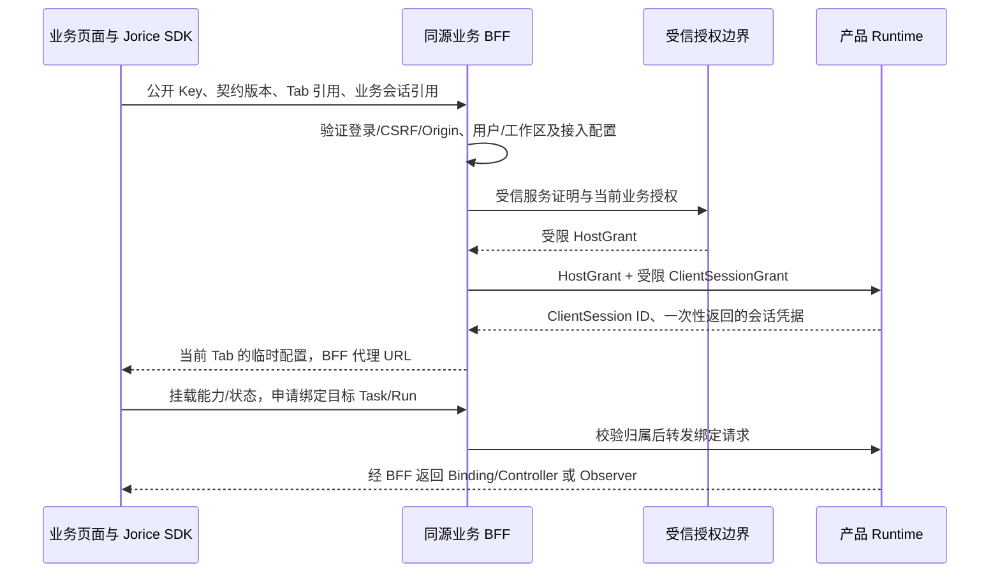

# Jorice 前端 npm SDK、接入 Key 与运行绑定设计 v1.0

日期：2026-10-20。状态：待评审设计提案，未批准实施；本轮仅修改文档。
配套：[Runtime 总体设计](2026-10-19-runtime-platform-design.md)、[认证与 Plugin 设计](2026-10-20-jorice-access-plugin-design.md)、[业务流程设计](2026-10-20-jorice-business-flow-review.md)。
本设计补齐开发者实际接入链：后台创建前端应用→取得公开接入 Key→引入 npm 包→Hook 注册→业务登录认证→绑定 Tab/Task→Agent 调用 UI。
源码核对基线：`cloud-agent@948b8a43`；现有代码能力与拟新增 Jorice API 分开说明，未运行 npm 发布、SDK 测试或业务验收。

## 1. 已有底座与本次缺口

| 事项 | 当前工作区代码 | Jorice 仍需补齐 |
|---|---|---|
| npm workspace | `@zebra-agent/react`、`@zebra-agent/client-core`、contracts/ui-contracts | 对产品开发者统一的初始化入口、接入指南和兼容发布流程 |
| React 注册 | ZebraAgentProvider、useZebraAction、useZebraReadable、HITL hooks | 公开 Key/业务会话 bootstrap、Profile/SDK 兼容校验与错误引导 |
| Client Session | ClientSessionGrant、会话凭据、Profile/Host 绑定、心跳 | 前端应用登记、受权 BFF 解析、稳定主体/工作区/Tab 关联和续接流程 |
| UI 执行 | 注册表、Client Effect、Receipt、Run Binding、Controller fence | 与 Jorice 接入配置/任务会话串联、接入测试和停用/轮换 |

仓库有 npm package manifest 不代表已公开发布或满足完整产品接入；不据此宣称 `npm install` 当前即可使用 Jorice。
Readable Hook 的存在也不证明值已完整进入模型上下文；值的采集、传输、授权过滤、版本与 Worker context 注入必须单独验收。

## 2. Key、会话凭据和控制权不能混为一物

需要一个方便开发者配置的公开接入 Key，但它只回答“接入哪个前端应用/产品环境”，不证明用户身份，也不授予 UI 控制权。

| 标识/凭据 | 谁生成/保存 | 用途与边界 |
|---|---|---|
| Publishable Integration Key，例如 `jpk_test_example` | Jorice 生成；可放前端构建配置 | 公开、不可当 Secret；解析 integration_id/product/environment/frontend_app_id，不能独立调用 Runtime 或申请控制权 |
| BFF 工作负载身份 | 业务部署登记并保存在服务端 | BFF 访问 Broker/Runtime；优先复用受信工作负载/mTLS/签名断言，不强制再发一把通用 ServerKey |
| HostGrant | 受信授权边界签发；BFF/目标验证 | 固定业务用户、工作区、资源与目标权限；不放进 npm 初始化参数或浏览器存储 |
| ClientSessionGrant | 受信 BFF 形成，目标在已验证 Host 上下文中校验 | 打开限定 app/Origin/profile/user 的 Client Session；不是另一把长期 API key，也不替代 HostGrant |
| Client Session Credential | 目标开会话时生成，只返回一次原始值；目标保留 hash | 形如 session_id:secret，认证该 Client Session；可经 BFF bootstrap 交给对应 Tab 内存使用，不能当全产品共享密钥 |
| Controller Fence | 目标在 Run 控制租约中生成/轮换 | 证明此刻该 Tab 是该 Run 的控制端；与会话凭据分开，不能写进日志/事件 |
| tab_handle / conversation_id | BFF 生成或验证，浏览器保留受控引用 | 定位 Tab/业务会话，不是授权；每次由当前登录会话及服务端绑定重新核对 |

真正能执行 UI 的条件是：已验证用户权限 ∩ 发布的前端能力 ∩ 当前 Task 允许范围 ∩ 实际挂载能力 ∩ 当前 Controller/有效 Effect。
同一前端应用/环境的用户可共用公开 Key；真实用户、工作区和获准 authority scope 由 BFF 根据业务会话确定，不为每个用户分发一把长期 Key。
Key 或 Origin 泄露不应让攻击者登录、读业务数据或调用 Hook；Origin 白名单/CORS 不能替代用户认证。
ClientSessionGrant 当前是严格领域输入，由受验证的 BFF/Host 通道承载；不把它无依据地描述成已有独立 JWT 协议，也不往 v1 严格 schema 私加 Jorice 字段。

## 3. 后台新增“前端应用接入”

### 3.1 登记对象

逻辑对象名为 FrontendIntegrationRegistration；由 Jorice 管理配置意图，目标确认已应用版本。独立于 Plugin 安装，也不以 Plugin API key 代替。

| 字段 | 约束 |
|---|---|
| integration_id、product_id、environment | 稳定 ID；公开 Key 不跨开发/测试/生产复用 |
| frontend_app_id、host_app_id、真实 authority scope 映射 | 显式绑定业务应用与授权来源，BFF 按真实会话选择获准范围；不生成虚构 tenant/user |
| deployment_id、允许的 Agent | 由受信服务解析到具体目标；不接受浏览器传入任意 Runtime URL |
| allowed_origins、BFF 接入配置 | 精确 Origin；同源 bootstrap/proxy，受信 BFF 身份引用和 CSRF 策略 |
| Published Profile/SDK/协议兼容矩阵 | 允许的精确 Profile revision/digest、能力合同和 SDK 范围；Task 仍固定自身 Profile |
| Key 状态/registration revision | 有效、轮换中、已停用；记录创建者、用途、观察时间、目标确认和撤销状态 |
| 会话/控制策略 | 业务主体/工作区映射、会话约束、Tab/Controller、续接、退出和速率上限 |

当前 ClientSessionGrant 只接受 HTTPS Origin；开发接入默认使用受信 HTTPS 测试来源。若需 HTTP localhost，必须以隔离的开发合同/adapter 明确实现，不能关闭生产 Origin/TLS 验证来兼容。

### 3.2 开发者在后台的步骤

1. 选择产品/环境/目标 Runtime，创建前端应用并绑定受信 Host/BFF，登记开发与生产 Origin 的各自配置。
2. 导入或维护能力契约清单：Readable/Action 名称、参数/结果 schema、风险/资源绑定、限制；审阅后发布不可变 Profile。
3. 将接入配置应用到目标，目标验证 Host/Frontend/Profile/合同后确认 revision；未确认不能显示“已接通”。
4. 生成该环境公开 Key，提供 npm 版本、Provider/Hook 示例、BFF 必需接口与服务端身份配置说明；不把服务私钥生成进前端示例。
5. 接入测试显示当前业务用户/工作区的获准标识、实际部署、Profile、Tab、挂载动作、Controller 和一次真实 UI Effect/Receipt。
6. 通过后发布业务前端；后台保留最后连接/测试时间、客户端版本分布和可见错误，不把页面在线等同于可以执行业务写入。

后台“生成 Key”只是登记链的一步。没有 BFF 登录校验或目标信任时，Key 仍不能建立有权限的 Client Session。
配置在目标/BFF 保存受控版本与安全新鲜度；运行时不向 Jorice 逐请求回查，Jorice 故障不切断已部署有效绑定。

## 4. npm 包与 Hook 的开发者接口

拟提供单一前端入口 `@jorice/react`，作为现有 Zebra SDK 的薄接入封装；包名/API 为设计提案，未创建、发布或确认 npm 名称可用。
复用 React hooks、client-core、contracts 和现有 HITL/UI；不另建聊天框架、Effect 引擎或一套领域状态机。
首次只适配 cloud-agent；将来新引擎通过已验收的客户端合同接入，不预先开发跨框架 SDK 家族。

下面是拟新增 API 的使用示意，不能直接当作当前可运行示例。`frontendCapabilities` 是业务构建携带的契约清单，不含处理函数和秘密。

```tsx
import { z } from "zod";
import {
  JoriceProvider,
  useJoriceAction,
  useJoriceReadable,
} from "@jorice/react";
import frontendCapabilities from "./jorice.capabilities.json";

function RecordPage({ record, openPanel }) {
  useJoriceReadable("record.current", {
    id: record.id,
    version: record.version,
  });
  useJoriceAction("record.open_panel", {
    parameters: z.object({ id: z.string() }),
    result: z.object({ opened: z.boolean() }),
    handler: ({ id }) => {
      openPanel(id);
      return { opened: true };
    },
  });
  return <div>{record.title}</div>;
}

function AgentEnabledPage({ conversationId, record, openPanel }) {
  return (
    <JoriceProvider
      publishableKey="jpk_test_example"
      bootstrapUrl="/api/jorice/bootstrap"
      capabilities={frontendCapabilities}
      conversationId={conversationId}
    >
      <RecordPage record={record} openPanel={openPanel} />
    </JoriceProvider>
  );
}
```

Provider 负责 bootstrap、版本核对、会话/Task 绑定、Hook mount、流/心跳、控制权、Receipt 和清理；业务登录仍由产品拥有。
Hook 名称和输入/结果合同必须匹配已发布 Profile，运行时注册只能收窄；SDK 不能因为见到新 Hook 就自动发布新能力或扩大权限。
契约可用现有 schema 工具在构建/CI 导出并导入草稿，避免重复维护；首版允许显式契约文件，不要求开发 React 源码分析器。
函数只保留在页面进程，不能把 handler 源码上传后交给 Runtime 执行；服务端只接收受限合同、挂载快照和获准状态。

Readable 值发送受限 schema/大小/敏感规则约束，带资源引用和 UI revision；BFF/Runtime 再过滤，不能上传整个状态 store/DOM。
Action 用于导航、筛选、展开、本地草稿/交互；正式业务写入仍走 Host Backend Tool，Client Receipt 只证明声明的 UI 动作结果。
Hook 是业务方代码，SDK 不承诺沙箱隔离其任意 JS 副作用；开发/发布审阅及业务 API 自身授权必须阻止在“低风险 UI Hook”里隐藏高风险写入。
重复同名注册按现有冲突语义拒绝，handler 闭包更新不改合同；卸载后不能继续宣称动作可用，协议/profile 冲突停止相关执行并明确报错。

### 4.1 初次挂载、SPA 路由和重新挂载

现有 `ensure_mount_narrows()` 不仅要求挂载是 Profile 子集，还禁止同一 Client Session 后续增加 Action/Readable；同一 UI revision 也不能描述不同快照。
首版 SDK 在初次 React 挂载中合并提交实际 Hook 集合，目标确认后才显示 ready；不能先发送空/部分挂载，再假设后续可任意补齐。
挂载后卸载只收窄，同集合下的值更新推进 UI revision；SPA 路由、延迟组件或卸载重挂需要增加已移除/未曾挂载的能力时，停止旧绑定并对账未决 Effect，重新开 Client Session 和 Run Binding。
新 Session 仍限于当前 Task 固定 Profile/能力上限，旧控制权须释放/失效后才可获得新 fence；超出 Task 闭包或更换 Profile 时按 successor Task 流程处理。
旧 Effect 不能改 session_id 直接重派；成功/失败/未知按原事实处理，符合条件的重新提案另建关联记录。
Strict Mode/HMR 的瞬时重复挂载先在 SDK 内合并/清理，仍以服务端合同为准；首次批次后的增加统一走上述重绑定，不因是开发环境忽略校验。
首版不新增可无限扩展的 mount epoch；将来如需在同 Session 动态扩展，须另行版本化授权/快照/恢复合同。

## 5. 从 Key 到某个 Task/Tab 的绑定



1. 公开 Key 从已部署受信配置解析；浏览器的 product/environment/user/workspace/runtime 参数都不能覆盖服务端绑定。
2. BFF 验证当前业务会话、Agent 使用权和资源 ACL，当前用户与原 conversation 归属一致；没有登录则返回需业务登录。
3. BFF 以受信身份获取/使用受限 HostGrant，在同一受验证通道形成 ClientSessionGrant。Client app/profile/user_ref 与 Host/真实主体映射必须一致。
4. 目标验证 Host context、Frontend binding 和 Published Profile，打开 Client Session；新增 Jorice registration/用户工作区关联通过版本化合同或可信绑定保存，不伪造现有字段。
5. BFF 返回 SDK 所需的 frontend_app_id、Profile revision/digest、协议/SDK 版本、Client Session 配置和同源 proxy/stream URL；HostGrant/服务身份不返回浏览器。
6. Hook mount 形成 Published Profile 的实际子集；目标核验 task_id/run_id、主体/工作区/deployment、Profile/挂载快照，创建 Client Run Binding。
7. Controller 通过目标 CAS 租约取得单独 fence，其余 Tab 是 Observer；有会话凭据也不能在任意 Run 执行动作。
8. 绑定结果持久确认后 SDK 才显示 ready。用户/工作区变化、Task successor、协议/Profile 不兼容时停止旧绑定，不能只更新 UI 名称继续使用。

bootstrap 对 Cookie 写请求检查 CSRF/Origin，响应 no-store；SDK 不把会话凭据/fence 放 URL、构建变量、日志、localStorage 或 sessionStorage。
bootstrapUrl/proxy/stream URL 必须符合登记的同源路径策略，SDK/BFF 拒绝任意上游 URL 和跨源跳转；公开 Key 的环境和服务端固定 Host 映射不能被请求参数覆盖。
bootstrap 按当前业务会话、integration、document 与请求标识持久去重，Tab 引用只作关联；Provider 重渲染/Strict Mode/并发重试不能创建多个可控制会话，未就绪前不能谎报 Hook 已可调用。
现有 client-core 可在 sessionStorage 保存有限去重/游标/待提交 Receipt，这不包含会话凭据/fence；新增封装仍须按用户/工作区/Tab 隔离并在身份变化时清理，敏感结果不缓存。
BFF 代理逐次验证当前业务身份和归属，再加入自身验证后的 HostGrant；不信任浏览器自带 Authorization/X-User 或指定任意上游地址。

### 5.1 刷新、重新登录和凭据续接

首版每个新 document（包括整页刷新）重新 bootstrap 并开独立 Client Session；Runtime 原始凭据只返回一次，BFF 不缓存它供跨 document 重发，浏览器只保留在内存。现有 `openClientSurface` 的不缓存约束保持兼容。
tab_handle 只是业务恢复提示，复制 Tab 可能复制 sessionStorage，不能据此复用 Client Session/Secret/fence。SDK 每个 document 生成内存 instance ID；BFF 为当前身份/工作区/integration/document 串行化 bootstrap，保存非秘密关联/操作状态，不私加 v1 字段。
Provider 在同 document 内复用初始化中的 Promise 和已取得配置，重渲染/Strict Mode 不重复取控制权；响应丢失的重复请求只能查询已接受状态，不能假定目标会再次返回原 Secret。
开会话成功但响应丢失或 BFF 崩溃时，先按原 grant/请求标识查询目标，确认旧会话关闭/失效且旧控制权已释放，再以受控的新操作开会话；该对账/关闭合同需补齐，不能从 hash 恢复 Secret。
新 Tab 默认独立 Session/Observer；旧 Controller 仍有效时，刷新后的页面也需等待释放/过期或显式受权接管，并由目标 CAS 推进 fence，不能隐式共享控制权。
旧会话未完成动作/Receipt 先按目标状态对账：已成功不重做、未知不自动重跑；需要重新投递时走受权的失效/重提流程，并保留关联。
SDK 恢复的是同一业务 conversation/Task 的结果与待办，再建立新的 Client 绑定；自动恢复不能扩大 Task 权限、换用户或跨环境复用。
多 BFF 副本共享受控身份绑定/operation 状态或明确拒绝恢复，不依赖随机命中原进程；本阶段不新增长期保存 Client Secret 的凭据缓存服务。

## 6. Agent 如何准确调用这个前端

Runtime 只将当前 Task/Run 中已批准且已挂载的 Action 暴露为 CLIENT 工具，不通过公开 Key 广播指令，也不在所有同产品页面中任选一个。
Worker 创建持久 Client Effect，固定 Task/Run/ClientSession、action/合同 digest、输入、binding、fence hash、UI revision、期限与幂等标识。
Effect 经 BFF 流送达当前 Controller；SDK 核验坐标、合同、fence/UI revision、期限和去重状态，调用本地同名 Hook，校验/限制结果并提交 Receipt。
Runtime 验证 Receipt 与原请求/当前控制权，持久提交结果并恢复等待执行；任何一步的重投都沿用原标识，不能再生成一项相同动作。
页面不在线/动作未挂载时返回 unavailable 或等待客户端；旧 Tab/旧 UI/过期动作拒绝，不能降级成任意 click/DOM 脚本。
对于已知安全可重试的纯展示动作可按合同重新提案；未知或高风险行为先确认，不把“浏览器没有收到响应”当作动作没有执行。

因此存在三层关联：公开 Key 绑定应用/产品环境；Client Session 绑定登录用户与 Tab；Run Binding + Controller + Effect 绑定某个任务的具体操作。
聊天消息的发起 Tab 不自动永久拥有控制权；界面需展示控制/观察状态，并提供受权的显式申请/接管，旧 fence 立即失效。

## 7. 接口、轮换和停用

下列是拟新增语义，不冒充现有统一 API；示例 bootstrap URL 是业务方可配置的同源路径。

| 操作 | 谁调用 | 要求 |
|---|---|---|
| 创建/更新前端接入、生成/轮换 Key | 有该产品环境管理权限的 Jorice 操作人 | revision/CAS、审计、环境固定、受信目标配置确认 |
| bootstrap/续接 | SDK→业务 BFF | 公开 Key + 当前业务会话/CSRF、Tab 引用与契约；无权不返回运行配置/凭据 |
| 开/关 Client Session、mount/state | BFF→Runtime | 独立 Host 授权/会话凭据与所属关系、Published Profile、限流和输入校验 |
| bind/claim/heartbeat/release | BFF→Runtime | 精确 Task/Run/Session、当前主体、绑定 revision 和适用 fence |
| Effect 流/Receipt/恢复查询 | SDK 经 BFF→Runtime | 当前认证、坐标/游标/幂等和结果约束；不持 Key 直接连接 Runtime |
| 接入测试/状态查看 | 有权开发者/产品管理员 | 区分已登记、目标已确认、已登录、已挂载、可控制和真实 Effect 已验证 |

Key 轮换为同一 integration 生成新公开值，可配置交叠窗口；轮换只停止旧值的新 bootstrap，不自动换包、重建全部 Task 或撤回已发请求。
公开 Key 复制不构成用户授权泄漏，轮换也不能替代修复错误的业务认证；服务端私钥/会话凭据按各自撤销流程处理。
停用 registration 与轮换分开：目标/BFF 确认阻止新 Session/新绑定，后续 UI 调用/Receipt/控制租约按停用合同失效；任务需要客户端时暂停，不伪造已完成。
停用期间未发 UI 动作取消/失效，已发/未知动作对账；不自动取消与之无关的已授权后台任务，不声称撤回已执行业务操作。
新增 Profile/Agent/Origin 的允许范围经相应发布/授权变更生效，不能借更新 Key 配置扩大旧 Task 权限；安全撤销和只收紧变更继续按新鲜度阻断。
撤销状态按目标本地确认/新鲜度执行，投影陈旧显示未确认范围；不把 Jorice 每次在线作为 SDK 动作的前置依赖。

## 8. 实施增量与验收

本设计纳入 J1/H2E/E，而非另起通用 SDK 项目；包构建/发布也需要契约与恢复验证，不在本轮实施。

| 部分 | 复用 | 新增/完善 |
|---|---|---|
| Jorice 管理面 | 产品/环境、目标信任、Profile/部署意图 | 前端接入登记、公开 Key 生命周期、接入向导/测试、SDK 兼容矩阵和目标确认 |
| 产品 BFF | 业务登录、HostGrant 交换、同源代理 | Key 解析、用户/工作区/document 绑定、bootstrap 幂等/对账、CSRF/恢复/清理；不缓存 Secret 供刷新重发 |
| React npm 入口 | Zebra Provider/hooks/client-core/HITL | JoriceProvider 初始化封装、公开 Key/契约引导、状态错误和身份变化清理；不复制引擎 |
| cloud-agent | ClientSession/Profile/Binding/Effect/Receipt/fence | 接入登记与精确身份关联的公开合同、停用新鲜度与兼容适配；Readable 值链路补齐/验证 |

必须验收：

1. 复制公开 Key、伪造 Origin 或传其他 user/workspace/runtime URL 均不能建立越权会话。
2. 未登录 bootstrap 无权；有效业务登录映射同一用户/工作区，跨环境/Agent/Profile 拒绝。
3. Hook 名称/schema 不在 Published Profile 时拒绝；已挂载子集与 Readable 值实际进入上下文的范围可证明。
4. Agent 能产生真实 Client Effect 并调用指定页面 Hook；Receipt 入库和 Worker 恢复可查询，不能只证明浏览器控制台打印。
5. 同产品两个用户、同用户两个 Tab、两个独立产品运行时都不串动作；Observer 不能执行，接管后旧 fence 零有效操作。
6. 页面卸载、Strict Mode/HMR、UI revision 变化、断线/刷新后动作去重及未决 Receipt 有确定处理；未知不盲重做。
7. 登出/切工作区/Task successor 清理旧绑定和凭据；旧 stream/Receipt/Tab 引用不能访问新身份。
8. 公开 Key 轮换、registration 停用、凭据过期、bootstrap 响应丢失/进程崩溃和目标失联分别验证，不混成同一“重新登录”错误。
9. 浏览器构建、存储、URL、日志、模型上下文中没有 HostGrant/服务密钥/会话凭据/fence 泄漏；只存在公开 Key 和获准引用/状态。
10. 停 Jorice 后有效已部署接入仍工作，安全状态超期仍按合同拒绝；兼容 SDK/Runtime 可独立升级，不兼容版本明确阻止绑定。

## 9. 源码依据与文档位置

- [现有 React package manifest](../../../sdks/typescript/packages/react/package.json)、[Provider 与 Hooks](../../../sdks/typescript/packages/react/src/index.ts)、[使用边界说明](../../../sdks/typescript/packages/react/README.md)
- [SDK wire/config 合同](../../../sdks/typescript/packages/contracts/src/index.ts)、[client-core](../../../sdks/typescript/packages/client-core/src/index.ts)、[BFF surface open](../../../sdks/typescript/packages/client-core/src/client_surface.ts)、[去重与游标存储](../../../sdks/typescript/packages/client-core/src/runtime_state.ts)
- [Client Session/Grant/控制权合同](../../../packages/agent-core/src/agent_core/domain/client_sessions.py)、[Client 能力合同](../../../packages/agent-core/src/agent_core/domain/client_capabilities.py)、[Client Effect](../../../packages/agent-core/src/agent_core/domain/client_effects.py)
- [开会话/绑定入口](../../../apps/api/src/zebra_agent_api/client_sessions.py)、[会话凭据校验](../../../apps/api/src/zebra_agent_api/client_grant_auth.py)、[Receipt 入口](../../../apps/api/src/zebra_agent_api/client_effect_receipts.py)
- [挂载单调收窄与绑定准入](../../../packages/agent-control-plane/src/agent_control_plane/client_admission.py)
- [Client Integration ADR](../../ADR-CLIENT-01_Client_Integration_Plane.md)为 Proposed 历史设计；当前实现判断以所列源码为准。

本节示例 npm 名称、JoriceProvider、公开 Key、registration 和 bootstrap 是新增设计；现有 Zebra SDK/Client 链是复用底座，两者不能混称当前已完整接通。
