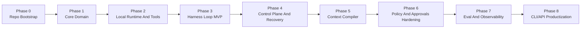

CA-P3-02W: claimed Luke Ding; atomic initial UI/Readable/RUN, old protocols retained; implementation/full gates/45 PG-API/153 SDK tests and new/old candidate joints passed; published-source consumer remains separate. See docs/CA-P3-02W_initial_ui_run.md.

CA-P3-02V: claimed Luke Ding; reuse published U, fresh Native full gates/focused PG and candidate positive Worker joint passed; final published-source consumer acceptance remains separate. See docs/CA-P3-02V_task_run_worker.md.

CA-P3-02U: claimed Luke Ding; first RUN admission only, never post-commit Worker noncommit proof. Boundary in docs/CA-P3-02U_atomic_task_run.md; Native full gates and40 focused passed; candidate joint passed; publication and fixed-source consumer joint separately recorded.

CA-P3-02T：Task原子准入与安全终止，依赖S/P已发布；协议和证明范围先固定，复用原事务，完整门禁、32定向及候选双浏览器通过；发布后消费者固定源联合另记。详见docs/CA-P3-02T_atomic_task_termination.md。

## CA-P3-02S：已开始的原子Surface准入终止（验证通过，Review）

make test 11060 passed/3045 conditional skips; make check1408 types/30eval; API14 and real owned PG16 focused passed. Started atomic-surface candidate Chromium/WebKit passed; published-source consumer joint is separate. 新atomic-surface/1仅open/mount，同PG业务效果/原收据同事务，提交点STOP门禁；持执行锁时pending无证明，退出且STOP/无原子收据才证明，提交先胜只恢复原结果。旧started/部分提交/Task创建不升级，不重发/重领/清pending。真实PG30项及候选双浏览器联合通过；完整门禁通过，发布后固定源消费者联合另记。见[正式边界](CA-P3-02S_atomic_surface_termination.md)。

## CA-P3-02R：派发前终止证明（验证通过，Review）

make test 11059 passed/3036 conditional skips; make check1406 types/30eval; API13 and real owned PG7 focused passed. Pre-dispatch candidate Chromium/WebKit passed; published-source consumer joint is separate. 已核对N/Q依赖；证明仅限新pre-dispatch/1原请求，持久start/terminate第一写者门闩。已开始、旧claim、无claim、超时无非提交证明；unknown不重发、不领取Controller、不清pending。边界及验收见[正式设计](CA-P3-02R_admission_termination.md)。保留历史/原收据/Coverage，无部署/生产迁移。

2026-10-23增量：[CA-P3-02O 审批原操作](CA-P3-02O_approval_operations.md)，复用旧事件/短事务，无迁移，原历史及Phase顺序保留。

2026-10-23增量：[CA-P3-02N Client Action Worker兼容](CA-P3-02N_client_tool_compatibility.md)，同次业务UI联合发现的原生前置；原合同/历史/Coverage不改，不改变历史Phase顺序。

2026-10-23增量：[CA-P3-01F可信脚本Eval生产者](CA-P3-01F_trusted_script_eval.md)；真实无副作用沙箱案例/原unknown/原子证据，旧D/E合同不变，完整Worker联合由Overdoze独立核验。

2026-10-23增量：[CA-P3-01E纯ScriptBundle校验](CA-P3-01E_script_bundle_validation.md)，补平台草稿只读前置，非物化/发布/执行证明；历史Phase顺序保持。

2026-10-23增量：[CA-P3-01D脚本Bundle公开物化/发布](CA-P3-01D_script_publication.md)，复用既有执行/Registry权威；平台消费者和生产验收独立，不改变历史Phase顺序。

# CA-P3-02M — 业务 OIDC 与签名云准入（Review）

[正式方案与边界](CA-P3-02M_signed_cloud.md)；[证据](evidence/ca-p3-02m/validation.json)。
复用 L/G-D；新增隔离 IdP/Broker/cloud Runtime 组合根，实际 TLS RS256/PKCE、两个共享 PG BFF、单次 code/Agent family、unknown不重兑，签名 Task/Run/Session/Controller 与当前业务/Profile 拒绝联合通过。
make test10971通过/3022条件跳过（1169.80s），make check通过（1393类型文件/30eval）。
生产 Python/schema/SDK/旧合同/历史/Coverage保持；真实产品参数尚缺，未验证供应商 IdP/业务账户/浏览器SDK与此云链路同次验收、模型/生产HA。无部署/生产迁移/npm发布/主线整合。

# CA-P3-02L 当前增量

[业务回调与Runtime生命周期](CA-P3-02L_auth_lifecycle.md)：独立分支Review；make test/check、SDK151和双浏览器联合验收通过，4610旧文件保持；登录单次签发及SDK取消围栏联合验收，不提前关闭生产IdP/云准入/HA。前端mock与历史/Coverage保持。

# CA-P3-02K 同源业务认证 SDK

[正式合同与交互](CA-P3-02K_bff_auth.md)。独立分支Review；完整make test/check、SDK145/双浏览器联合验收通过，4601旧文件保持；前端mock/历史/Coverage保持，不部署或生产迁移。

2026-10-22增量：[跨设备待对账与人工处置](CA-P3-02J_request_discovery.md)，复用原权威收据，不增加非提交证明或重发许可。

2026-10-22增量：[CA-P3-02G SDK/BFF Readable值命令](CA-P3-02G_readable_submit.md)，复用F公开合同和持久命令；不改变历史阶段或生产身份/HA验收。

2026-10-22增量：[CA-P3-02F Readable准入](CA-P3-02F_readable_admission.md)，复用AG-UI持久命令，先补绑定、脱敏恢复和空状态清除；SDK值提交另片，历史Phase不改变。

2026-10-22增量：[CA-P3-02E SDK 同步挂载](CA-P3-02E_sdk_surface_sync.md)，显式协商、旧工作排空与原生 HTTP/PG 浏览器参考验收；生产 IdP/Go Broker、多副本 BFF 与模型 harness 不在本片证明范围。

# Zebra Agent 实施任务拆解与阶段验收

> Status: Historical implementation baseline.
> Phase 0-8 is complete. This document preserves the original dependency order
> and acceptance model; it is not the current task queue. Use `PROGRESS.md` for
> the mainline snapshot and `docs/AGENT_TASKS.md` for executable work.

2026-10-22增量：CA-P3-02A产品Profile与可信BFF准入见[独立方案](CA-P3-02A_frontend_admission.md)及任务登记，
不改变本文件历史Phase顺序或据此声明生产/全部SDK验收完成。

2026-10-22增量：CA-P3-02B先补UI Effect当前Task/Run授权前置，见[正式方案](CA-P3-02B_effect_authority.md)，
保留既有事务/历史/Coverage；实际SDK浏览器验收另片，不改变历史阶段顺序。

2026-10-22增量：CA-P3-02C显式BFF浏览器SDK模式见[方案](CA-P3-02C_bff_browser.md)，
真实Hook/wire BFF与尚缺的生产BFF/原生联合验收分开；历史Phase顺序保持。

2026-10-22增量：CA-P3-02D公开原生action摘要与重挂载绑定同步见[正式方案](CA-P3-02D_surface_metadata.md)，
先补原生/PG前置，SDK真实消费与业务BFF联合验收另片，历史阶段顺序保持。

## 1. 文档目标

本文档把 `docs/Codex-like工程Agent平台最终架构设计_v1.0.md` 转成可执行的实施路线，用于：

- 明确阶段目标和边界
- 约束任务拆解顺序
- 定义每阶段的验收标准
- 减少“架构正确但无法开工”的状态

本文档最初优先解决 Phase 0 到 Phase 4 的落地问题，并为 Phase 5-8
保留扩展接口。该基线现已完成；后续增量不再通过继续增加 Phase 编号表达优先级。

### 1.1 产品定位基线

- Zebra Agent 的目标是通用执行型 Agent Runtime 与工作台，不是代码生成产品。
- Claude Code 和 Codex 是 Harness、工具执行、会话恢复与 HITL 交互的参考，不是任务域限制。
- 代码、Git 和 SCM 能力保留为可选工具；默认前端只呈现通用任务执行与结果。
- 人工操作区必须由真实 approval 驱动，无 approval 时不得显示 Commit、PR 等休眠控件。

## 2. 实施原则

### 2.1 开发顺序原则

按以下顺序推进，不倒置：

1. 先定义核心领域和 Ports
2. 再实现本地运行时和最小工具闭环
3. 再接入 Harness 主循环
4. 再补控制平面和恢复能力
5. 最后扩展 Web、远程 Sandbox、凭证代理和云端部署

### 2.2 验收原则

每阶段完成必须同时满足：

- 有代码，不只是文档
- 有可运行路径，不只是类型声明
- 有测试，不只是手工验证
- 有文档回写，不只是聊天说明

### 2.3 范围控制原则

第一阶段默认只支持：

- 本地单机
- 单 Agent 主循环
- Python 实现
- 本地工作目录
- 受控工具集合；本地阶段可包含 shell/file/patch/test/git 适配器

第一阶段明确不做：

- 多 Agent 编排
- 浏览器自动化内核化
- 生产级多租户控制面
- 远程凭证代理
- Kubernetes 级沙箱编排

## 3. 阶段总览



## 4. 分阶段任务拆解与验收

## Phase 0: Repo Bootstrap

### 目标

把仓库从“只有架构文档”变成“可持续开发的工程骨架”。

### 任务拆解

1. 建立 monorepo + `uv` workspace 根配置
2. 建立 `apps/` 与 `packages/` 的基础结构
3. 建立仓库协作文件：`AGENTS.md`、`PROGRESS.md`、`task_plan.md`、`findings.md`、`WORKLOG.md`
4. 建立 `Makefile`、`.env.example`、`.python-version`、`.gitignore`
5. 建立最小 smoke test 和 CLI 引导入口

### 验收标准

- `uv sync --all-packages --group dev` 可执行
- `uv run pytest` 通过
- `uv run zebra-agent` 可运行
- 文档能说明仓库结构、当前阶段和下一步

### 当前状态

已完成。

## Phase 1: Core Domain

### 目标

建立不依赖基础设施的核心领域模型、事件模型和 Ports，形成后续所有实现的稳定中心。

### 任务拆解

1. 在 `packages/agent-core` 中补齐 `domain/identifiers.py`
2. 定义 `domain/sessions.py` 的 Session 聚合和状态迁移
3. 定义 `domain/events.py` 的基础事件模型和核心事件枚举
4. 定义 `domain/messages.py`、`domain/tools.py`、`domain/artifacts.py`
5. 在 `ports/` 中定义：
   - `event_store.py`
   - `projection_store.py`
   - `model_gateway.py`
   - `tool_gateway.py`
   - `policy_engine.py`
   - `runtime.py`
   - `artifact_store.py`
   - `clock.py`
6. 为领域状态迁移和事件合法性编写单元测试

### 验收标准

- `agent-core` 不依赖 FastAPI、Docker SDK、OpenAI SDK、数据库客户端
- 所有核心 Ports 均有明确类型签名
- 事件、Session、消息模型可以被测试直接实例化
- 存在针对状态迁移和事件字段的测试

### 退出产物

- 稳定的 `agent-core` 领域模型
- 第一版事件协议草案
- 后续包可依赖的抽象接口

## Phase 2: Local Runtime And Tools

### 目标

打通本地受控执行路径，使系统能在抽象 Runtime 下执行基础动作。

### 任务拆解

1. 在 `agent-runtime` 中实现 `LocalRuntime`
2. 增加进程执行、超时、输出截断和退出码处理
3. 增加本地 workspace/worktree 抽象
4. 在 `agent-tools` 中定义工具契约和统一结果模型
5. 实现首批 builtin tools：
   - files
   - patch
   - command
   - tests
   - git
6. 编写运行时与工具的集成测试

### 验收标准

- Harness 外部可以通过 `RuntimePort` 执行命令
- 工具执行不直接暴露自由 shell 字符串接口给 core
- 至少能完成“读文件 -> 改文件 -> 跑测试 -> 返回结果”的本地闭环
- 出现超时、非零退出码、输出过长时有结构化结果

## Phase 3: Harness Loop MVP

### 目标

实现最小可跑的 Harness 主循环，让系统具备任务接收、计划、执行、验证的基本闭环。

### 任务拆解

1. 在 `agent-core` 或独立 harness 子模块中实现：
   - loop
   - planner
   - verifier
   - stopping
   - budgets
2. 定义模型网关抽象和最小 mock provider
3. 将 `tool_gateway`、`runtime`、`policy_engine`、`event_store` 串起来
4. 实现单次任务运行和结构化输出
5. 实现失败后基于工具结果的再尝试逻辑

### 验收标准

- 可以在无真实模型条件下用 mock provider 跑通闭环
- 可以把用户输入转成事件和执行动作
- 可以产生结构化 plan、tool call、verification result
- 至少有一条 e2e smoke 用例覆盖主循环

## Phase 4: Control Plane And Recovery

### 目标

建立 Durable Session 能力，让任务状态可恢复、可重放、可审计。

### 任务拆解

1. 在 `agent-storage` 中实现 SQLite Event Store
2. 实现 Projection Builder 和基础查询投影
3. 实现租约/恢复的最小机制
4. 定义 `SessionCreated`、`UserMessageReceived`、`ToolExecutionCompleted` 等核心事件 JSON Schema 草案
5. 实现 `apps/worker` 的消费与恢复入口
6. 编写 worker 中断恢复测试

### 验收标准

- Session 事件可追加、可读取、可按顺序重放
- Worker 中断后可从事件恢复到最近稳定状态
- 工具执行重复提交有幂等保护
- 最少有一条 resilience 测试覆盖恢复流程

## Phase 5: Context Compiler

### 目标

从“直接拼 prompt”升级到可解释、可压缩、可缓存的上下文编译。

### 任务拆解

1. 实现 repo scanner、repo map、related files 和基础 ranker
2. 定义 context item、provenance、token budget
3. 增加 conversation compaction 和 tool output compaction
4. 建立 prompt layout 和 cache key 规则
5. 增加 prompt injection 基础识别

### 验收标准

- 给定任务输入，能稳定输出一组排序后的上下文项
- 每个上下文项有来源信息
- 有 token budget 裁剪逻辑
- 压缩前后行为有测试覆盖

## Phase 6: Policy And Approvals Hardening

### 目标

把安全边界从“约定”变成“代码中的硬控制”。

### 任务拆解

1. 定义 policy profiles：`read_only`、`workspace_write`、`full_access`
2. 增加文件系统、命令、网络、git、mcp 规则
3. 增加 pre-tool 和 post-tool hooks
4. 增加 approval service 与 risk summary
5. 编写 path traversal、shell injection、secret exfiltration 等安全测试

### 验收标准

- 高风险操作会被明确拒绝或进入审批
- 规则判断可以被单元测试和集成测试覆盖
- 安全测试至少覆盖路径越权、shell 注入和敏感信息泄露

## Phase 7: Eval And Observability

### 目标

建立回归评测、任务质量评测和运行观测，避免系统“能跑但无法持续优化”。

### 任务拆解

1. 建立 traces、audit、metrics、cost 记录模型
2. 建立 eval case 目录与 grader
3. 建立本地 replay runner
4. 增加 bugfix/refactor/recovery 基线任务
5. 把评测接入发布前检查

### 验收标准

- 每次任务运行至少能记录事件、工具结果和成本摘要
- 可以回放至少一条历史任务
- 有最小 eval 数据集和 grader

## Phase 8: CLI/API Productization

### 目标

把工程内核包装成可供开发者使用的稳定入口。

### 任务拆解

1. 完善 CLI 命令：`run`、`resume`、`inspect`、`approve`
2. 增加 API app 基础路由和健康检查
3. 增加 SSE 或 websocket 流式输出
4. 增加配置加载和 profile 选择
5. 补齐 operator runbook

### 验收标准

- CLI 可以创建、恢复、查看任务
- API 可以暴露基础会话和健康检查接口
- 主要操作有清晰的 operator 使用方式

## 5. 并行策略

以下工作可以并行，但必须在依赖满足后启动：

- `apps/api` 与 `apps/cli` 可在 Phase 3 之后并行
- `agent-context` 可在 Phase 1 后并行推进
- `agent-security` 可在 Phase 2 后并行推进
- `evals/` 与 `agent-observability` 可从 Phase 3 开始预铺目录，但正式验收在 Phase 7

以下工作不要过早并行：

- `services/sandboxd`
- `credential-broker`
- `egress-proxy`
- `web`
- `kubernetes` 部署

## 6. 当前执行入口

```text
当前执行规则：
1. 从 PROGRESS.md 确认主线状态、能力边界和待决策项
2. 从 docs/AGENT_TASKS.md 选择一个 Ready 任务
3. 按任务卡声明 Owner、Branch、Owned paths 和 Acceptance
4. Locked 任务必须等待显式维护者决策，不因本文档中的目标架构自动解锁
```

Phase 0-8 的顺序仍用于解释依赖关系、回归测试和历史验收，不再表示
“本周计划”或当前开发阶段。

## 7. 阶段验收清单模板

每阶段结束时都应补一份相同结构的验收记录：

```markdown
## 验收记录
- 阶段：
- 日期：
- 负责人：
- 目标是否完成：
- 代码入口：
- 测试命令：
- 测试结果：
- 未完成项：
- 风险与下一步：
```

## CA-P3-02H 命令收据前置

[当前授权收据查询](CA-P3-02H_command_receipts.md)补齐 unknown 的原生只读观察；BFF 持久对账和 SDK 恢复独立后续，不关闭 P3。

## CA-P3-02I 原请求与恢复

[当前合同与恢复流程](CA-P3-02I_command_recovery.md)：原 Segment 可选前置条件、共享业务日志、SDK 持久标识和只读对账；不关闭完整 P3。

### CA-P3-02P：原准入操作
L/O后登记的原Task创建/打开/挂载原操作合同，见[设计与边界](CA-P3-02P_admission_operations.md)。复用原生PG存储，结果丢失只GET原密文收据；部分提交未留结果保持unknown。完整make test11056通过/3031条件跳过、check1404类型/30eval通过，API/PG12通过，见专用证据；不授权迁移、部署或历史重写。

### CA-P3-02Q：原claim/result只读观察
M/P之后增加[观察合同](CA-P3-02Q_admission_observation.md)，人工审计由业务BFF独立管理；没有claim/result都不证明非提交，不重发/重领Controller。API/PG候选通过，完整test/check通过，见专用证据；无Native迁移或生产操作。
